

<h3 align="center">Loom21 Документация</h3>

  

    Следете и управлявайте вашия инвентар, фактури, клиенти, доставчици, плащания и още много.
     
    <a href="https://github.com/loom21/loom21doc" target="_blank"><strong>Вижте в GitHub »</strong></a>
     
     
    <a href="https://github.com/loom21/loom21doc/issues" target="_blank">Докладвайте грешка</a>
    ·
    <a href="https://github.com/loom21/loom21doc/issues" target="_blank">Поискайте функционалност</a>
  

<!-- TABLE OF CONTENTS -->

  
Съдържание

  <ol>
    <li>
      <a href="#getting-started">Начало</a>
      <ul>
        <li><a href="#create-account">Създайте акаунт</a></li>
        <li><a href="#sign-in">Вход</a></li>
      </ul>
    </li>
    <li><a href="#dashboard">Табло</a></li>
    <li><a href="#notifications">Известия</a></li>
    <li><a href="#payment-links">Платежни връзки</a></li>
    <li>
      <a href="#storefronts">Онлайн магазини и бутонът „Купи“</a>
      <ul>
        <li><a href="#storefront-setup">Настройка на онлайн магазин</a></li>
        <li><a href="#storefront-publish">Публикуване на продукти</a></li>
        <li><a href="#buy-button">Бутонът „Купи“</a></li>
        <li><a href="#storefront-orders">Поръчки от онлайн магазина</a></li>
      </ul>
    </li>
    <li>
      <a href="#sales">Продажби</a>
      <ul>
        <li><a href="#add-edit-sales">Добавяне/Редакция на продажби</a></li>
        <li><a href="#payments">Плащания</a></li>
        <li><a href="#invoice-numbers">Номера на фактури и PDF документи</a></li>
        <li><a href="#credit-notes">Кредитни известия</a></li>
        <li><a href="#annul-invoice">Анулиране на фактура</a></li>
        <li><a href="#overpayments">Надплащания и възстановявания</a></li>
        <li><a href="#import-invoices">Преминаване от друга програма (импорт на фактури)</a></li>
        <li><a href="#country-rules">Правила за фактуриране и вашата държава</a></li>
      </ul>
    </li>
    <li>
      <a href="#reports">Отчети</a>
      <ul>
        <li><a href="#sales-report">Отчет за продажби</a></li>
        <li><a href="#deliveries-report">Отчет за доставки</a></li>
        <li><a href="#vat-ledger">Дневник за продажбите</a></li>
      </ul>
    </li>
    <li>
      <a href="#settings">Настройки</a>
      <ul>
        <li><a href="#general-settings">Общи настройки</a></li>
        <li><a href="#subscription">Абонамент</a></li>
        <li><a href="#stripe">Stripe</a></li>
        <li><a href="#btcpay-server">BTCPay Сървър</a></li>
        <li><a href="#lightning-wallet">Lightning address</a></li>
        <li><a href="#speed-wallet">Speed Wallet</a></li>
        <li><a href="#lnbits">LNbits</a></li>
        <li><a href="#product-settings">Настройки на продукти</a></li>
        <li><a href="#product-categories">Категории продукти</a></li>
        <li><a href="#measures">Мерни единици</a></li>
        <li><a href="#brands">Марки и модели</a></li>
        <li><a href="#custom-fields">Потребителски полета</a></li>
        <li><a href="#price-lists">Ценови листи</a></li>
        <li><a href="#import-templates">Импорт и експорт (Excel и CSV)</a></li>
      </ul>
    </li>
    <li><a href="#accounts">Акаунти</a></li>
    <li><a href="#products-services">Продукти и услуги</a></li>
    <li><a href="#inventory">Инвентар</a></li>
    <li><a href="#stores">Магазини / Складове</a></li>
    <li><a href="#deliveries">Поръчки за доставка</a></li>
    <li><a href="#customers-suppliers">Клиенти и доставчици</a></li>
    <li><a href="#user-profile">Потребителски профил</a></li>
  </ol>

<!-- GETTING STARTED -->
## Начало

За да започнете да използвате приложението loom21, е необходимо да създадете акаунт. Препоръчителният ред за настройка е:

1. **Създайте акаунт** и потвърдете имейла си.
2. Конфигурирайте **[Общите настройки](#general-settings)** — задайте език, валута, ДДС и адрес.
3. Конфигурирайте поне един **[платежен процесор](#settings)** (Stripe, BTCPay Server и др.), за да се появи при плащане.
4. Добавете своите **[Продукти и услуги](#products-services)**.
5. Създайте първата си **[Продажба](#sales)**.
6. За да продавате на собствения си сайт, настройте **[Онлайн магазин](#storefronts)** и добавете **[бутон „Купи“](#buy-button)**.

### Създаване на акаунт
След като се регистрирате, ще получите имейл за потвърждение на акаунта си, след което можете да влезете в приложението.

**Грешна парола:** след 5 поредни грешни пароли входът се заключва за 15 минути, дори с вярната парола. Изчакайте или използвайте **Забравена парола?**, за да зададете нова. За ваша сигурност страницата за вход не казва дали даден имейл има акаунт.

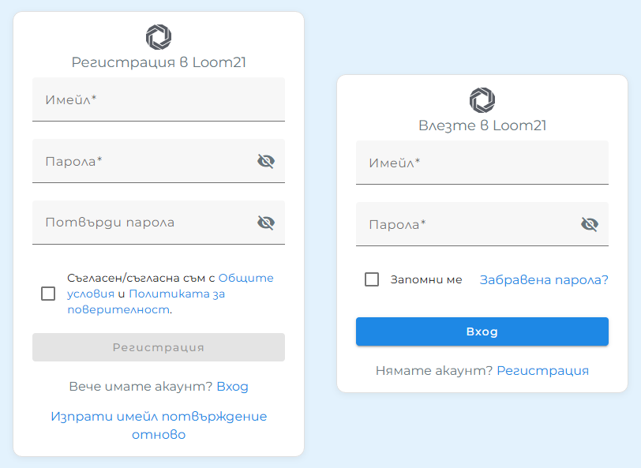

(<a href="#readme-top">обратно в началото</a>)

<!-- DASHBOARD -->
## Табло

Таблото е първата страница, която виждате след влизане в системата. То ви дава бърз преглед на бизнес представянето ви за избрания период.

**Основни функции:**

- **Избор на период** — Изберете последните 30 дни или някой от предишните 6 календарни месеца, за да сравните представянето си.
- **КПИ карти** — В горната част ще намерите обобщаващи карти с:
  - Общ приход във фиат валута (карта и банкови плащания)
  - Общ приход в биткойн (в сатоши)
  - Брой платени фактури, разбити по метод на плащане (биткойн срещу фиат)
  - Завършени поръчки за доставка и такива, очакващи потвърждение
  - Платени платежни връзки, разбити по метод на плащане
  - Индикатори за тренд (стрелки нагоре/надолу), за да видите бързо дали числата ви се подобряват.
- **Как се отчита приходът** — приходът са реално получените пари, на датата на плащането, а не на датата на продажбата. Продажба от май, платена през октомври, е приход за октомври; в броя на фактурите тя остава продажба от май. Кредитните известия и отбелязаните възстановявания се изваждат, така че сумата е нетна. Фактура, която никога не е платена, не добавя нищо.
- **Графика на продажбите** — Стълбовидна графика, показваща дневния обем на продажбите за избрания период.
- **Графика на платежните връзки** — Стълбовидна графика, показваща дневната активност на платежните връзки.
- **Графика на доставките** — Стълбовидна графика, показваща дневната активност на поръчките за доставка.
- **Хронологична лента** — Хронологичен списък с последните събития от продажби, доставки и платежни връзки.
- **Превключване светъл / тъмен режим** — Превключете между светла и тъмна тема с иконата в горния десен ъгъл на лентата с инструменти. Предпочитанието ви се прилага незабавно в цялото приложение.

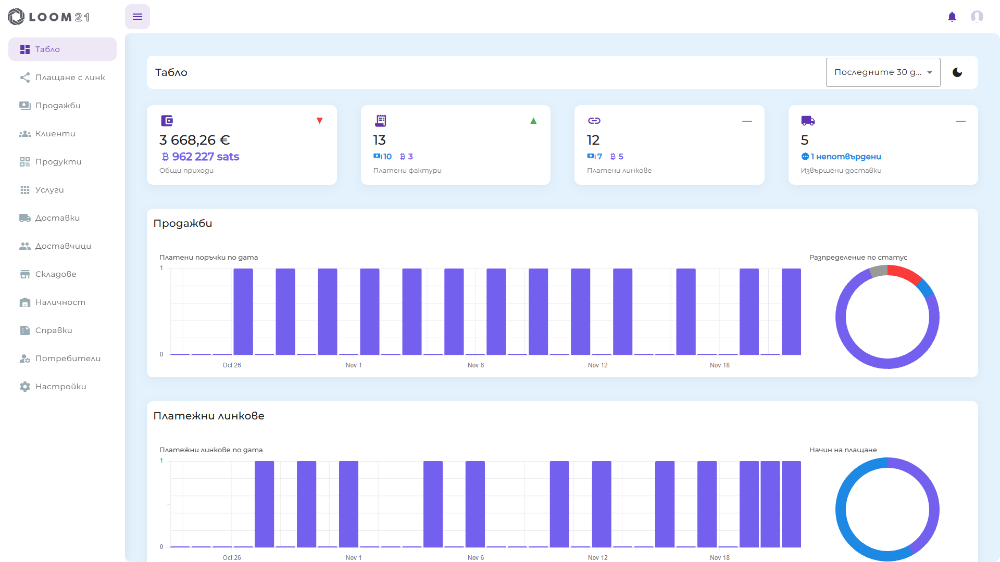

(<a href="#readme-top">обратно в началото</a>)

<!-- PAYMENT LINKS -->
## Известия

**Камбанката** горе на всяка страница показва колко известия още не сте прочели. Натиснете я, за да видите последните; натиснете известие, за да отворите това, за което се отнася (продажбата, връзката за плащане, Настройки → Абонамент …), и то се маркира като прочетено. **Всички известия** отваря пълния списък, със **Само непрочетените** и **Маркирай всички като прочетени**.

Известие, което изисква действие от вас, се показва и като **лента** горе на всяка страница, докато не бъде изпълнено (записано възстановяване, запазен ЕИК) или докато не я затворите. Камбанката се обновява сама, без да презареждате страницата.

**За какво се известявате и кой го вижда:**
- **Пристигнало плащане** по фактура или връзка за плащане („Фактура 0000000123 е платена: 120,00 € с карта“): потребителите, които виждат продажбите или връзките за плащане. Само в приложението, без имейл. Плащане, което сами отбелязвате с **Маркирай платено**, не се обявява.
- **Фактура е платена повече от дължимото** или е платена анулирана фактура: потребителите, които записват възстановявания, с лента, докато възстановяването не бъде записано в продажбата.
- **Поръчките този месец на 80% и 100% от лимита на плана**, гратисният период, молба за надграждане и отново работещите връзки за плащане и нови продажби: администраторите. **Спрени връзки за плащане и нови продажби** отива до всички, в камбанката; екранът на продажбата също го казва, когато започнете нова продажба (вижте [Лимити на плана](#plan-limits)).
- **План, даден ви от loom21**, 14 дни преди края му и когато изтече: администраторите.
- **Във фактурите ви липсва ЕИК на фирмата**: администраторите, с лента, докато не бъде запазен в [Общите настройки](#general-settings).
- **Промени в Общите условия**: администраторите.

Важните (лимити, надплащания, изтичащ план) идват и по имейл. Всеки потребител има свое „прочетено“: това, което прочетете вие, остава непрочетено за другите.

(<a href="#readme-top">обратно в началото</a>)

## Платежни Връзки 

Платежната връзка е уникален URL адрес, който можете да споделите с клиенти, за да приемате плащания за продукт, услуга или дарение — без да е необходим вход от страна на купувача. След като я създадете, можете да копирате връзката, да я изпратите по имейл или съобщение, или да я вградите навсякъде.

**Как да създадете платежна връзка:**

1. Отидете на **Платежни връзки** от страничното меню и натиснете **Нова**.
2. Попълнете данните:
   - **Наименование** — това, което купувачът ще вижда (напр. „Билет за уъркшоп").
   - **Валута** — валутата за тази връзка.
   - **Сума** — фиксирана цена, или активирайте **Променлива сума**, за да позволите на купувача сам да въведе сума в диапазон, определен от вас.
   - **ДДС** — активирайте и задайте процент ДДС, ако е приложимо.
   - **Вид доставка за дневника** — когато връзката е без ДДС: какво продава (същите възможности като в продажбата), което определя колоната ѝ в [Дневника за продажбите](#vat-ledger). Задължително е, когато в [Общите настройки](#general-settings) е включено **Активирай ДДС**.
   - **Описание** — незадължителни детайли, показвани на купувача.
   - **Снимка** — показва се на страницата за плащане. След като връзката е запазена, натиснете **Качи снимка** (JPEG, PNG или WebP, до 10 MB) или поставете адреса на снимка, която е онлайн. **Смени снимката** и **Премахни** я променят по-късно.
   - **Кратък код** — запомнящ се кратък идентификатор за връзката (незадължително).
   - **Дата на изтичане** — автоматично деактивирайте връзката след определена дата.
   - **Брой в наличност** — ограничете общия брой покупки чрез тази връзка.
   - **Макс. на поръчка** — ограничете колко единици един купувач може да закупи наведнъж.
3. Изберете **методите на плащане** (показват се само активирани процесори).
4. Добавете **промо кодове**, ако искате да предложите отстъпки — всеки код има наименование, стойност на отстъпката и тип (процент или фиксирана сума).
5. Натиснете **Запази**.

**След запазване** URL адресът на връзката се показва в горната част на страницата. Използвайте бутона **Копирай**, за да го копирате, или **Преглед**, за да го отворите така, както купувачът би го видял.

**Пауза на връзка** — натиснете превключвателя на статуса, за да поставите активна връзка на пауза (купувачите вече няма да могат да плащат) или да я публикувате отново. Ще бъдете помолени да потвърдите промяната.

**Какво вижда купувачът:** името на фирмата ви („Продавач: …“), обобщение на поръчката, количеството (при фиксирана цена — до Макс. на поръчка и оставащата наличност), връзка **Имаш промо код?**, данъка и общата сума, и своя имейл. **Продължи** след това показва по един бутон за всеки начин на плащане (вижте [Страницата за плащане на клиента](#pay-page)). След плащането страницата го потвърждава и предлага **Направи още едно плащане**. Връзка на пауза, изтекла или изчерпана казва това и моли купувача да се свърже с вас.

#### Поддържани платежни процесори

| Процесор | Вид плащане |
|-----------|-------------|
| Stripe | Кредитна / Дебитна карта |
| BTCPay Server | Bitcoin Lightning и On-chain |
| Lightning address (всеки портфейл) | Bitcoin Lightning |
| Speed Wallet | Bitcoin Lightning и On-chain |
| LNbits | Bitcoin Lightning |

> :bell: Предстои добавянето на още платежни процесори.

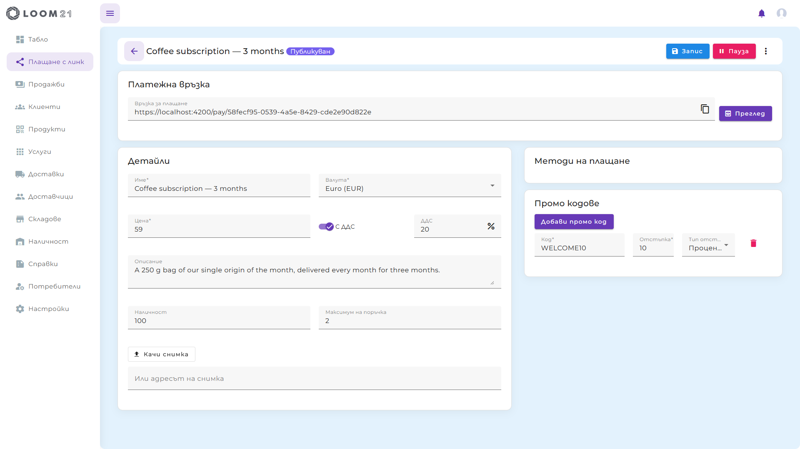

(<a href="#readme-top">обратно в началото</a>)

## Онлайн магазини и бутонът „Купи“ 

**Онлайн магазинът** позволява на собствения ви сайт да продава вашите продукти чрез loom21. Публикувате продуктите, които искате да продавате, а сайтът ги показва, приема поръчки и плащания. Цените, наличностите и плащанията остават в loom21: всяка поръчка е обикновена продажба, получава номер, когато бъде платена, и наличността ѝ се изписва от склада на онлайн магазина.

Най-лесният начин да го използвате е **[бутонът „Купи“](#buy-button)**: един ред HTML, който поставяте в който и да е сайт (WordPress, Webflow, Squarespace, обикновен HTML), без да ви трябва програмист. Програмист може и да използва ключа на онлайн магазина, за да изгради цял магазин върху Storefront API на loom21.

Колко онлайн магазина можете да имате зависи от плана ви: 1 на Free и Starter, 3 на Growth, 10 на Pro. Само администраторите управляват онлайн магазините.

### Настройка на онлайн магазин 

1. Уверете се, че е настроен поне един доставчик на плащания (вижте [Настройки](#settings)), за да могат купувачите да плащат.
2. Отидете на **Настройки → Онлайн магазини** и натиснете **Нов онлайн магазин**. Ако сте на лимита на плана си, бутонът е **Надградете за още онлайн магазини**.
3. Попълнете разделите (по-долу) и натиснете **Запази**. Онлайн магазинът получава своя **публичен ключ**, когато бъде запазен за първи път.
4. [Публикувайте продуктите](#storefront-publish), които искате да продавате.
5. В раздела **За разработчици** добавете сайта си в **Разрешени сайтове**, след което натиснете **Създай бутон „Купи“**.

Страницата Онлайн магазини показва всеки онлайн магазин като карта: дали е активен, складът му, методите за плащане и доставка, разрешените сайтове и ключът. Натиснете **Отвори**, за да го промените.

**Общи**
- **Наименование** — показва се на купувачите от вашия сайт.
- **Имейл за поддръжка** — където купувачите пишат с въпроси. Празно: фирменият ви имейл.
- **Език на имейлите до купувача** — езикът на имейла с касовата бележка, който купувачите получават след плащане.
- **Активен** — когато е изключен, ключът спира да работи и сайтовете не могат да зареждат продукти или да приемат поръчки (бутонът „Купи“ показва, че в момента не е наличен).
- Онлайн магазините показват логото на акаунта ви от [Общите настройки](#general-settings).

**Каталог и наличност**
- **Склад** — наличността му е това, което купувачите могат да поръчат, и поръчките изписват от него.
- **Ценова листа** — определя цените и валутата, включително количествените нива. Вижте [Ценови листи](#price-lists).
- **Показване на наличността** — какво виждат купувачите: **В наличност / Ниска наличност / Изчерпан** (никога колко бройки), **Точно количество** или **Скрито**. **Праг за ниска наличност** определя кога се показва „Ниска наличност“.
- **Макс. количество на ред** — най-много колко бройки от един продукт може да поръча купувач (от 1 до 1000).
- **Време за резервация** — колко дълго поръчката задържа наличността, докато купувачът плаща (от 5 до 60 минути). Наличност, задържана за неплатена поръчка, не може да бъде продадена на друг; тя се освобождава, когато времето изтече или купувачът се откаже.
- **Макс. задържани бройки** — общо за всички неплатени поръчки, за да не може никой да задържи цялата ви наличност.

**Плащания и доставка**
- **Методи за плащане** — на купувачите се предлагат отметнатите, в този ред (сменете го със стрелките). Показват се само доставчиците, активирани в настройките ви за плащане.
- **Методи за доставка** — всеки с **Наименование**, фиксирана **Цена** без ДДС и **Изисква адрес**. Избраният се добавя към фактурата като ред. Когато имате методи за доставка, купувачите на стоки трябва да изберат един; оставете списъка празен, ако не доставяте.

**Визия и SEO** и **Страници** са за пълен онлайн магазин, изграден върху него (заглавието и описанието за търсачките, основният цвят, връзки към социални мрежи, текстът в долния колонтитул и страници като общи условия, поверителност и връщане на стоки). Бутонът „Купи“ не ги използва. Примерните текстове на страниците са отправна точка, а не правен съвет: дайте ги за проверка, преди да разчитате на тях.

**За разработчици**
- **Публичен ключ** — безопасно е да се постави в кода на сайта ви: с него може само да се четат публикуваните продукти, да се изчислява цената на кошница и да се поръчва. **Смени ключа** създава нов (старият продължава да работи кратко време, за да обновите сайта си); **Отмени** го спира веднага.
- **Разрешени сайтове** — `https://` адресите на сайтовете, където ще използвате онлайн магазина, напр. `https://shop.example.com`. Адресът трябва да съвпада точно, включително `www.`, ако сайтът ви го използва. Записват се със **Запази**.
- **Бутон „Купи“** — **Създай бутон „Купи“** отваря диалога за [бутона „Купи“](#buy-button).
- **Сървърна тайна** и **Опитайте** — за програмисти, които изграждат магазин върху Storefront API.

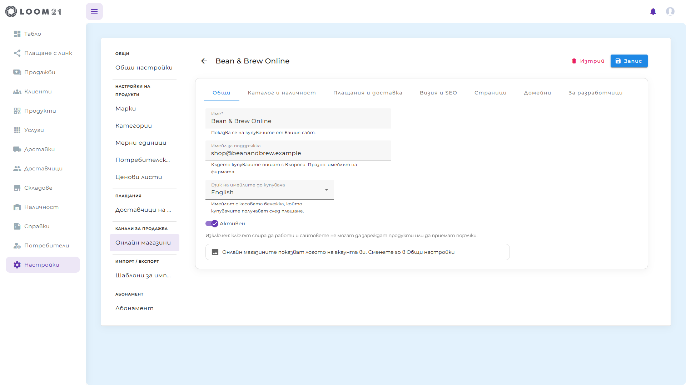

(<a href="#readme-top">обратно в началото</a>)

### Публикуване на продукти 

В онлайн магазините ви могат да се виждат и поръчват само публикувани продукти и услуги. Публикувайте продукт от раздела му **Онлайн магазин** (вижте [Продукти и услуги](#products-services)) или отметнете няколко в списъка с продукти или услуги и натиснете **Публикувай в онлайн магазина**. Потребителските полета се показват в онлайн магазина само когато е включено **Показвай в онлайн магазина** (вижте [Потребителски полета](#custom-fields)).

(<a href="#readme-top">обратно в началото</a>)

### Бутонът „Купи“ 

Бутонът „Купи“ продава един продукт на всеки сайт. Купувачът го натиска, въвежда имейл, име и количество (и метод и адрес за доставка, когато доставяте) и плаща, без да напуска страницата ви: с **Lightning** чрез QR код, с **on-chain биткойн** чрез QR код и адрес или с **карта** на страницата за плащане на loom21 в нов раздел. След плащането бутонът показва номера на поръчката, купувачът получава имейл с касовата бележка, а поръчката е в loom21.

**Създаване:**
1. Отворете диалога: **Бутон „Купи“ за вашия сайт** в раздела Онлайн магазин на публикуван продукт или **Създай бутон „Купи“** в раздела За разработчици на онлайн магазин (след това изберете продукта).
2. Изберете **Онлайн магазин**, **Текст на бутона**, **Език** (този на страницата, English или Български), **Тема** (автоматична, светла или тъмна), **Цвят**, **Показвай цената** и **Купувачите избират количество**.
3. Проверете **прегледа**: това е истинският бутон с истинската ви цена и наличност. От вътрешността на loom21 той не приема поръчки.
4. Копирайте кода и го поставете в HTML на сайта си:
   - **Обикновен** — винаги най-новата версия 1.x, така че поправките достигат сайта ви сами. Препоръчително.
   - **Фиксиран** — точно една версия, която браузърът проверява (Subresource Integrity). Тя никога не се променя; за по-нова версия копирайте кода отново.

Диалогът ви предупреждава за всичко, което би попречило на бутона да работи: продуктът не е публикуван (с бутон **Публикувай**), онлайн магазинът няма разрешени сайтове или работещ ключ, или е изключен.

**Ако бутонът не се появява на сайта ви,** почти винаги сайтът липсва в **Разрешени сайтове** в раздела За разработчици на онлайн магазина. Конзолата на браузъра казва точно кой адрес да добавите. „Powered by Loom21“ се показва под поръчката на всеки план.

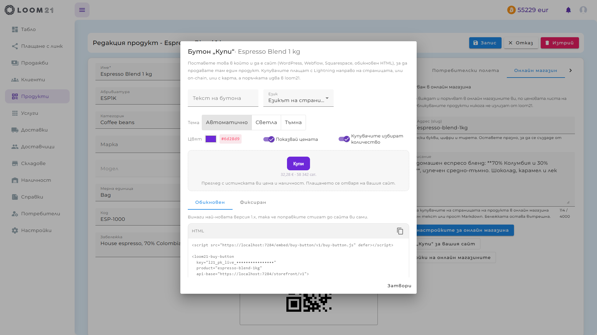

(<a href="#readme-top">обратно в началото</a>)

### Поръчки от онлайн магазина 

- **Преди да бъде платена,** поръчката от онлайн магазина принадлежи на поръчката на купувача: не е в списъка с продажби и в отчетите и не можете да я променяте.
- **Когато бъде платена,** тя става обикновена издадена продажба: получава следващия номер на фактура, наличността ѝ се изписва от склада на онлайн магазина, а купувачът се съпоставя с клиент по имейл (или се добавя като нов). Брои се към поръчките на плана ви като всяка друга продажба.
- В екрана на продажбата тя има значка **Онлайн магазин** до номера си.
- **Платена след изтичане на резервацията:** плащането пак се приема, а продажбата показва „Платена след изтичане на резервацията на наличността — проверете наличността за тази поръчка.“, защото междувременно стоката може да е продадена.
- Ако купувачът не плати навреме, поръчката приключва и наличността ѝ се освобождава.

(<a href="#readme-top">обратно в началото</a>)

## Продажби

Страницата Продажби показва всички ваши поръчки за продажба. Можете да търсите по номер на поръчка, име на клиент или бележка (натиснете Enter или лупата). Създайте нова поръчка с бутона **Нова поръчка** или отворете съществуваща, като натиснете иконата с лилавата стрелка.

Натиснете **Филтри**, за да стесните списъка. Филтърът се прилага веднага щом го промените, а **Изчисти** нулира всички:
- **Клиент**, **Период** (по датата на поръчката, т.е. датата на фактурата; двата дни са включени) и **Мин./Макс. сума**.
- **Статус на плащане** и **Статус на поръчка**.
- **Документ**: фактури или кредитни известия.
- **Анулирани**: скрийте анулираните фактури или покажете само тях.
- **Произход**: документи, издадени в Loom21, или импортираните от предишната ви програма (вижте [Преминаване от друга програма](#import-invoices)).
- **Склад**, когато имате повече от един.

Кредитните известия, анулираните фактури и импортираните документи имат значка до номера си.

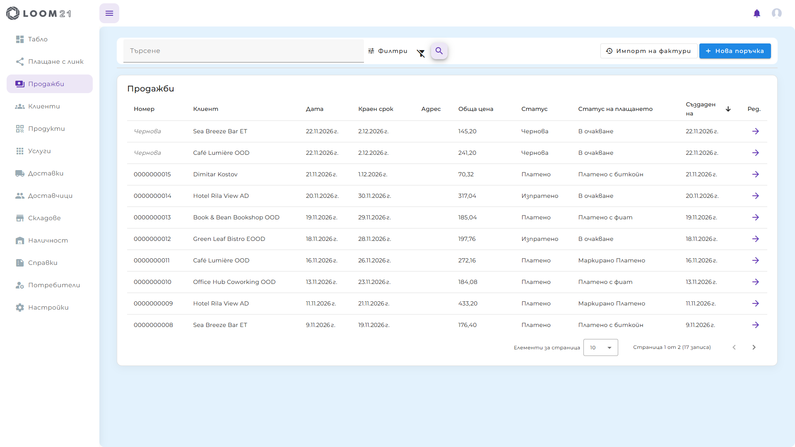

(<a href="#readme-top">обратно в началото</a>)

### Добавяне/Редактиране на продажби

**Полета на заглавката на поръчката** (ляв панел):
- **Пореден номер** — дава се автоматично, когато продажбата за първи път бъде изпратена или платена, и след това не се променя. Черновите още нямат номер. Вижте [Номера на фактури и PDF документи](#invoice-numbers).
- **PO номер** — референтният номер на поръчката на клиента, ако е приложимо.
- **Дата на поръчка / Дата на падеж** — кога е направена поръчката и кога се очаква плащане.
- **Статус** — проследявайте поръчката в статуси: Чернова, Изпратена, Платена и др.
- **Магазин** — изберете от кой магазин се изпраща стоката (влияе на нивата на инвентара; не важи за услуги).
- **ДДС** — включете или изключете ДДС за поръчката; процентът се наследява от Общите настройки.
- **Основание за неначисляване на ДДС** — показва се, когато ДДС е изключен. Попълва се от [Общите настройки](#general-settings) и се отпечатва на фактурата (напр. „чл. 113, ал. 9 ЗДДС“). При нужда го променете тук за отделна продажба.
- **Вид доставка за дневника** — показва се, когато ДДС е изключен: какъв вид продажба без ДДС е това: вътреобщностна доставка (ВОД) на стоки до бизнес в ЕС, дистанционни продажби / услуги към потребители (B2C) в ЕС (OSS), доставка на услуги към бизнес (B2B) в ЕС, освободени доставки или доставки извън обхвата на ЗДДС, или износ на стоки извън границите на ЕС. Определя колоната на продажбата в [Дневника за продажбите](#vat-ledger). След като изберете вид, **Основание за неначисляване на ДДС** става задължително и се попълва автоматично със стандартния правен текст за този вид (например „чл. 28 от ЗДДС“ за износ), освен при освободени доставки, където текстът зависи от това какво продавате. Кредитните известия и копията вземат вида от фактурата.
- **Отстъпка %** — приложете обща процентна отстъпка върху общата сума на поръчката.
- **Бележка** — вътрешна бележка или инструкции.

**Добавяне на артикули:**
- Пишете директно в полето за търсене на продукти, за да добавяте артикули един по един.
- Натиснете **Избери артикули**, за да търсите и отбелязвате множество продукти или услуги наведнъж.
- Натиснете **История на поръчките** (налично след избор на клиент), за да видите предишните покупки на клиента и да добавите отново артикули от минали поръчки с едно кликване.

**Автоматично разрешаване на цена** — когато изберете продукт и клиент, системата автоматично търси най-подходящата цена от вашите [Ценови листи](#price-lists) и клиентски ценови замествания. Полето за единична цена се актуализира незабавно; при необходимост можете да го редактирате ръчно.

**Избор на клиент** — търсете и изберете клиент, за да попълните автоматично адреса за доставка и фактуриране. При необходимост можете да промените адресните полета директно в поръчката.

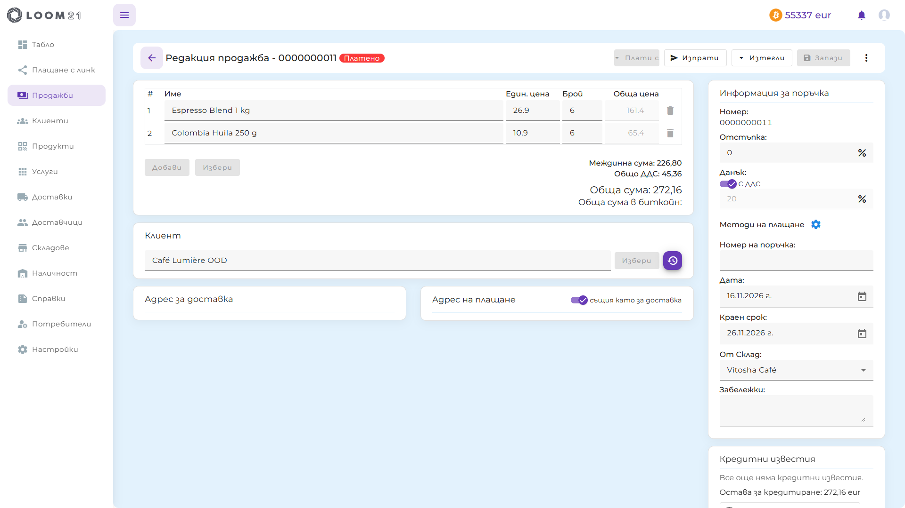

(<a href="#readme-top">обратно в началото</a>)

### Плащания 

Лентата с инструменти на запазена поръчка ви дава бърз достъп до всички действия за плащане и документи:

**Плати** — падащ бутон, показващ всеки активиран платежен процесор. Изберете един, за да отворите диалога за плащане:
- **Stripe** — клиентът въвежда данните на картата директно в защитен диалог.
- **Биткойн процесори** (BTCPay Server, Lightning address, Speed Wallet, LNbits) — показват се QR код и Lightning/он-чейн адрес за плащане. При BTCPay Server, Speed Wallet и LNbits плащанията се потвърждават в реално време — статусът на поръчката се актуализира автоматично в момента, в който транзакцията е уредена, без да е необходимо опресняване на страницата. При Lightning address потвърждението в реално време зависи от това дали доставчикът на портфейла го поддържа; използвайте бутона **Тествай връзката** в Настройки, за да проверите адреса си (вижте [Lightning address](#lightning-wallet)).

**Изпрати** — запазва поръчката и отваря диалог с URL за плащане и URL за печат, които можете да копирате и споделите с клиента.

**Изтегли** — падащо меню за генериране и изтегляне на PDF документи:
- **Оферта** — налична преди плащане.
- **Фактура** — налична след маркиране на поръчката като платена.
- **Касова бележка** — налична след маркиране на поръчката като платена.
- **Списък за вземане** — наличен по всяко време.

**Маркирай като платена** — ръчно маркирайте поръчката като платена (за плащания в брой или друг офлайн метод).

**Експортирай JSON** — изтеглете пълните данни на поръчката като JSON файл.

**Копирай поръчка** — създава нова чернова поръчка, предварително попълнена със същия клиент, артикули, методи на плащане, адреси, настройки за ДДС, отстъпка, валута и бележки от текущата поръчка. Копието е чернова и се отваря незабавно, за да можете да го прегледате и коригирате; номер получава, когато бъде изпратено или платено. Използвайте го, за да повторите бързо предишна поръчка или за да започнете от съществуваща поръчка като шаблон.

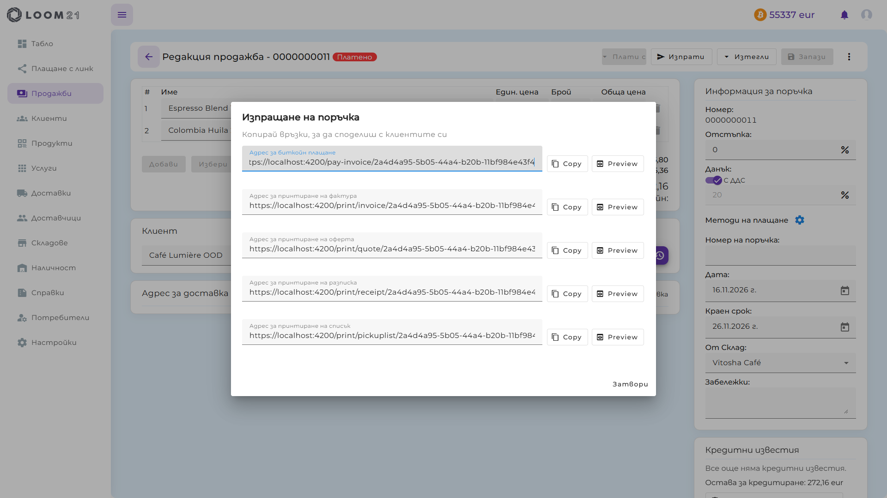

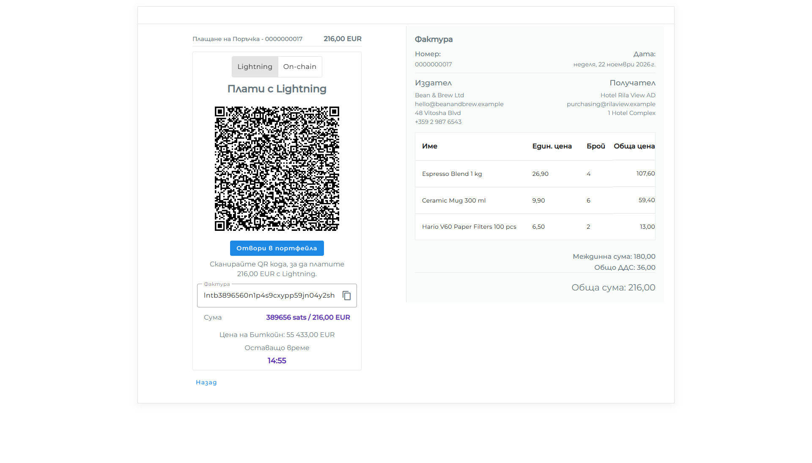

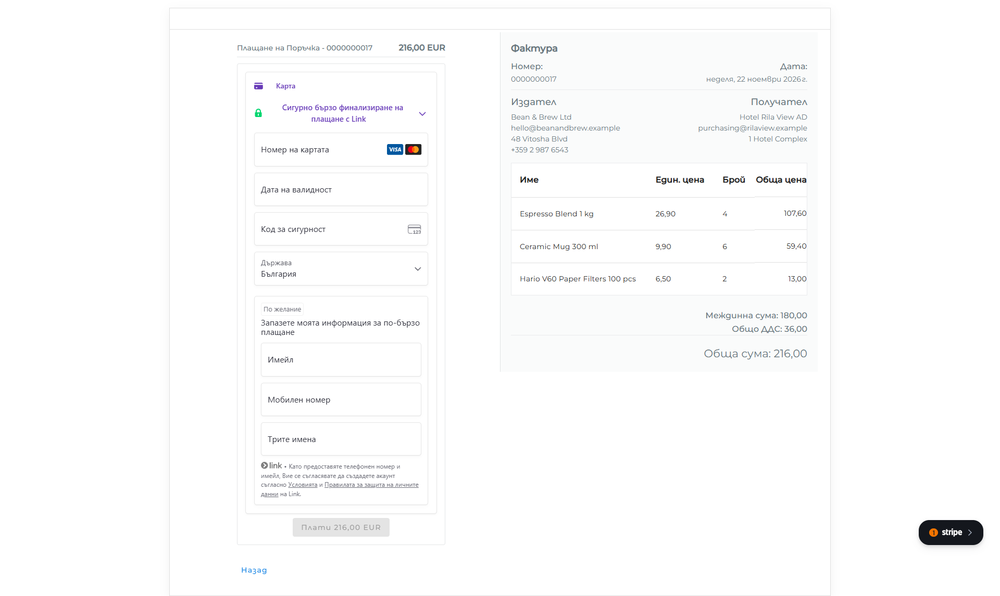

> :bell: Всички функции в приложението са защитени с автентикация, с изключение на връзките, генерирани чрез бутона Изпрати.

#### Страницата за плащане на клиента

URL адресът за плащане от **Изпрати** отваря страница, на която клиентът вижда фактурата и дължимото и плаща без акаунт:
- **По един бутон за всеки начин на плащане:** **Карта** (Stripe), **Биткойн** (BTCPay Server) и **Lightning**. Ако имате активирани няколко Lightning доставчика (Lightning address, Speed Wallet, LNbits), клиентът вижда един бутон **Плати с Lightning**, който използва първия от тях. При само един начин на плащане плащането започва веднага.
- **Вашето лого** е най-горе (от плана Starter нагоре, от [Общите настройки](#general-settings)). Без лого планът Free показва логото на loom21, а платените планове не показват лого. „Powered by Loom21“ най-долу има само на плана Free.
- **Когато бъде платена**, страницата го казва веднага, без презареждане, с номера на фактурата и бутон за изтегляне на PDF на фактурата.
- Ако кредитни известия са намалили фактурата, страницата обяснява защо дължимото е по-малко. Кредитно известие или отменена фактура не могат да бъдат платени.
- Ако страницата не може да се зареди (грешна връзка, няма връзка с интернет), тя го казва и предлага **Опитай отново**.

(<a href="#readme-top">обратно в началото</a>)

### Номера на фактури и PDF документи 

**Номера.** Продажбата получава номер, когато за първи път бъде изпратена или платена. Черновите нямат номер, затова изтрита чернова не оставя празнина в номерацията. Фактурите и кредитните известия имат обща непрекъсната поредица от 10 цифри (0000000001, 0000000002, …), както изисква ЗДДС. Веднъж даден, номерът не се променя и не можете да въведете свой.

**Издавали сте фактури с друга програма?** [Импортирайте ги](#import-invoices): номерацията тогава продължава след последната ви фактура. Ако не искате да ги импортирате, преди да издадете първата си фактура в loom21, задайте **Номер на първата фактура** в [Общите настройки](#general-settings) на номера след последната ви фактура, за да продължи поредицата без повторения. Например, ако последната ви фактура е 0000001234, въведете 1235. След като първата фактура получи номер, настройката се заключва.

**Издадените продажби не се редактират и не се изтриват.** Това е възможно само за черновите. За да коригирате издадена фактура, издайте [кредитно известие](#credit-notes); ако е издадена по грешка и с нея още нищо не се е случило, [анулирайте я](#annul-invoice).

**Език на PDF документите.** Всички PDF документи за продажби и доставки (фактура, оферта, касова бележка, списък за вземане, кредитно известие, доставка, списък с доставки) са на български, когато езикът ви е български, и на английски в останалите случаи.

**Какво отпечатват фактурата и кредитното известие**, както изисква ЗДДС:
- „ОРИГИНАЛ“;
- датата на данъчното събитие: датата на поръчката, а при кредитно известие — датата на връщането или промяната;
- ЕИК и ДДС номер на вас и на клиента. Въведете своите в [Общи настройки](#general-settings), а тези на клиента — в [картата на клиента](#customers-suppliers);
- „Данъчна основа“. При отстъпка се показват сумата, отстъпката и данъчната основа;
- когато не се начислява ДДС — основанието за това.

**Други валути.** Фактура или кредитно известие във валута, различна от EUR, отпечатва и обменния курс, например „Обменен курс: 1 USD = 0.9234 EUR (курс на ЕЦБ/БНБ към 02.10.2026)“. Това е референтният курс на Европейската централна банка за датата на данъчното събитие, а ако тя е почивен ден — за последния работен ден преди нея. ЕЦБ публикува курса за деня следобед, затова фактура, издадена преди 17:15 българско време, използва курса от предходния работен ден и го запазва. Кредитното известие използва курса на фактурата си. За валута без курс на ЕЦБ, като BTC, курс не се отпечатва.

Под курса, както се изисква за данъчни цели, PDF документът показва **Равностойност в EUR**: данъчната основа, ДДС и общата сума в EUR.

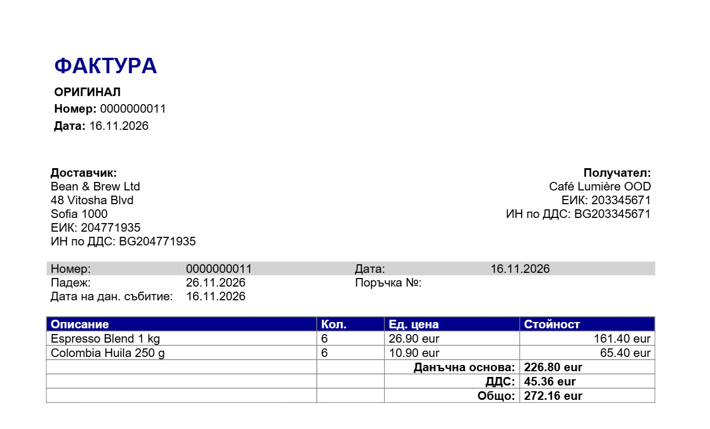

(<a href="#readme-top">обратно в началото</a>)

### Кредитни известия 

Кредитното известие коригира вече издадена фактура: стоката е върната или клиентът получава отстъпка след фактурирането.

**Създаване:** отворете фактурата, отворете менюто **⋮** и изберете **Създай кредитно известие**. В **Какво се кредитира** изберете:
- **Редове** — въведете колко от всеки ред се кредитира (**Кредитирай всичко останало** попълва всички). За всеки ред изберете дали стоката се връща на склад и в кой **Склад**. Услугите никога не се връщат на склад.
- **Сума** — отстъпка след фактурата. Въведете какво получава клиентът обратно, с включен ДДС; ДДС се отделя по ставката на фактурата. Нищо не се връща на склад.

След това попълнете:
- **Основание** (задължително) — отпечатва се на кредитното известие, напр. „Върната стока“.
- **Дата на връщане или промяна** — ЗДДС изисква кредитното известие да се издаде до 5 дни от нея. Ако са минали повече, ще видите предупреждение, но пак можете да го издадете.
- **Възстановяване** — само ако фактурата е платена. Отбележете как сте върнали парите (кредит в магазина, в брой, банков превод, карта или Lightning), датата и референция. Това само се записва: Loom21 не изпраща парите.

Натиснете **Издай кредитно известие**. То получава следващия номер, издава се веднага и не може да се променя.

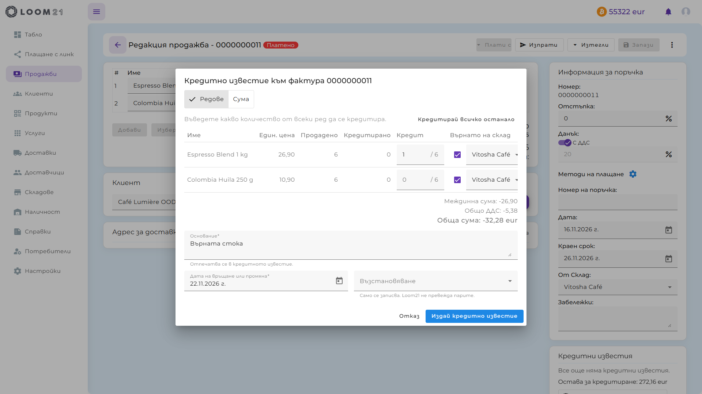

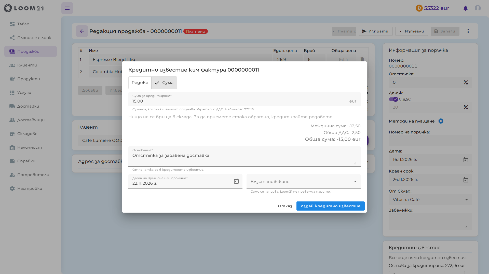

**Какво още трябва да знаете:**
- Една фактура може да има няколко кредитни известия, до размера на фактурираното. Картата **Кредитни известия** на фактурата ги изброява, заедно с това, което остава за кредитиране.
- Дължимото от клиента намалява с кредитните известия („Остава за плащане след кредитните известия“), и плащанията таксуват само него.
- Когато всичко е кредитирано, фактурата става **Отменена**, а ако е била платена, плащането ѝ се отбелязва като възстановено.
- Кредитно известие по неплатена фактура не записва възстановяване: няма пари за връщане. То намалява дължимото.
- Кредитните известия имат значка в списъка с продажби, а филтърът **Документ** показва фактури или кредитни известия. В отчетите те са редове с отрицателни стойности.
- PDF на кредитното известие се изтегля от неговия екран.

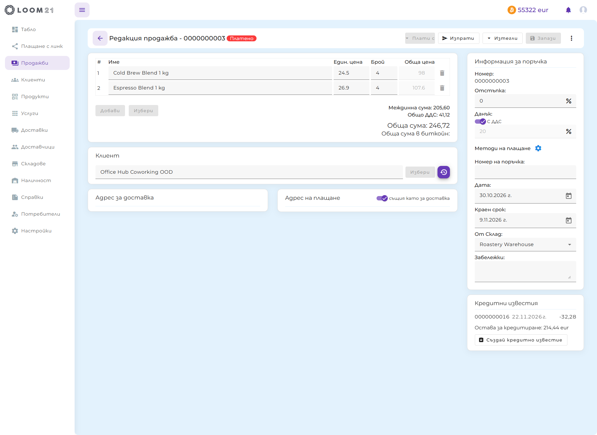

(<a href="#readme-top">обратно в началото</a>)

### Анулиране на фактура 

Фактура, издадена по грешка (грешен клиент, дублирана фактура, грешни данни по ДДС), може да се **анулира** (чл. 116 ЗДДС) вместо да се кредитира.

**Кога е възможно:** само докато фактурата е неплатена, няма кредитни известия и е издадена през текущия календарен месец. След това тя може вече да е включена в справка-декларация по ДДС, затова се коригира с кредитно известие. Когато анулирането не е възможно, екранът казва защо.

**Как:** отворете фактурата, отворете менюто **⋮** и изберете **Анулирай фактурата**. Въведете основанието (отпечатва се на фактурата и на протокола) и потвърдете, че клиентът е уведомен и няма да включи фактурата в дневника си за покупки.

**Какво се случва:**
- Фактурата запазва номера и съдържанието си, отбелязва се като **Анулирана** („АНУЛИРАНА“ на PDF документа, с основанието) и става Отменена. Стоката ѝ се връща на склад.
- Тя не може да се променя, кредитира, изпраща или плаща и не влиза в отчета за продажби.
- **Протокол за анулиране** изтегля протокола, който се подписва с клиента.
- За да издадете правилната фактура, използвайте **Копирай поръчка**. Копието помни коя фактура заменя, и протоколът я посочва, след като бъде издадена.

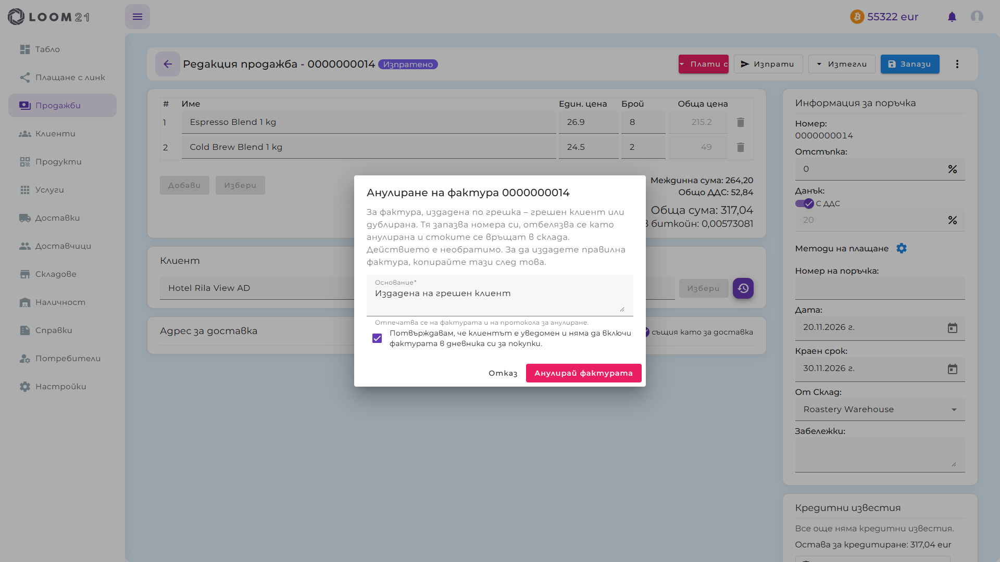

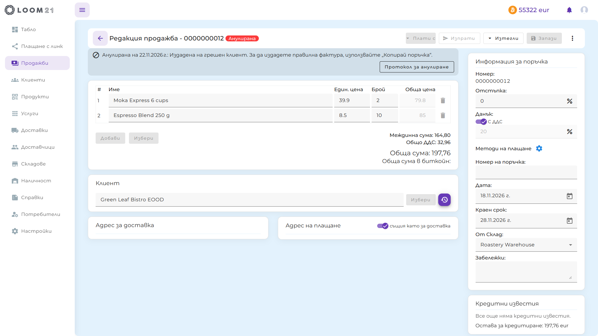

(<a href="#readme-top">обратно в началото</a>)

### Надплащания и възстановявания 

Понякога клиентът плаща повече, отколкото дължи: плащане пристига, след като фактурата е отменена или кредитирана, или една фактура е платена два пъти. Loom21 ви изпраща имейл, а фактурата показва предупреждение със сумата за връщане.

Loom21 не изпраща възстановявания. Върнете парите сами, след което натиснете **Отбележи възстановяване** в предупреждението и въведете сумата и датата. Предупреждението показва какво остава и изчезва, когато всичко е възстановено. Отбелязаните възстановявания се изваждат от прихода в [Таблото](#dashboard).

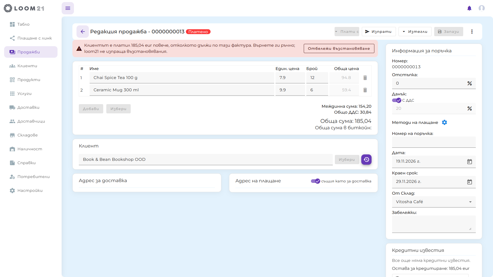

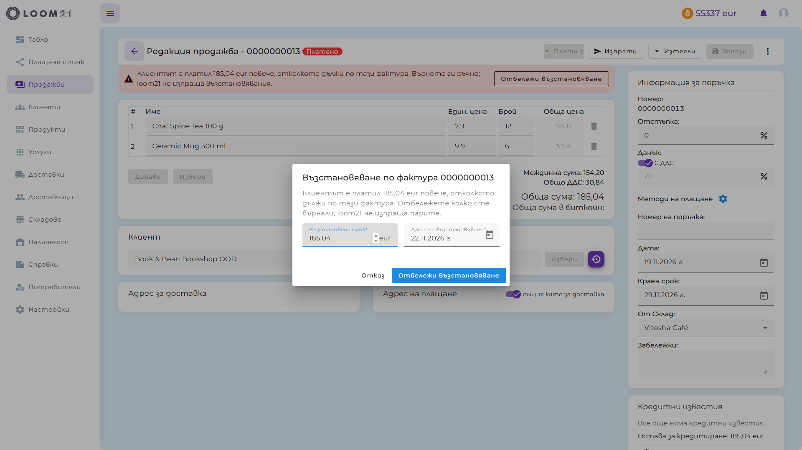

(<a href="#readme-top">обратно в началото</a>)

### Преминаване от друга програма (импорт на фактури) 

Ако сте издавали фактури с друга програма преди Loom21, внесете ги. След това можете да ги кредитирате или анулирате, да съберете неплатеното, а номерацията на Loom21 просто продължава след последната ви фактура. Импортът е възможен само **преди Loom21 да издаде първата си фактура**; след това се затваря.

**Преди да започнете:** импортирайте продуктите и услугите си (вижте [Импорт и експорт](#import-templates)), за да могат редовете на фактурите да се съпоставят с тях.

**Как се използва:**
1. Отидете в **Продажби** и натиснете **Импорт на фактури**.
2. Натиснете **Шаблон за фактури** и попълнете двата му листа:
   - **Documents**: по един ред за всяка фактура или кредитно известие, с номер, дата, клиент, валута, сумите както са отпечатани и дали е платена;
   - **Lines**: редовете на всеки документ, с номера му, описанието както е отпечатано, количество и единична цена (без ДДС, след отстъпките).

   Предпочитате CSV? **CSV шаблон** има същите колони на един лист: по един ред за всеки ред от фактурата, като колоните на документа се повтарят на всеки негов ред. Разделяйте колоните със запетая или точка и запетая, пишете десетичните числа с точка и запишете файла като UTF-8.
3. Натиснете **Изберете файл**. Loom21 проверява целия файл и показва всеки проблем с листа, реда и колоната му. Поправете ги във файла и го изберете отново. Нищо не се записва, докато файлът не е правилен.
4. **Съпоставете артикулите.** Всеки ред трябва да принадлежи на някой от вашите продукти или услуги. Loom21 намира повечето сам: по Id на продукта, баркод или код, или по точно име. Описанията, които не може да разпознае, се показват по веднъж, с броя редове и най-близките продукти. Изберете кой продукт или услуга е всяко от тях. Изберете **Създай нов продукт** или **Създай нова услуга** само ако наистина е нов, за да няма повторения в каталога. Loom21 запомня избора ви за следващия файл.
5. **Преглед и импорт.** Проверете обобщението и отговорете на един въпрос: **дневника за кой месец ще подадете първо от Loom21?** После натиснете **Импортирай**.

**Добре е да знаете:**
- **Сумите, както са отпечатани, са водещи.** Редовете, ДДС и отпечатаните суми в EUR трябва да съвпадат с тях до стотинка.
- **Клиентите** се търсят по ЕИК, после по ДДС номер, после по име. Ненамерените се добавят.
- **Платените фактури** получават плащане на датата, която посочите, така че дължимите суми и [Таблото](#dashboard) са верни.
- **Кредитните известия** посочват фактурата, която коригират, в същия файл или в по-ранен импорт, и кредитират редовете ѝ.
- **Валута:** празна колона Currency означава валутата на акаунта ви (Настройки → Общи), затова я попълнете, когато акаунтът ви е настроен на друга.
- **Документ в друга валута** изисква отпечатания на него курс, като EUR за 1 единица (EurPerUnit), или, ако проверката го поиска, като единици за 1 EUR (UnitsPerEur).
- **Наличностите не се променят.** Стоката е излязла, когато старата програма е издала фактурата.
- **Импортираните фактури не могат да се редактират.** Могат да се платят, кредитират и анулират. PDF документът им е с надпис „КОПИЕ“ и с бележка, че са импортирани, защото оригиналът е издаден от предишната ви програма.
- **Дневникът за продажбите** включва импортираните документи само от първия месец, който подавате от Loom21. По-ранните месеци са подадени от предишната ви програма и включването им би ги декларирало два пъти.
- **Фактури за много години?** Разделете ги на няколко файла до 10 000 реда и импортирайте първо най-старите.
- **Сбъркали сте?** В **Импортирано досега** бутонът **Премахни импорта** премахва изцяло импорта и плащанията му, докато Loom21 не е издал първата си фактура. Добавените клиенти и продукти остават.

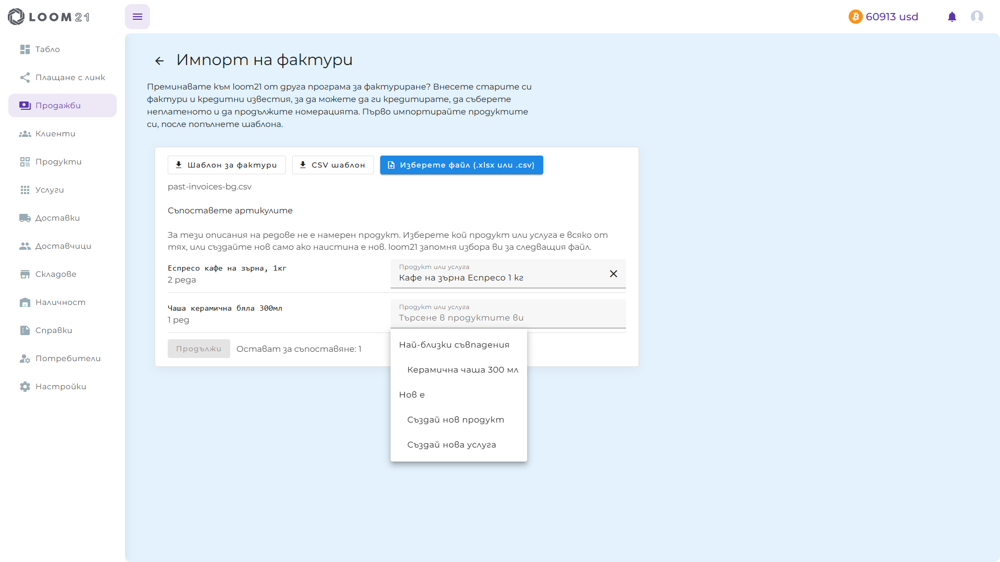

(<a href="#readme-top">обратно в началото</a>)

### Правила за фактуриране и вашата държава 

Фактурирането в Loom21 е изградено по българския ЗДДС и днес същите правила важат за всеки акаунт, независимо от държавата. Повечето от тях са изисквания на правилата за ДДС в ЕС; някои са само български. Ако фактурирате извън България, проверете с вашия счетоводител тези, които са само български.

| Правило | Какво прави Loom21 | Откъде идва |
|---|---|---|
| Номера на фактури | Обща непрекъсната поредица за фактури и кредитни известия, дава се при издаване и не се променя | Правилата за ДДС в ЕС изискват последователни номера. Форматът от 10 цифри е български |
| Корекции | Издадена фактура се коригира с кредитно известие, не се редактира и не се изтрива | Обичайна практика в ЕС |
| Реквизити на фактурата | Отпечатва датата на данъчното събитие, ДДС номерата, данъчната основа и основанието, когато не се начислява ДДС | От списъка със задължителни реквизити в ЕС |
| „ОРИГИНАЛ“ | Отпечатва се на фактурите и кредитните известия | Българска практика |
| ЕИК | Отпечатва се, когато е попълнен | В България — ЕИК. В други държави въведете регистрационния номер на фирмата или оставете полето празно |
| Срок за кредитно известие | Предупреждение, когато кредитното известие е издадено повече от 5 дни след връщането или промяната. Никога не блокира | ЗДДС |
| Анулиране | Само за неплатена фактура без кредитни известия, издадена през текущия календарен месец (по българско време) | ЗДДС. В други държави коригирайте фактурите с кредитни известия, освен ако счетоводителят ви не каже, че анулирането е допустимо |
| [Дневник за продажбите](#vat-ledger) | Българският дневник за продажбите — видове документи и колони | ЗДДС. В други държави попитайте счетоводителя си какви колони му трябват |

Планираме всеки акаунт да може да избере държавата си, за да следват правилата нея.

(<a href="#readme-top">обратно в началото</a>)

<!-- REPORTS -->
## Отчети

Разделът Отчети ви дава подробна информация за вашата дейност по продажби и доставки. Отидете на **Отчети** от страничното меню, за да изберете вид отчет.

### Отчет за продажби

Отчетът за продажби показва пълен, търсим и филтрируем списък на всеки продукт или услуга, които са продадени — по един ред за всеки артикул от всички поръчки.

**Как да използвате:**

1. Отидете на **Отчети → Отчет за продажби**.
2. Използвайте **лентата за търсене** в горната част, за да намерите артикули по наименование на продукт или пореден номер.
3. Натиснете **Филтри**, за да разгънете панела с филтри и да стесните резултатите по:
   - **Период** — изберете начална и крайна дата.
   - **Категория** — филтрирайте по категория на продукта.
   - **Мярка** — филтрирайте по мерна единица.
   - **Марка / Модел** — филтрирайте по марка, а след това по конкретен модел в рамките на тази марка.
   - **Клиент** — въведете името на клиент, за да търсите и филтрирате по конкретен купувач.
4. Натиснете бутона **Търси** (лупа), за да приложите филтрите.
5. Натиснете **Изчисти**, за да нулирате всички филтри.
6. Използвайте менюто **Експортирай**, за да изтеглите отчета с текущите филтри:
   - **Експорт в Excel** — .xlsx файл, в който числата и датите са истински числа и дати, готови за сортиране и сумиране.
   - **Експортирай CSV** — текстов файл, който можете да отворите в Excel или Google Sheets.
   - **Експортирай JSON** — изтегля структуриран файл с данни за техническа употреба.
7. Резултатите могат да се сортират, като натиснете заглавието на всяка колона. Използвайте контролите за **странициране** в долната част за навигация при много резултати.
8. Натиснете иконата стрелка на всеки ред, за да отидете директно към оригиналната поръчка за продажба.

Показани колони: наименование на продукт, баркод, пореден номер, количество, бележка, единична цена, обща цена, наименование на клиент, мярка, категория и дата.

Кредитните известия са редове с отрицателни стойности и значка, така че сумите са нетни. Кредит за сума е един ред с основанието като наименование. Анулираните фактури не се показват.

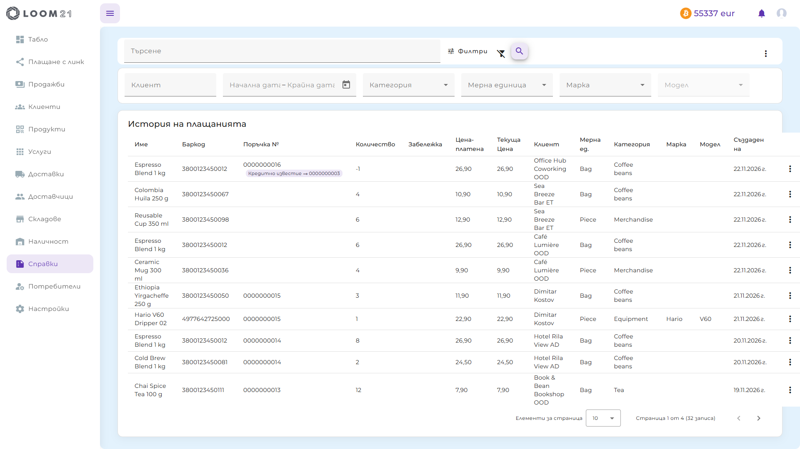

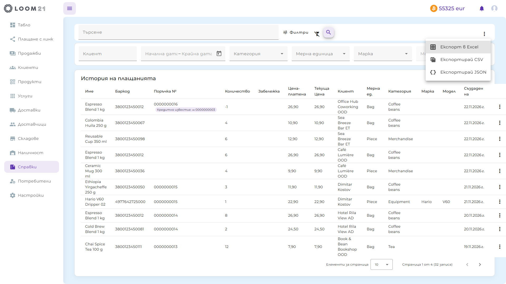

(<a href="#readme-top">обратно в началото</a>)

### Отчет за доставки

Отчетът за доставки предоставя същия подробен, филтрируем изглед за поръчките за доставка — показва всеки получен продукт заедно с информация за доставчика и датата.

Използвайте го по същия начин като Отчета за продажби: прилагайте филтри, търсете, сортирайте и експортирайте при необходимост.

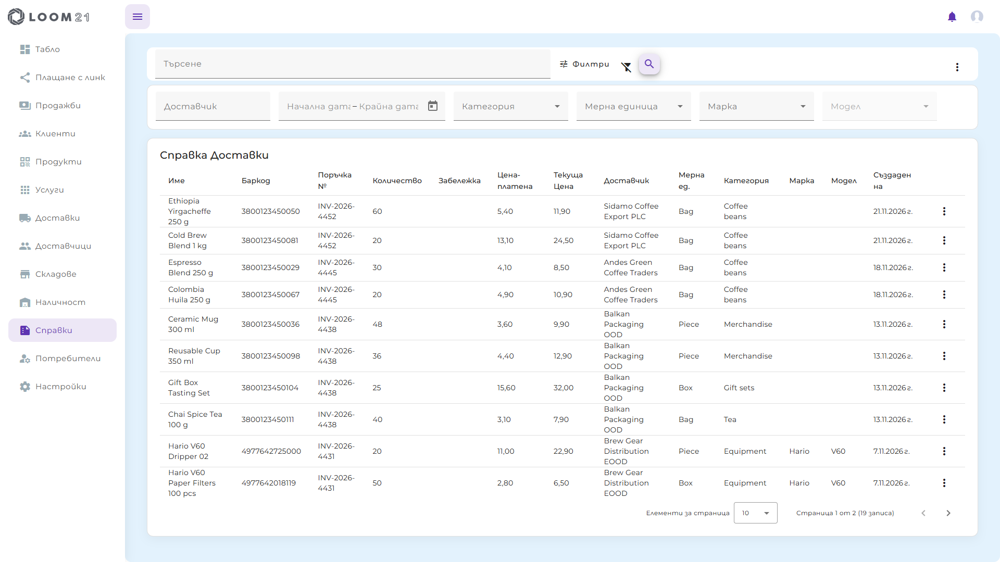

(<a href="#readme-top">обратно в началото</a>)

### Дневник за продажбите

Дневникът за продажбите е списъкът с продажбите за месеца, който вашият счетоводител импортира в счетоводната си програма, за да подаде справка-декларацията по ДДС. Той следва ЗДДС и е достъпен само когато в [Общите настройки](#general-settings) е включено **Активирай ДДС**, т.е. фирмата ви е регистрирана по ЗДДС.

**Как да използвате:**
1. Отидете на **Отчети → Дневник за продажбите**. Той се отваря на миналия месец.
2. Изберете **Месец** и **Година**.
3. Ако има списък **Проверете преди импорт**, прегледайте го и поправете посоченото.
4. Отворете **Експортирай** и изберете **Експорт в Excel** или **Експортирай CSV**, след което изпратете файла на счетоводителя си.

**Какво съдържа:**
- **Фактурите** — в месеца на данъчното им събитие (датата на поръчката), с вид документ 01.
- **Кредитните известия** — в месеца, в който са издадени, с **отрицателни** суми, вид документ 03 и номера и датата на фактурата, която коригират.
- **Анулираните фактури** — с номера, датата и клиента си и **0.00** във всички суми.
- **Продажбите чрез платежни връзки** — един ред за целия месец („Физически Лица - Отчет по чл. 119“, вид документ 02, с номер година, месец и 02, напр. 20261002), разделен по ставка на ДДС и намален с възстановяванията.
- **[Импортираните фактури](#import-invoices)** — само от първия месец, който подавате от Loom21. В по-ранните месеци са изключени и екранът го казва: предишната ви програма ги е подала.

**В коя колона отива продажбата:**
- Продажба с ДДС отива в колоните за **20%** или **9%** според ставката си.
- Продажба без ДДС отива в колоната на своя **вид доставка за дневника**, избран в продажбата. Платежните връзки без ДДС отиват в колоната на вида доставка на връзката.
- Всички суми са в **EUR**. Продажба в друга валута се превалутира по курса, отпечатан на фактурата или кредитното известие (вижте [Номера на фактури и PDF документи](#invoice-numbers)), така че сумите в дневника са точно равностойността в EUR от PDF документа. Екранът показва валутата, курса и датата на курса.
- Клиент без ЕИК и без ДДС номер се смята за физическо лице: двете полета се попълват с петнадесет деветки („999999999999999“).

**Експортираният файл** има колоните, които счетоводният софтуер импортира, с български заглавия, в този ред:
1. пореден номер на запис;
2. вид на документа (01 фактура, 02 продажби без фактура, 03 кредитно известие);
3. номер на документа;
4. дата на издаване;
5. дата на данъчно събитие;
6. име на контрагента;
7. ЕИК;
8. ДДС номер;
9. при кредитно известие — номерът на фактурата;
10. при кредитно известие — датата на фактурата;
11. общата сума с ДДС (колона 9 от дневника);
12. след това сумите за колони 11, 12, 13 и 14 от дневника (20% и 9% с ДДС), 16 (износ), 17 (ВОД), 19 (дистанционни продажби), 21 (услуги към бизнес в ЕС) и 25 (освободени доставки).

Датите са във формат ДД.ММ.ГГГГ, а сумите — с два знака след десетичната запетая. Валутата, курсът и предупрежденията не са във файла: те са на екрана, а предупрежденията са и на втория лист на Excel файла.

**Какво дневникът отбелязва.** Той никога не гадае. Следните неща се показват на екрана, отбелязват се на реда си и се поставят на втори лист „Внимание“ в Excel файла:
- продажба във валута без курс на ЕЦБ, като BTC (сумите ѝ остават в тази валута);
- курс, който още не е публикуван за деня (използван е последният: експортирайте отново по-късно);
- продажба без ДДС без избран вид доставка (изберете го в продажбата);
- ставка на ДДС, различна от 20% и 9%;
- платежни връзки без ДДС и без вид доставка за дневника, или във валута без курс на ЕЦБ.

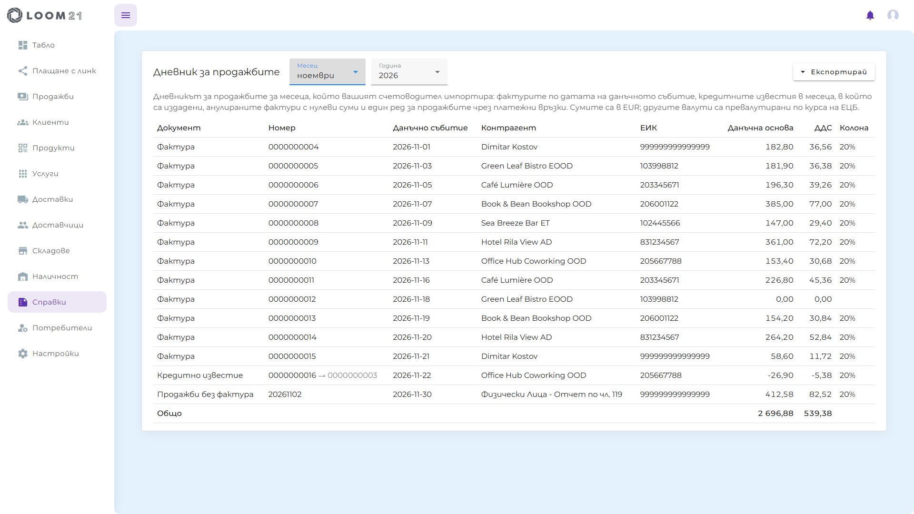

(<a href="#readme-top">обратно в началото</a>)

<!-- SETTINGS -->
## Настройки

Тук конфигурирате предпочитанията на организацията си и платежните процесори. Платежните процесори трябва да бъдат настроени в този раздел, преди да станат достъпни като опции при плащане или в платежни връзки.

### Общи настройки 

Тук конфигурирате основните идентификационни данни и предпочитания на организацията си. Тези настройки засягат цялото приложение.

**Данни на фирмата:**
- **Фирмено наименование, имейл, телефон** — появяват се на разпечатаните фактури и документи.
- **Лого на фирмата** (от плана Starter нагоре) — натиснете **Качи лого** (JPEG, PNG или WebP, до 10 MB; най-добре е широко лого на еднороден или прозрачен фон). Отпечатва се в горната част на фактурите, кредитните известия, офертите, касовите бележки и документите за доставка и се показва в горната част на страниците ви за плащане и онлайн магазините ви. На плана Free вместо това виждате връзка **Надградете**. Ако се върнете на Free, логото се пази, но не се показва; надграждането го връща.
- **Адрес за фактуриране** — адресът на организацията ви, също отпечатван на документи.

**Локализация:**
- **Език** — променя езика на приложението. Страницата се презарежда автоматично при запазване на промяна на езика.
- **Валута** — основната оперативна валута. Влияе на цените, общите суми и отчетите в приложението.
- **Магазин по подразбиране** — магазинът, предварително избран при създаване на нови продажби и доставки.

**Настройки за ДДС:**
- **Активирай ДДС** — включва ДДС глобално. Можете да го превключвате и за отделни поръчки.
- **ДДС номер** — данъчният регистрационен номер на организацията ви, отпечатван на фактурите.
- **ЕИК** — вашият ЕИК, отпечатван на фактурите и кредитните известия.
- **Номер на първата фактура** — ако сте издавали фактури преди loom21, номерът след последната от тях; празно поле започва от 1. Подсказката показва номера, който ще получи следващата фактура. Може да се променя само докато не е издадена първата фактура или кредитно известие, след това се заключва, за да няма празнини или повторения в номерацията.
- **Процент ДДС** — ставката по подразбиране, прилагана към нови поръчки.
- **Основание за неначисляване на ДДС** — попълва се на новите продажби без ДДС и се отпечатва на фактурите им, напр. „чл. 113, ал. 9 ЗДДС“ за фирма, която не е регистрирана по ДДС. ЗДДС го изисква на всяка фактура без ДДС.

**Контрол на инвентара:**
- **Забрани отрицателно количество** — когато е активирано, системата няма да позволява продажба, която би намалила наличността на продукт под нула.

**Настройки за биткойн:**
- **Скрий биткойн цените** — премахва всички показвания на биткойн цени и опции за плащане в приложението.
- **Замести биткойн курса** — позволява ви да въведете фиксиран обменен курс вместо да използвате пазарния курс в реално време.
- **Използвай само биткойн** — скрива фиат сумите и показва само биткойн суми.

**Тема:**
- **Тъмен режим** — превключване между светла и тъмна тема. Може да се превключва бързо и от [Таблото](#dashboard).

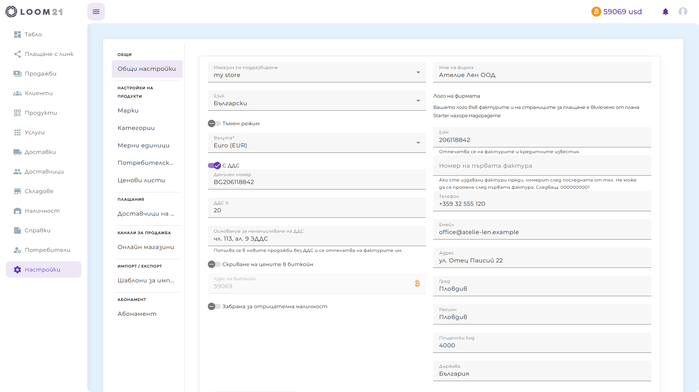

(<a href="#readme-top">обратно в началото</a>)

### Абонамент

Показва текущия ви план в loom21 и как се плаща:
- месечно или годишно с карта: „подновява се на …“;
- годишно в биткойн: „платен до …“;
- **Безплатен** (Free): „Безплатен завинаги, без карта“. Всеки нов акаунт започва с него — 1 потребител, 1 магазин и до 50 поръчки на месец;
- план, **даден ви от loom21**: „Безплатен до …, предоставен от loom21“. Изберете план дотогава, за да го запазите; иначе акаунтът се връща на безплатния план.

Отдолу е какво включва планът: потребители, поръчки на месец, магазини, потребителски роли, достъп до API, поддръжка, ваше лого и дали страниците за плащане показват „Powered by loom21“.

**Използване** показва лента за поръчките този месец, магазините и потребителите спрямо лимитите на плана („42 от 50“ или „7, без ограничение“). Броят на поръчките започва отначало на 1-во число всеки месец. Лентата на поръчките става жълта на 80% и червена при лимита.

Натиснете **Промени абонамента** или **Избери План** на безплатния план, за да отворите избора на планове. Всяка карта показва цената на плана в евро на месец (годишните и биткойн плановете показват и сумата за годината) и какво включва. Вижте [Цени](https://loom21.com/bg/pricing).

#### Лимити на плана

- **Потребители и магазини:** не можете да поканите повече потребители или да добавите повече магазини, отколкото позволява планът. Първо надградете.
- **Поръчки на месец:** броят се издадените фактури и плащанията по връзки за плащане; черновите, кредитните известия и импортираните фактури не се броят. Получавате имейл и [известие](#notifications) на 80% и на 100%. Когато акаунт надхвърли лимита си, се прилагат Общите условия (раздел 6): гратисен период, след това молба за надграждане, а след това всеки месец, в който лимитът е достигнат, **връзките за плащане и новите продажби се спират** до началото на следващия месец или до надграждане. Надграждането вдига спирането веднага.
- **Вече издадена фактура винаги може да бъде платена,** дори по време на спиране, а съществуващите продажби могат да се редактират.
- **По време на спиране** новата продажба показва горе „Новите поръчки са спрени до …“, с бутон **Надградете** за администраторите.

(<a href="#readme-top">обратно в началото</a>)

### Stripe
- За да приемате фиат плащания чрез Stripe, конфигурирайте своите Stripe Publishable и Secret ключове.

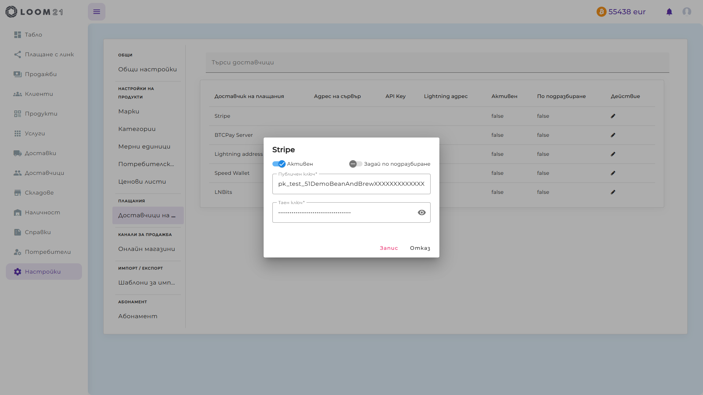

(<a href="#readme-top">обратно в началото</a>)

### BTCPay Сървър
- Самостоятелно хостван биткойн платежен процесор с поддръжка на Lightning и on-chain плащания.
- Конфигурирайте URL адреса на вашия BTCPay Server и API ключ, за да го активирате.

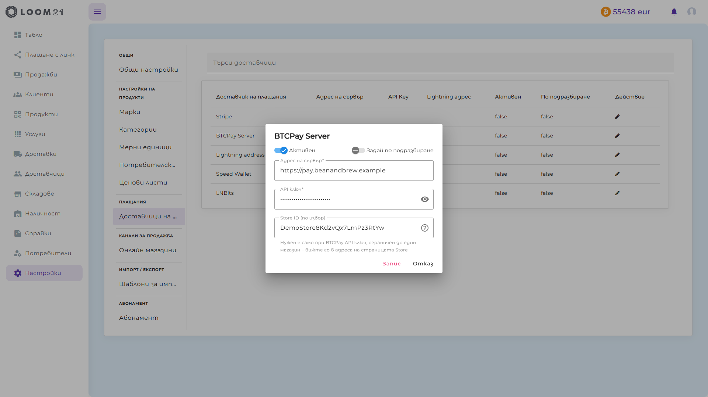

(<a href="#readme-top">обратно в началото</a>)

### Lightning address
Получавайте Lightning плащания направо в собствения си портфейл, чрез неговия **Lightning адрес** (прилича на имейл адрес, напр. `you@breez.tips`). Работи с **всеки портфейл, чийто Lightning адрес поддържа LNURL-pay**. loom21 само иска фактура от адреса ви, затова никога не държи парите или ключовете ви.

- Въведете Lightning адреса си в **LN URL**.
- **Автоматичното потвърждение изисква проверка на плащането (LUD-21).** За да види loom21, че фактурата е платена, услугата зад Lightning адреса на портфейла ви трябва да я поддържа, а не всички го правят. Натиснете **Тествай връзката**, преди да започнете. Бутонът иска от адреса ви тестова фактура (нищо не се плаща) и показва едно от следните:
  - **„Потвърждението на плащане в реално време се поддържа“** — плащанията се потвърждават автоматично, както при другите доставчици.
  - **„Този портфейл не поддържа потвърждение на плащане в реално време“** — клиентите пак могат да ви платят, но loom21 не може да разбере. Проверете портфейла си и отбележете продажбата с **Маркирай като платена**. Платежните връзки и бутонът „Купи“ не могат да се отбележат ръчно, затова за тях използвайте портфейл, който го поддържа.
  - **„Неуспешна връзка с този адрес“** — проверете адреса.
- Известно е, че го поддържат (ноември 2026): Glow (адреси `breez.tips`), Alby и Coinos. Wallet of Satoshi и Zebedee не го поддържат. Това може да се промени, затова разчитайте на **Тествай връзката**, а не на този списък.
- Само Lightning. За on-chain биткойн използвайте [BTCPay Server](#btcpay-server).

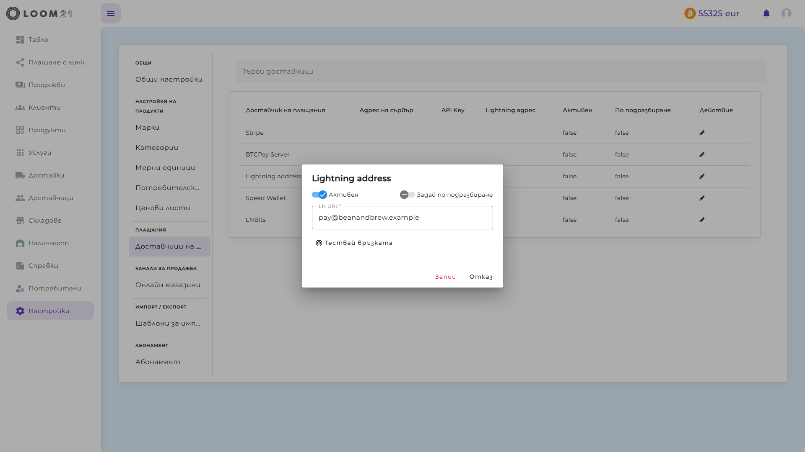

(<a href="#readme-top">обратно в началото</a>)

### Speed Wallet
- Биткойн портфейл с поддръжка на Lightning и on-chain плащания.
- Въведете вашия Speed Wallet API ключ, за да го активирате.

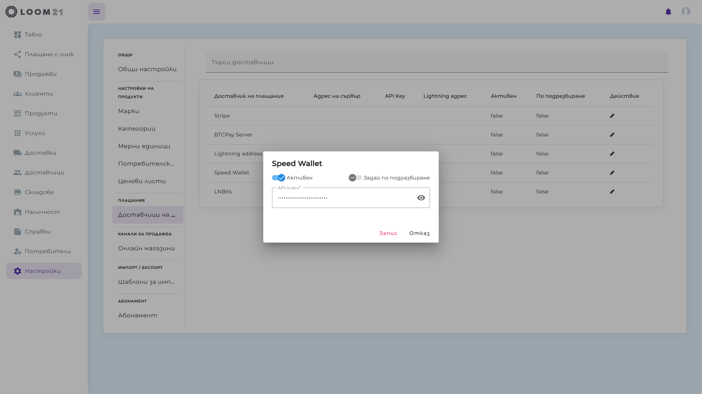

(<a href="#readme-top">обратно в началото</a>)

### LNbits
- Система за Lightning Network акаунти с отворен код. Поддържа множество портфейли и разширения.
- Конфигурирайте вашия LNbits URL и API ключ, за да го активирате.

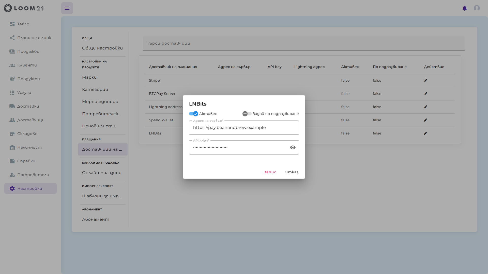

(<a href="#readme-top">обратно в началото</a>)

### Настройки на продукти

Разделът **Настройки на продукти** (намиращ се под Настройки в страничното меню) групира няколко конфигурационни страници, контролиращи начина, по който продуктите ви се организират, описват и ценообразуват. Използвайте подменюто, за да превключвате между:

- **Марки и модели** — производители и продуктови линии
- **Категории** — групи за организиране на продукти
- **Мерни единици** — единици за измерване
- **Потребителски полета** — допълнителни полета, дефинирани от вас за данни за продукта
- **Ценови листи** — многостепенни и специфични за клиент правила за ценообразуване

(<a href="#readme-top">обратно в началото</a>)

### Категории продукти 

Категориите ви позволяват да групирате свързани продукти заедно, улеснявайки намирането и филтрирането им в приложението — в списъка с продукти, в Инвентара и в Отчетите.

**Добавяне на категория:**

1. Отидете на **Настройки → Настройки на продукти → Категории**.
2. Натиснете **Добави** (или бутона **+**), за да отворите формата за категория.
3. Въведете **Наименование** на категорията (напр. „Електроника", „Облекло", „Суровини").
4. Натиснете **Запази**. Новата категория се появява в списъка и е незабавно достъпна за присвояване на продукти.

**Редактиране на категория:**

1. Намерете категорията в списъка и натиснете иконата за **редактиране** на нейния ред.
2. Актуализирайте наименованието при необходимост.
3. Натиснете **Запази**. Промяната се отразява навсякъде, където категорията се използва.

**Slug:** адресът на категорията в пълен онлайн магазин, изграден върху вашия [онлайн магазин](#storefronts). Малки латински букви, цифри и тирета; ако го оставите празно, се създава от наименованието.

**Снимка на категория:** отворете запазена категория и натиснете **Качи снимка** (JPEG, PNG или WebP, до 10 MB). Запазва се веднага, дори ако след това затворите формата, и се показва в списъка с категории; натиснете я там, за да я видите на цял екран. **Смени снимката** и **Премахни** я променят по-късно.

**Изтриване на категория:**

1. Натиснете иконата за **изтриване** на реда на категорията.
2. Потвърдете изтриването при подкана.

> Продуктите, вече присвоени на тази категория, не се изтриват — те просто губят асоциацията с категорията и ще показват „без категория", докато не им бъде присвоена нова.

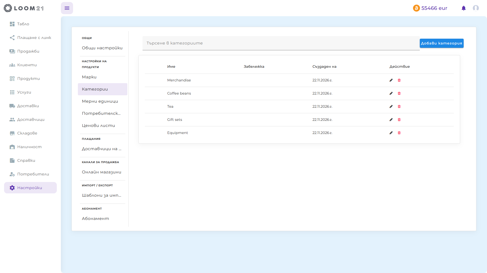

(<a href="#readme-top">обратно в началото</a>)

### Мерни единици

Мерните единици определят единиците за измерване, използвани при описване на количествата продукти — например килограми, литри, бройки или метри. След дефиниране, мерна единица може да се присвои на всеки продукт или услуга и се използва в инвентара, продажбите и отчетите.

**Добавяне на мерна единица:**

1. Отидете на **Настройки → Настройки на продукти → Мерни единици**.
2. Натиснете **Добави** (или бутона **+**), за да отворите формата за мерна единица.
3. Въведете **Наименование** на единицата (напр. „Килограм", „Брой", „Литър").
4. Натиснете **Запази**. Мерната единица вече е достъпна за присвояване на продукти и услуги.

**Редактиране на мерна единица:**

1. Намерете мерната единица в списъка и натиснете иконата за **редактиране** на нейния ред.
2. Актуализирайте наименованието при необходимост.
3. Натиснете **Запази**. Актуализираното наименование се отразява навсякъде, където мерната единица се използва.

**Изтриване на мерна единица:**

1. Натиснете иконата за **изтриване** на реда на мерната единица.
2. Потвърдете изтриването при подкана.

> Продуктите, вече използващи тази мерна единица, не се изтриват — те просто губят асоциацията и ще показват „без мярка", докато не им бъде присвоена нова.

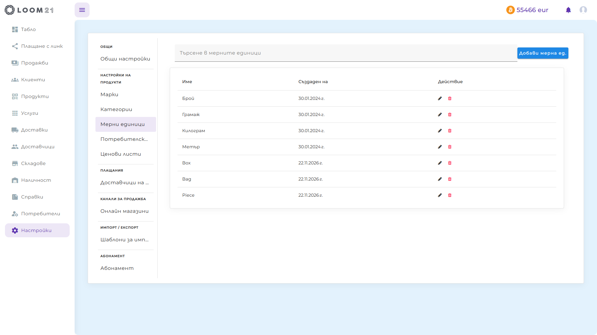

(<a href="#readme-top">обратно в началото</a>)

### Марки и модели

Ако продуктите ви са свързани с производители или марки, можете да ги управлявате тук. Всяка марка може да има множество модели под нея, които след това можете да присвоявате на отделни продукти за по-детайлна категоризация и отчети.

**Как да използвате:**

1. Отидете на **Настройки → Настройки на продукти → Марки**.
2. Натиснете **Добави**, за да създадете нова марка. Въведете наименование на марката, незадължително описание и, ако имате такова, адреса на логото ѝ. След като марката е запазена, отворете я отново, за да **Качите снимка** за логото.
3. Натиснете марка в списъка, за да видите детайлите й вдясно и да управлявате нейните модели.
4. В панела с детайлите на марката натиснете **Добави модел**, за да създадете модели (напр. конкретни продуктови линии или версии), принадлежащи към тази марка.
5. Използвайте бутоните за редактиране и изтриване, за да актуализирате или премахнете марки и модели при необходимост.

След настройка на марките и моделите можете да ги присвоявате на продукти от страницата за редактиране на продукт. Това ви позволява да филтрирате Отчета за продажби по марка или модел, за да видите кои продуктови линии се представят най-добре.

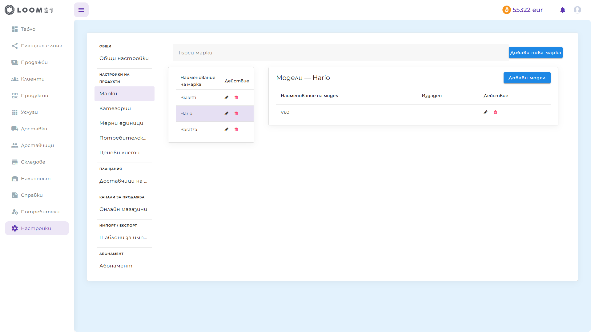

(<a href="#readme-top">обратно в началото</a>)

### Потребителски полета

Потребителските полета ви позволяват да добавите собствени полета за данни към всеки продукт в каталога си — извън стандартните полета като наименование, цена и категория. Например можете да добавите „Дата на изтичане на гаранцията", „Референтен номер на доставчика" или отметка „Сертифициран".

**Как да използвате:**

1. Отидете на **Настройки → Настройки на продукти → Потребителски полета**.
2. Натиснете **Добави поле**, за да дефинирате ново потребителско поле. Ще бъдете помолени да въведете:
   - **Етикет** — наименованието, показвано на формата на продукта (напр. „Срок на гаранцията").
   - **Име на поле** — кратък вътрешен идентификатор (без интервали, напр. `warrantyExpiry`).
   - **Тип данни** — изберете от Текст, Число, Десетична дроб, Да/Не или Дата.
   - **Задължително** — дали полето трябва да е попълнено преди запазване на продукт.
   - **Стойност по подразбиране** — незадължителна предварително попълнена стойност.
   - **Показвай в онлайн магазина** — купувачите виждат полето на страницата на продукта в онлайн магазина ви (напр. Материал, Размер). Полета с изключена отметка никога не излизат от loom21. Списъкът отбелязва показваните в колоната **Онлайн магазин**.
3. Използвайте **манипулатора за плъзгане** (иконата за захват вляво), за да пренаредите полетата — това контролира реда, в който се появяват на формата на продукта.
4. Използвайте **превключвателя**, за да активирате или деактивирате поле без да го изтривате. Неактивните полета са скрити на формите на продуктите, но данните им се запазват.
5. Натиснете иконите за **редактиране** или **изтриване**, за да промените или премахнете дефиниция на поле.

След като потребителските полета са дефинирани, те се появяват като допълнителен раздел **Потребителски полета** на страницата за редактиране на всеки продукт, където можете да попълвате стойностите за всеки продукт.

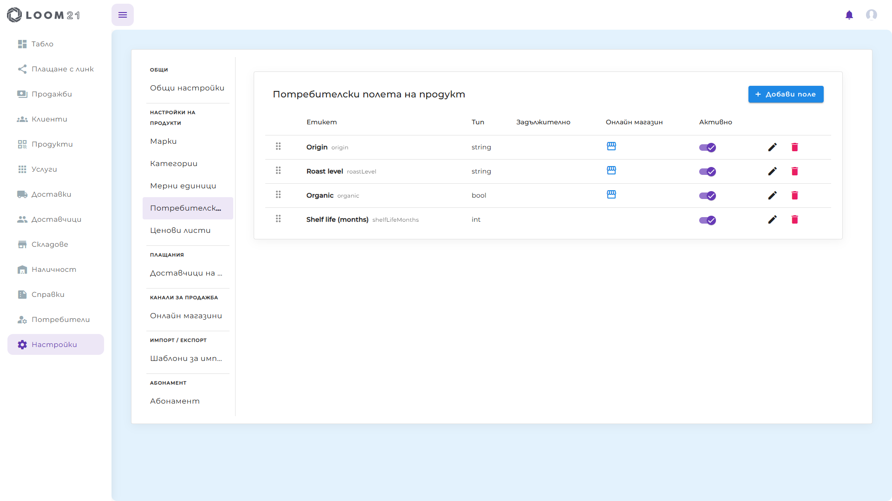

(<a href="#readme-top">обратно в началото</a>)

### Ценови листи

Ценовите листи ви дават пълен контрол върху ценовата стратегия. Вместо да използвате единична фиксирана цена за продукт, можете да създадете множество ценови листи — например „Едро" с по-ниски цени, „Дребно" или сезонна промоция — и да задавате конкретни цени за продукт в рамките на всяка листа.

Във всяка ценова листа можете също да задавате **количествени нива** (цената автоматично намалява при по-голяма поръчка), да прилагате **процентни отстъпки** или дори да дефинирате **формула**, която изчислява цената динамично.

Освен това можете да задавате **клиентски ценови замествания** директно на продукт — така един конкретен клиент винаги получава специална цена, независимо от активната ценова листа.

#### Създаване на ценова листа

1. Отидете на **Настройки → Настройки на продукти → Ценови листи**.
2. Натиснете **Нова ценова листа**, за да разгънете формата за създаване.
3. Въведете **наименование** (напр. „Едро 2026"), изберете **валута** и по желание задайте период **Важи от / Важи до**, за да е листата активна само в определен период.
4. Отметнете **По подразбиране**, ако тази листа трябва да е основната при липса на друго правило.
5. Натиснете **Запази**. Новата листа се появява в левия панел.

#### Добавяне на продукти и нива към ценова листа

1. Натиснете ценова листа в левия панел, за да я отворите.
2. В раздела **Нива** използвайте полето за търсене на продукти, за да намерите продукта, който искате да добавите.
3. Попълнете:
   - **Мин. количество** — минималното количество, което клиентът трябва да поръча, за да получи тази цена (оставете празно за „всяко количество").
   - **Цена** — продажната цена на продукта в тази листа.
   - **Отстъпка %** — незадължителна процентна отстъпка, прилагана допълнително към цената.
   - **Формула** — разширена опция за въвеждане на математически израз за автоматично изчисляване на цената (напр. `BasePrice * 0.85` за постоянна 15% редукция). Налични променливи: `BasePrice`, `Quantity` и всички потребителски полета, които сте дефинирали.
4. Натиснете **Добави ниво**. Можете да добавите множество нива за един и същ продукт с различни минимални количества, за да създадете стъпки на ценообразуване при обем.
5. Използвайте иконите за **редактиране** и **изтриване** на всеки ред за ниво.

#### Активиране или деактивиране на ценова листа

- Използвайте **превключвателя** до наименованието на ценовата листа, за да я активирате или деактивирате без да я изтривате.

#### Изтриване на ценова листа

- Натиснете иконата за **изтриване** до ценовата листа. Ще бъдете помолени да потвърдите. Изтриването на ценова листа премахва и всичките й нива.

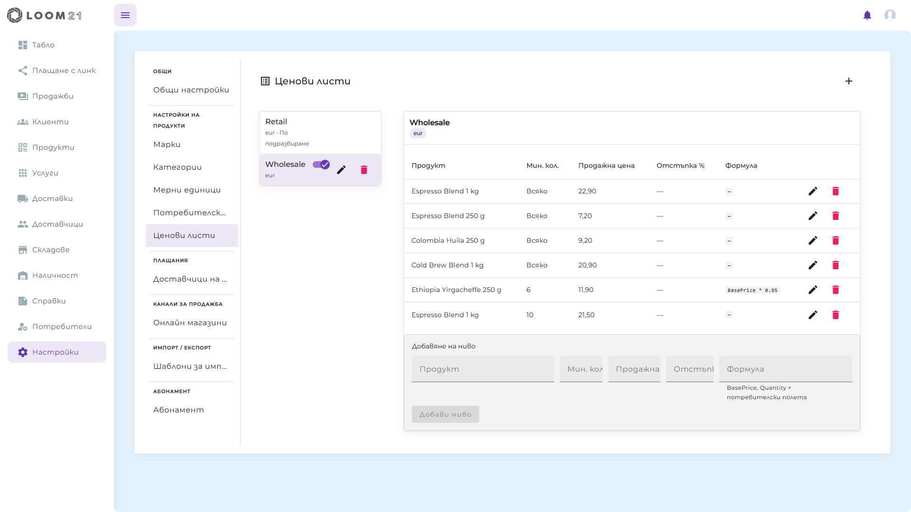

(<a href="#readme-top">обратно в началото</a>)

### Импорт и експорт (Excel и CSV)

Продуктите, услугите, клиентите и доставчиците могат да се експортират в електронна таблица и да се импортират от такава — за да добавите или промените много записи наведнъж. Работят и Excel (.xlsx), и CSV (.csv); препоръчваме Excel.

**Къде:**
- **Експорт** — в екрана Продукти, Услуги, Клиенти или Доставчици отворете **Експортирай** и изберете **Експорт в Excel**, **Експортирай CSV** или **Експортирай JSON**.
- **Импорт** — бутонът **Импортиране** в същия екран.
- **Празни шаблони** — **Настройки → Настройки на продукти → Шаблони за импорт**, или **Шаблон за импорт (Excel)** в менюто за експорт на екрана. Шаблоните съдържат и вашите [потребителски полета](#custom-fields).
- **Стари фактури** от друга програма имат свой шаблон и импорт: вижте [Преминаване от друга програма](#import-invoices).

#### Добавяне на нови записи

1. Изтеглете шаблона.
2. Попълнете по един ред за всеки запис. Задължително е само **Name**; колоните, които не ви трябват, може да липсват. Редът на колоните и главните букви нямат значение.
3. Импортирайте файла в съответния екран.

#### Промяна на съществуващи записи

1. **Експортирайте** записите в Excel.
2. Променете във файла каквото е нужно: цени, наименования, категории, потребителски полета и т.н.
3. **Импортирайте** файла в същия екран. Записите се обновяват; не се създават копия.

Това е възможно, защото всеки експорт има колона **Id**, която казва на импорта на кой запис е редът. В Excel колоната е скрита, за да не се промени по невнимание:
- **Excel** — натиснете триъгълника в горния ляв ъгъл, за да изберете целия лист, после натиснете с десен бутон буквата на някоя колона и изберете **Unhide** (Покажи).
- **Google Sheets** — натиснете малките стрелки в левия край на заглавието на колона **B**, или натиснете с десен бутон заглавие на колона и изберете **Unhide columns** (Покажи колоните). Първо отворете файла в Google Sheets; прегледът в Drive не позволява това.

<!-- SCREENSHOT TODO: експортиран файл с продукти в Excel или Google Sheets с показана колона Id.
 -->

**Добре е да знаете:**
- **Не променяйте стойностите в Id.** Ред без Id се добавя като нов запис. Id от друг акаунт или от услуга във файла с продукти се отхвърля.
- **Променят се само колоните, които са във файла.** Можете да импортирате файл само с **Id** и **PriceSale**, за да обновите цени; всичко останало остава същото. Празна клетка в колона, която *е* във файла, изтрива тази стойност.
- Запазете файла като **.xlsx** (в Google Sheets: **File → Download → Microsoft Excel**) или **.csv**. За клиенти и доставчици използвайте .xlsx: CSV съдържа само един лист и листът Addresses ще се загуби.

#### Ако импортът открие проблеми

Нищо не се записва, докато целият файл не е наред. Екранът показва първите проблеми, всеки с номера на реда, както го виждате в таблицата, например:
- „Ред 4: PriceSale трябва да е число.“
- „Ред 7: Name е задължително.“
- „Ред 9: доставчикът „Nobody“ не е сред вашите доставчици. Първо го добавете в Доставчици.“
- „Addresses, ред 3: повече от един ред се казва „Shop“. Попълнете CompanyId.“

Поправете ги във файла и го импортирайте отново. Файлът може да е до 10 MB и до 10 000 реда.

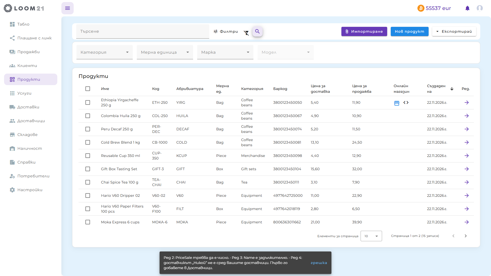

#### Колони за продукти и услуги

| Колона | Задължителна | Описание |
|---|---|---|
| `Id` | Не | Попълва се от експорта. Оставете я празна за нов продукт (скрита в Excel) |
| `Name` | **Да** за нови редове | Наименование на продукта или услугата (до 256 знака) |
| `PriceSale` | Не | Продажна цена (0 или повече) |
| `PriceDelivery` | Не | Цена на доставка / себестойност (0 или повече) |
| `BtcPriceSale`, `BtcPriceDelivery` | Не | Цени в биткойн |
| `Code` | Не | Вътрешен код на продукта или SKU (до 50 знака) |
| `Abr` | Не | Кратко съкращение на наименованието на продукта |
| `Barcode` | Не | Номер на баркода. Водещите нули се запазват |
| `QrCode` | Не | Текст на QR кода |
| `Category` | Не | Наименование на категория. Ако не съществува, се създава |
| `Measure` | Не | Мерна единица. Ако не съществува, се създава |
| `Brand` | Не | Наименование на марка. Ако не съществува, се създава |
| `Model` | Не | Модел от тази марка. Изисква `Brand`; ако не съществува, се създава |
| `Supplier` | Не | Наименование на доставчик. Доставчикът трябва вече да съществува в [Доставчици](#customers-suppliers) |
| `Note` | Не | Вътрешна бележка |
| `Image` | Не | URL към изображение на продукта |
| `Discontinued` | Не | `TRUE` или `FALSE` |
| *вашите потребителски полета* | Зависи | По една колона за всяко [потребителско поле](#custom-fields), с неговия етикет като заглавие. Задължително поле трябва да е попълнено, когато колоната му е във файла. Поле с формат трябва да го спазва |

> Услугите използват същите колони като продуктите. Наименованията се сравняват без значение на главните букви.

#### Колони за клиенти и доставчици

| Колона | Задължителна | Описание |
|---|---|---|
| `Id` | Не | Попълва се от експорта. Оставете я празна за нов запис (скрита в Excel) |
| `Name` | **Да** за нови редове | Фирмено наименование или лично име |
| `ContactName` | Не | Основното контактно лице |
| `Email`, `Phone`, `Website` | Не | Данни за контакт |
| `EIK` | Не | ЕИК, отпечатван на фактурите. Работи и колона с име `Bulstat` |
| `TaxNumber` | Не | ДДС или данъчен регистрационен номер |
| `PriceList` | Не | Само за клиенти: наименованието на една от вашите [Ценови листи](#price-lists) |
| `Note` | Не | Вътрешни бележки |
| `BitcoinAddress` | Не | Биткойн адрес на контакта |

**Адреси.** В Excel адресите са на втори лист, **Addresses**, по един ред за адрес:

| Колона | Описание |
|---|---|
| `Company` | Наименованието на клиента или доставчика, както е на първия лист |
| `Name`, `Phone` | Име на адреса (напр. „Офис“) и телефон |
| `AddressLine1`, `AddressLine2`, `City`, `Region`, `Postcode`, `Country` | Адресът |
| `Default` | `TRUE` за адреса по подразбиране |
| `Id`, `CompanyId` | Попълват се от експорта (скрити). Оставете ги празни за нов адрес |

- Адресният ред принадлежи на фирмата от първия лист със същото наименование, включително такава, добавена със същия файл, а иначе — на вашия клиент или доставчик с това наименование.
- Първият адрес на фирмата става адрес по подразбиране, освен ако не зададете друг.
- Адресите, които липсват във файла, се запазват — не се изтриват.

В CSV клиентът или доставчикът има един адрес в колоните `AddressLine1`, `AddressLine2`, `City`, `Region`, `Postcode` и `Country`: адреса по подразбиране.

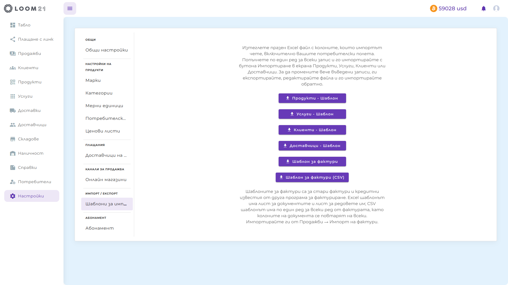

(<a href="#readme-top">обратно в началото</a>)

## Акаунти 

Страницата Акаунти показва всички потребители с достъп до вашата организация. Всеки ред показва имейла, собственото и фамилното име, фирменото наименование, уебсайта и телефонния номер на потребителя.

**Покана на нов потребител** (само администратор):
1. Натиснете бутона **Поканете потребител**.
2. Попълнете **имейл адреса**, **паролата**, собственото и фамилното име и телефона на новия потребител. Имейл, който вече има акаунт в loom21, не може да бъде поканен: използвайте друг.
3. Изберете една или повече **Роли** с отметките (от плана Growth нагоре). При другите планове всеки поканен потребител е администратор.
4. Запазете — потребителят вече може да влезе със създадените данни.

**Редактиране на потребител:**
- Натиснете иконата за редактиране на всеки ред, за да актуализирате данните или да промените ролите. Само администратор променя ролите и никой не променя собствените си: друг администратор може.

**Роли и какво позволяват** (от плана Growth нагоре):

| Роля | Какво може потребителят |
|---|---|
| Администратор | Всичко, включително потребители и роли, настройки на фирмата и на плащанията, складове и абонамента. |
| Касиер | Създава продажби, изпраща фактури и ги отбелязва като платени, добавя клиенти. Не може да променя цени, да дава отстъпки, да издава кредитни известия или да анулира. |
| Управление на продажби | Всичко, което прави касиерът, плюс цени и отстъпки, кредитни известия, анулиране, възстановени суми, импорт на фактури, платежни връзки, клиентски цени, приходите в таблото и справката за продажбите. Без справката за доставките, в която има доставни цени. |
| Склад | Добавя и изписва наличност ръчно и приема доставки: отбелязва ги като доставени, без да ги променя. Не създава доставки и доставчици, не отбелязва доставки като платени, не вижда доставните цени (освен цените в самите доставки) и продажбите. |
| Снабдяване | Създава и редактира доставки и доставчици, с доставните цени, и отбелязва доставките като платени. Не променя наличностите ръчно и не вижда продажбите. |
| Каталог | Продукти и услуги, доставни цени, ценови листи, марки, категории, мерни единици и потребителски полета. |
| Счетоводител | Вижда продажби, кредитни известия, плащания, доставни цени, приходи, справки и дневника за продажбите. Не променя нищо. |

- Потребител с няколко роли може всичко, което позволява която и да е от тях.
- Всеки потребител вижда само менютата и бутоните, които ролите му позволяват, а loom21 проверява всяко действие и на сървъра.
- Без право да променя цени, цените в продажбата са клиентската цена, тази от ценовата листа или на продукта, без отстъпка.
- Доставните цени не се показват на роли, които нямат право да ги виждат.
- След преминаване към план под Growth вече дадените роли продължават да важат, но не могат да се променят, докато планът отново не включва роли.

**Премахване на потребител:**
- Отворете страницата за редактиране на потребителя и натиснете **Изтрий**, за да премахнете достъпа му. Само администратор може да премахва потребители, и не може да премахне себе си.
- Премахнатият потребител вече не може да влиза и не се брои към лимита на плана. Продажбите и доставките, които е направил, остават.
- Можете да го поканите отново със същия имейл: той получава ролите и паролата от поканата.

Броят потребители, които можете да поканите, зависи от плана ви — вижте [Цени](https://loom21.com/bg/pricing).

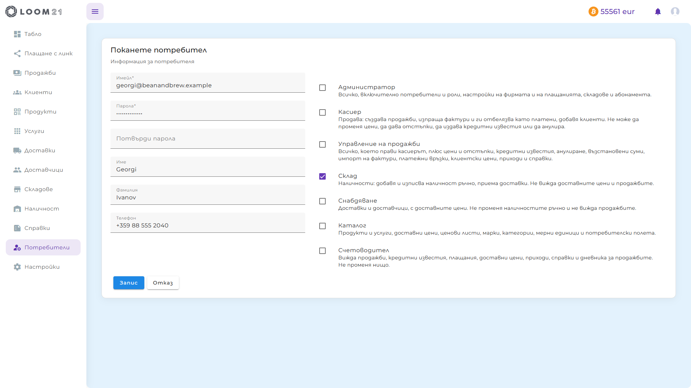

(<a href="#readme-top">обратно в началото</a>)

## Продукти и услуги 

Списъкът с продукти ви позволява да търсите по наименование или код, да филтрирате по Категория, Мярка, Марка и Модел (изборът на марка активира филтъра за модел) и да импортирате или експортирате каталога си като Excel, CSV или JSON (вижте [Импорт и експорт](#import-templates)). Таблицата показва основната снимка, наименованието, кода, съкращението, мярката, категорията, баркода, цената на доставка, продажната цена и датата на създаване на всеки продукт.

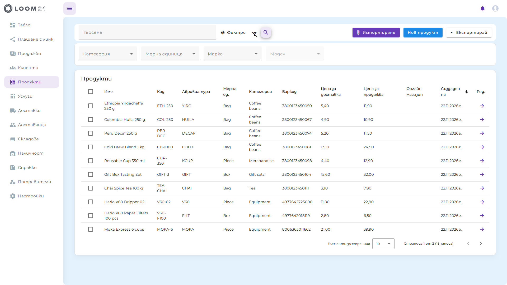

Натиснете **Нов продукт**, за да създадете такъв, или натиснете иконата стрелка на всеки ред, за да го отворите. Налични полета:

- **Наименование** (задължително), **Съкращение**, **Код**, **Бележка**
- **Категория**, **Мярка**
- **Марка и модел** — присвоете към марка и модел (конфигурирани в [Марки и модели](#brands)); изборът на марка активира падащото меню за модел.
- **Цена на доставка** — себестойността, използвана при получаване на наличности чрез поръчки за доставка.
- **Продажна цена** — цената за продажба по подразбиране (може да бъде заместена от [Ценови листи](#price-lists)).
- **Биткойн цени** — ако биткойн е активиран, се появяват отделни полета за биткойн цена с бутони стрелки за конвертиране между фиат и биткойн по текущия обменен курс.
- **Баркод и QR код** — въведете или сканирайте баркод; QR кодът се генерира автоматично.

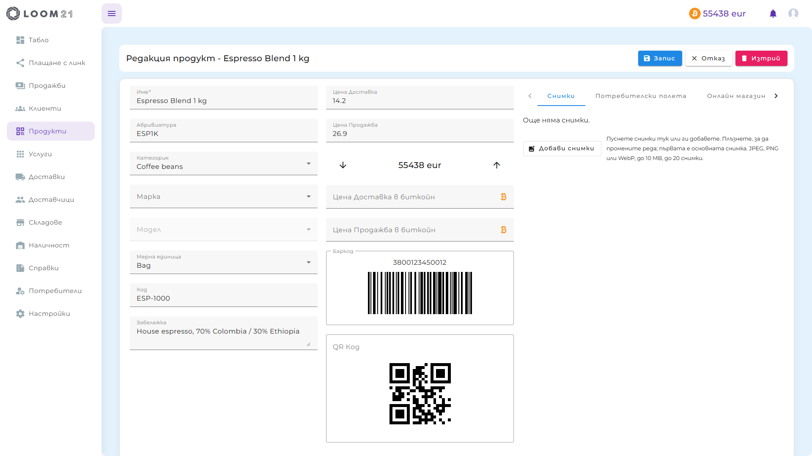

#### Раздел Снимки

Всеки продукт може да има до **20 снимки**. Отворете продукта и натиснете раздела **Снимки**:
- Натиснете **Добави снимки** или пуснете снимки върху раздела, за да добавите няколко наведнъж (JPEG, PNG или WebP, до 10 MB всяка).
- Избраната снимка се показва голяма над останалите; натиснете малка снимка, за да я видите голяма. Натиснете голямата снимка (или **Виж в цял размер**), за да я отворите на цял екран, където стрелките или клавишите ←/→ сменят снимките, а Esc затваря.
- **Плъзнете** снимка, за да промените реда, или натиснете **Направи основна** под голямата снимка. Първата е **основната снимка**: показва се в списъка с продукти и до продукта в продажба.
- За да изтриете снимка, натиснете бутона за изтриване и после още веднъж, за да потвърдите.

Снимките се преоразмеряват за екрана и се завъртат правилно, а данните от камерата (включително мястото, където е направена снимка с телефон) се премахват. Без право да редактирате продукти виждате снимките, но не можете да ги променяте.

#### Раздел Онлайн магазин

Поставя продукта във вашите [онлайн магазини](#storefronts) (след като имате такъв):
- **Публикувай в онлайн магазина** / **Махни от онлайн магазина** — купувачите могат да виждат и поръчват публикуван продукт в онлайн магазините ви, по ценовата листа на онлайн магазина. Непубликуваните продукти никога не излизат от loom21.
- **Адрес (slug)** — адресът на продукта в онлайн магазина ви и името, което използва бутонът „Купи“. Малки латински букви, цифри и тирета; ако го оставите празно, се създава от наименованието.
- **Публично описание** — показва се на купувачите на страницата на продукта в онлайн магазина ви. Обикновен текст или прост Markdown. **Бележката** остава вътрешна.
- **Запази настройките за онлайн магазина** запазва този раздел; бутонът **Запази** на самия продукт не го прави.
- **Бутон „Купи“ за вашия сайт** — отваря диалога за [бутона „Купи“](#buy-button) за този продукт.

За да публикувате много наведнъж, отметнете ги в списъка с продукти и натиснете **Публикувай в онлайн магазина** или **Махни от онлайн магазина** в лентата, която се появява. Публикуваните продукти имат икона в колоната **Онлайн магазин** на списъка.

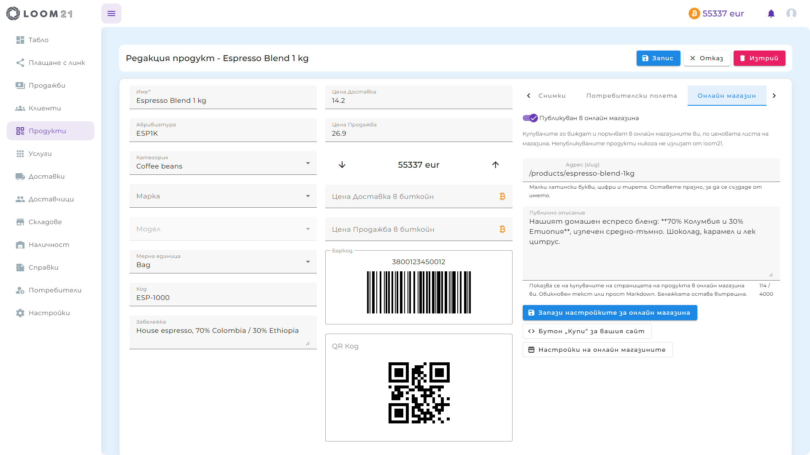

#### Раздел Потребителски полета

Ако сте дефинирали потребителски полета в [Настройки → Потребителски полета](#custom-fields), страницата за редактиране на всеки продукт ще включва раздел **Потребителски полета**. Тук можете да попълвате стойностите на тези допълнителни полета — като дата на гаранция, референция на доставчик или друга информация, специфична за вашия бизнес.

1. Отворете продукт, като натиснете лилавата стрелка в списъка с продукти.
2. Натиснете раздела **Потребителски полета**.
3. Попълнете стойностите за всяко показано поле.
4. Натиснете **Запази**, за да съхраните стойностите на потребителските полета за продукта.

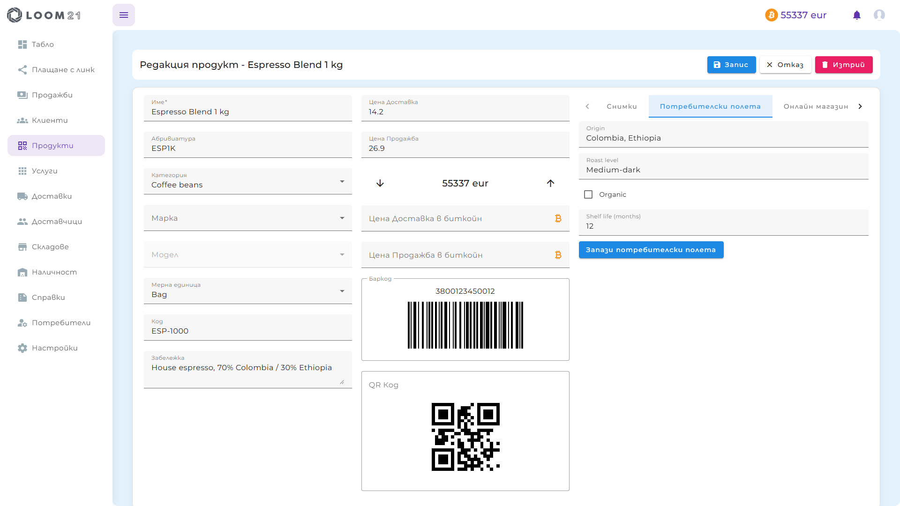

#### Раздел Ценообразуване

Всеки продукт разполага и с раздел **Ценообразуване**, в който можете да преглеждате и управлявате как конкретният продукт е ценообразуван в рамките на всички ваши ценови листи, както и клиентски специфични замествания.

**Нива в ценова листа** — За всяка ценова листа, която сте създали, можете да видите вече зададените ценови нива за този продукт. Тук можете да изтриете ниво; за добавяне или редактиране на нива отидете на **Настройки → Настройки на продукти → Ценови листи**.

**Клиентски ценови замествания** — Можете да зададете специална цена за конкретен клиент за този продукт. Натиснете **Добави индивидуална цена**, за да:
- Търсите и изберете клиент.
- Въведете цената за заместване (и по желание минимално количество, формула или период на валидност).
- Натиснете **Запази**.

**Тест на ценовото разрешаване** — Въведете количество и по желание изберете клиент, след което натиснете **Разреши цена**, за да видите точно каква цена ще изчисли системата за тази комбинация. Резултатът показва крайната цена и дали е дошла от клиентско заместване, ниво в ценова листа или базовата цена на продукта.

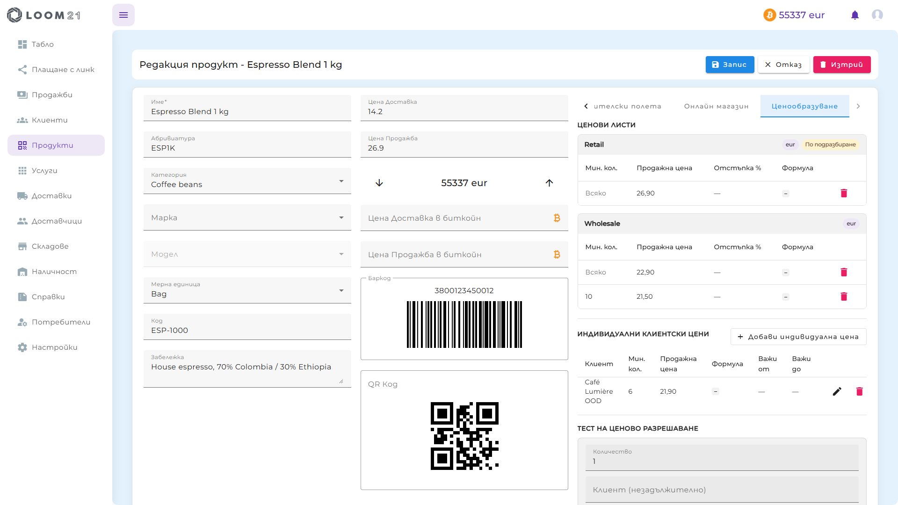

#### Управление на услуги

Услугите се управляват от специална страница **Услуги** в страничното меню. Списъкът поддържа същите възможности за търсене, филтриране (Категория, Мярка), импорт и експорт (Excel, CSV или JSON) като списъка с продукти.

**Полета на услугата:**
- **Наименование** (задължително), **Съкращение**, **Код**, **Бележка**
- **Категория**, **Мярка**
- **Цена на доставка**, **Продажна цена** (и биткойн еквиваленти, ако биткойн е активиран)
- **QR код** — генерира се автоматично от полето за код.
- **Снимки** — след като услугата е запазена, до 20 снимки, както в [раздел Снимки](#products-services) на продукт: добавяне, плъзгане за промяна на реда или **Направи основна**, и преглед в цял размер. Основната снимка се показва в списъка с услуги и в продажбите.
- **Онлайн магазин** — публикувайте услугата в онлайн магазините си, както в [раздел Онлайн магазин](#products-services) на продукт. Списъкът с услуги има същата лента **Публикувай в онлайн магазина** / **Махни от онлайн магазина** и колона **Онлайн магазин**.

Услугите се различават от продуктите по два ключови начина:
- Те **не се проследяват в инвентара** — продажбата на услуга никога не намалява наличностите.
- Те нямат **Марка**, **Модел**, **Баркод**, **раздел Потребителски полета** или **раздел Ценообразуване**.

(<a href="#readme-top">обратно в началото</a>)

## Инвентар 

Страницата Инвентар показва текущите нива на наличностите за всички ваши продукти във всички магазини. Наличностите се актуализират автоматично при записване на продажби (намаляват) и поръчки за доставка (увеличават).

**Филтриране на инвентара:**
Натиснете **Филтри**, за да разгънете панела с филтри и да стесните списъка по:
- **Търсене** — намерете продукт по наименование.
- **Магазин** — показвайте нивата на наличности за конкретно местоположение.
- **Категория, Мярка, Марка, Модел** — допълнително стесняване до конкретни групи продукти.

Таблицата показва текущото количество, мерната единица, категорията, марката и модела на всеки продукт.

**Ръчни корекции на наличности:**
Натиснете иконата за редактиране на всеки ред с продукт, за да отворите диалога за корекция:
- **Добави** — въведете количество и изберете магазин, за да увеличите наличностите (напр. след физическа инвентаризация).
- **Премахни** — въведете количество и изберете магазин, за да намалите наличностите.

Това е полезно при коригиране на несъответствия, открити по време на инвентаризация, или при записване на повредена или върната стока.

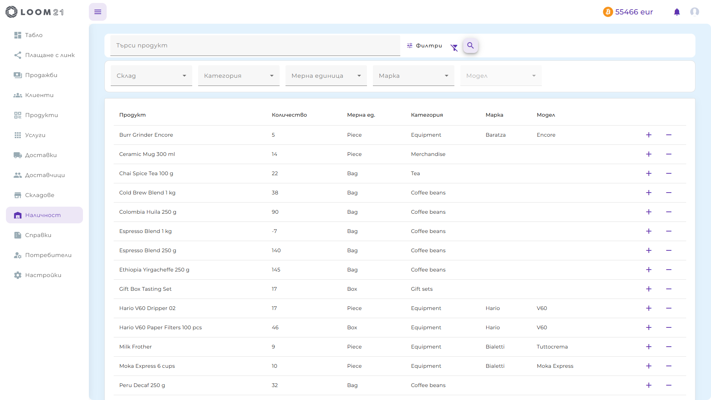

(<a href="#readme-top">обратно в началото</a>)

## Магазини / Складове 

Магазините представляват вашите физически обекти или складове. Инвентарът се проследява по магазин и всяка поръчка за продажба или доставка е свързана с конкретен магазин.

**Списък с магазини** — магазините се показват като карти, всяка от които показва снимката, наименованието, съкращението, адреса и телефонния номер на магазина. Магазин без снимка показва икона на магазин.

**Добавяне или редактиране на магазин:**

1. Натиснете **Добави магазин** (или бутона за редактиране на съществуваща карта с магазин).
2. Попълнете:
   - **Наименование** (задължително) — пълното наименование на магазина или обекта.
   - **Бележка** — вътрешни бележки.
   - **Адрес** — улица и телефонен номер за това местоположение.
3. Натиснете **Запази**.

**Снимка:** след като магазинът е запазен, отворете го и натиснете **Качи снимка** (JPEG, PNG или WebP, до 10 MB). Запазва се веднага и се показва на картата на магазина. Натиснете снимката, за да я видите на цял екран; **Смени снимката** и **Премахни** я променят по-късно.

За да изтриете магазин, отворете го и натиснете бутона **Изтрий**.

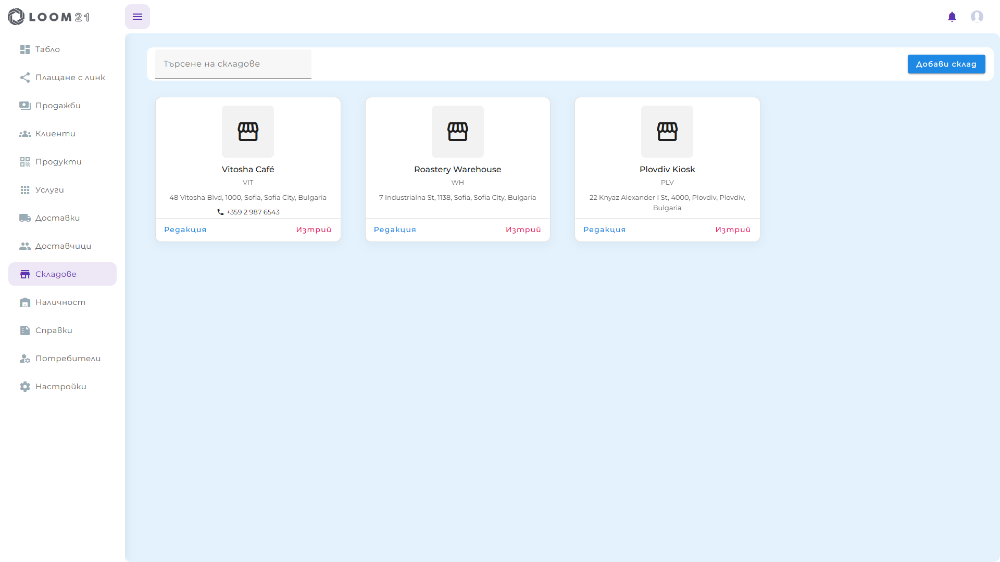

(<a href="#readme-top">обратно в началото</a>)

## Поръчки за доставка 

Поръчките за доставка записват входящи наличности от доставчици. Всяка потвърдена доставка автоматично увеличава инвентара на получените продукти в избрания магазин.

- **Създайте** нова поръчка за доставка с бутона **Нова**.
- **Търсете** съществуващи поръчки и ги отваряйте с иконата на лилавата стрелка.

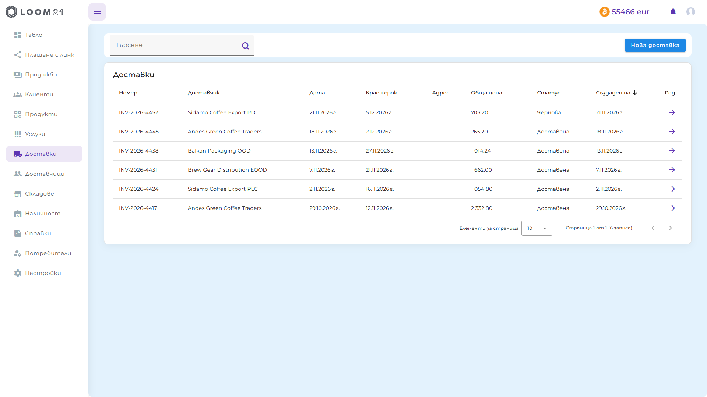

#### Детайли на поръчката за доставка

**Полета на заглавката на поръчката** (ляв панел):
- **Номер на поръчката** — автоматично генерирана референция, редактируема.
- **Дата на поръчката / Дата на падеж** — кога е създадена поръчката и кога се очаква.
- **Доставчик** — търсете и изберете доставчика за тази доставка.
- **Магазин** — целевият магазин, в който ще бъдат добавени получените наличности.
- **Включи данък** — превключете дали данъкът е включен в цените на артикулите.
- **Статус** — проследявайте доставката от Чернова до Доставена.
- **Бележка** — вътрешни забележки.

**Добавяне на артикули:**
- Търсете продукти по наименование и ги добавяйте по един, или използвайте **Избери артикули** за множествен избор.
- Въведете количеството и единичната цена за всеки получен артикул.
- Междинната сума, ДДС и общата сума се изчисляват автоматично.

**Документи** — използвайте бутона **Изтегли**, за да генерирате и изтеглите PDF:
- Фактура за доставка, касова бележка или списък за вземане.

**Адрес** — адресът за доставка на доставчика се попълва автоматично при избор на доставчик. При необходимост можете да го редактирате за конкретна поръчка.

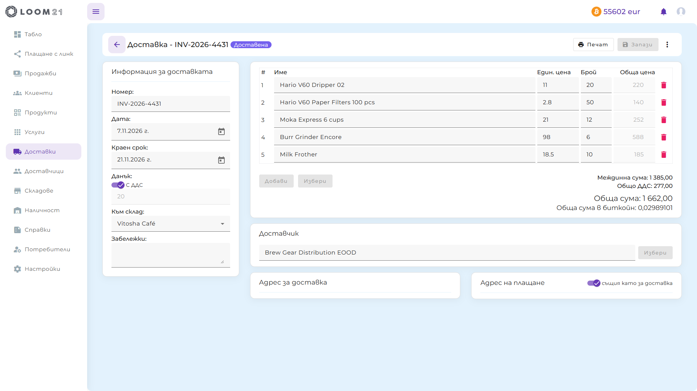

(<a href="#readme-top">обратно в началото</a>)

## Клиенти и доставчици 

Тази страница ви позволява лесно да управлявате базата данни от клиенти. Основните функции включват:
- Търсене на клиенти по наименование с лентата за търсене.
- Импортиране и експортиране на клиенти: добавяне или промяна на много клиенти наведнъж от Excel или CSV файл (вижте [Импорт и експорт](#import-templates)).
- Добавяне на нови клиенти с синия бутон или редактиране на съществуващи, като натиснете лилавата стрелка.

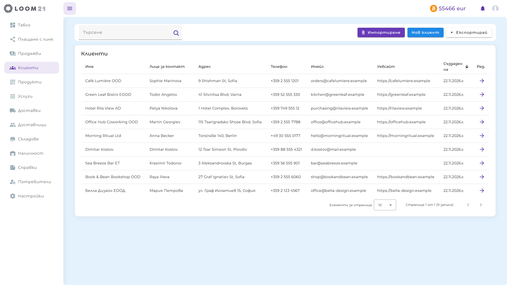

На тази страница можете да управлявате и актуализирате подробна информация за всеки клиент.

#### Детайли на клиента
- **Наименование** — пълното фирмено или лично наименование на клиента.
- **Контактно лице** — конкретното лице, с което да се кореспондира в тази компания.
- **ЕИК** — ЕИК на клиента, отпечатван на фактурите и кредитните известия.
- **Данъчен номер** — ДДС или данъчният регистрационен номер на клиента, отпечатван на фактурите.
- **Бележка** — вътрешни бележки за клиента.
- **Телефон, имейл, уебсайт** — данни за контакт.
- **Ценова листа** — по желание присвоете една от вашите [Ценови листи](#price-lists) на клиента. При задаване, всички нови поръчки за продажба на този клиент автоматично използват тази ценова листа вместо стандартната.
- **Множество адреси** — добавяйте и управлявайте множество адреси за доставка или фактуриране за клиента.

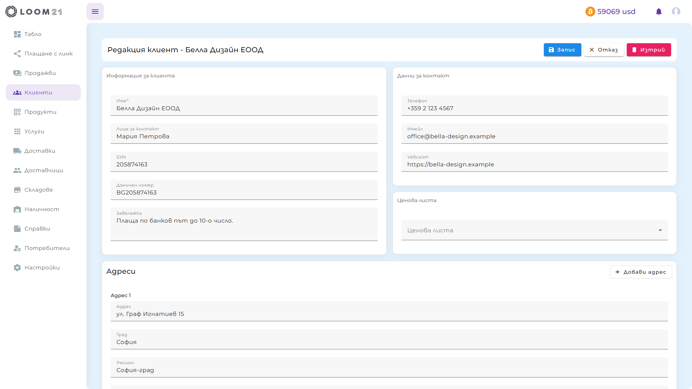

#### Управление на доставчици

Доставчиците се управляват в специален раздел **Доставчици**, достъпен от страничното меню. Списъчният изглед ви позволява да търсите, импортирате, експортирате (Excel, CSV или JSON) и да разглеждате записите за доставчици постранично. Вижте [Импорт и експорт](#import-templates).

**Детайли на доставчика** (при създаване или редактиране):
- **Наименование** (задължително), **Контактно лице**, **ЕИК**, **Данъчен номер**, **Бележка**
- **Телефон**, **Имейл**, **Уебсайт**
- **Множество адреси** — добавете толкова адреси за доставка, колкото е необходимо.

Ключовото разграничение от клиентите е в употребата им:
- **Доставчиците** се избират при създаване на **Поръчки за доставка** (входящи наличности).
- **Клиентите** се избират при създаване на **Поръчки за продажба** (изходящи продажби).

За разлика от записите за клиенти, доставчиците нямат присвояване на ценова листа.

(<a href="#readme-top">обратно в началото</a>)

## Потребителски профил

Натиснете вашето наименование или иконата за профил в горната лента за навигация, за да получите достъп до **Потребителски профил**. Тук можете да актуализирате личната си информация независимо от настройките за цялата организация.

**Информация за профила:**
- Собствено и фамилно име
- Имейл адрес
- Телефонен номер
- Фирмено наименование
- Уебсайт

Натиснете **Запази**, за да приложите промените.

**Промяна на паролата** — отделна форма в долната част на страницата:
1. Въведете вашата **Текуща парола**.
2. Въведете **Нова парола** (минимум 8 знака).
3. Потвърдете новата парола.
4. Натиснете **Промени**.

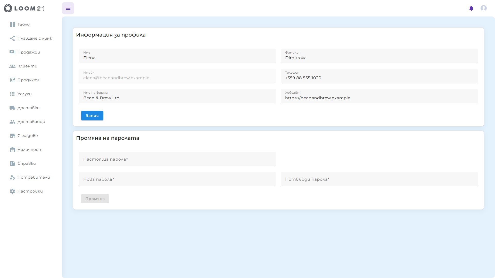

(<a href="#readme-top">обратно в началото</a>)

<!-- CONTACT -->
## Контакт

- X: [@loom21app](https://x.com/loom21app)
- Telegram общност: [t.me/+kcFe6QiEau0yNTVk](https://t.me/+kcFe6QiEau0yNTVk)
- Форма за контакт: [loom21.com/bg/contact](https://loom21.com/bg/contact)

Връзка към проекта: [https://github.com/loom21/loom21doc](https://github.com/loom21/loom21doc)

(<a href="#readme-top">обратно в началото</a>)

