

<h3 align="center">Loom21 Docs</h3>

  

    Track and manage your inventory, invoices, customers, vendors, payments and more.
     
    <a href="https://github.com/loom21/loom21doc" target="_blank"><strong>Explore the docs »</strong></a>
     
     
    <a href="https://github.com/loom21/loom21doc/issues" target="_blank">Report Bug</a>
    ·
    <a href="https://github.com/loom21/loom21doc/issues" target="_blank">Request Feature</a>
  

<!-- TABLE OF CONTENTS -->

  
Table of Contents

  <ol>
    <li>
      <a href="#getting-started">Getting Started</a>
      <ul>
        <li><a href="#create-account">Create Account</a></li>
        <li><a href="#sign-in">Sign In</a></li>
      </ul>
    </li>
    <li><a href="#dashboard">Dashboard</a></li>
    <li><a href="#notifications">Notifications</a></li>
    <li><a href="#payment-links">Payment Links</a></li>
    <li>
      <a href="#storefronts">Storefronts and the Buy Button</a>
      <ul>
        <li><a href="#storefront-setup">Setting Up a Storefront</a></li>
        <li><a href="#storefront-publish">Publishing Products</a></li>
        <li><a href="#buy-button">The Buy Button</a></li>
        <li><a href="#storefront-orders">Storefront Orders</a></li>
      </ul>
    </li>
    <li>
      <a href="#sales">Sales</a>
      <ul>
        <li><a href="#add-edit-sales">Add/Edit Sales</a></li>
        <li><a href="#payments">Payments</a></li>
        <li><a href="#invoice-numbers">Invoice Numbers and PDFs</a></li>
        <li><a href="#credit-notes">Credit Notes</a></li>
        <li><a href="#annul-invoice">Annulling an Invoice</a></li>
        <li><a href="#overpayments">Overpayments and Refunds</a></li>
        <li><a href="#import-invoices">Moving From Another Program (Import Invoices)</a></li>
        <li><a href="#country-rules">Invoicing Rules and Your Country</a></li>
      </ul>
    </li>
    <li>
      <a href="#reports">Reports</a>
      <ul>
        <li><a href="#sales-report">Sales Report</a></li>
        <li><a href="#deliveries-report">Deliveries Report</a></li>
        <li><a href="#vat-ledger">VAT Sales Ledger</a></li>
      </ul>
    </li>
    <li>
      <a href="#settings">Settings</a>
      <ul>
        <li><a href="#general-settings">General Settings</a></li>
        <li><a href="#subscription">Subscription</a></li>
        <li><a href="#stripe">Stripe</a></li>
        <li><a href="#btcpay-server">BTCPay Server</a></li>
        <li><a href="#lightning-wallet">Lightning address</a></li>
        <li><a href="#speed-wallet">Speed Wallet</a></li>
        <li><a href="#lnbits">LNBits</a></li>
        <li><a href="#product-settings">Product Settings</a></li>
        <li><a href="#product-categories">Product Categories</a></li>
        <li><a href="#measures">Measures</a></li>
        <li><a href="#brands">Brands &amp; Models</a></li>
        <li><a href="#custom-fields">Custom Fields</a></li>
        <li><a href="#price-lists">Price Lists</a></li>
        <li><a href="#import-templates">Import and Export (Excel and CSV)</a></li>
      </ul>
    </li>
    <li><a href="#accounts">Accounts</a></li>
    <li><a href="#products-services">Products and Services</a></li>
    <li><a href="#inventory">Inventory</a></li>
    <li><a href="#stores">Stores</a></li>
    <li><a href="#deliveries">Delivery Orders</a></li>
    <li><a href="#customers-suppliers">Customers and Suppliers</a></li>
    <li><a href="#user-profile">User Profile</a></li>
  </ol>

<!-- GETTING STARTED -->
## Getting Started

In order to start using the loom21 app you need to create an account. Here is the recommended setup flow:

1. **Create an account** and confirm your email.
2. Configure **[General Settings](#general-settings)** — set your language, currency, VAT, and address.
3. Configure at least one **[payment processor](#settings)** (Stripe, BTCPay Server, etc.) so it appears at checkout.
4. Add your **[Products and Services](#products-services)**.
5. Create your first **[Sale](#sales)**.
6. To sell on your own website, set up a **[Storefront](#storefronts)** and add a **[Buy button](#buy-button)**.

### Create Account
After you sign up you will receive a confirmation email to confirm your account and then you can sign in.

**Wrong password:** after 5 wrong passwords in a row, the login is locked for 15 minutes, even with the right password. Wait, or use **Forgot password** to set a new one. For your safety, the sign-in page doesn't say whether an email has an account.

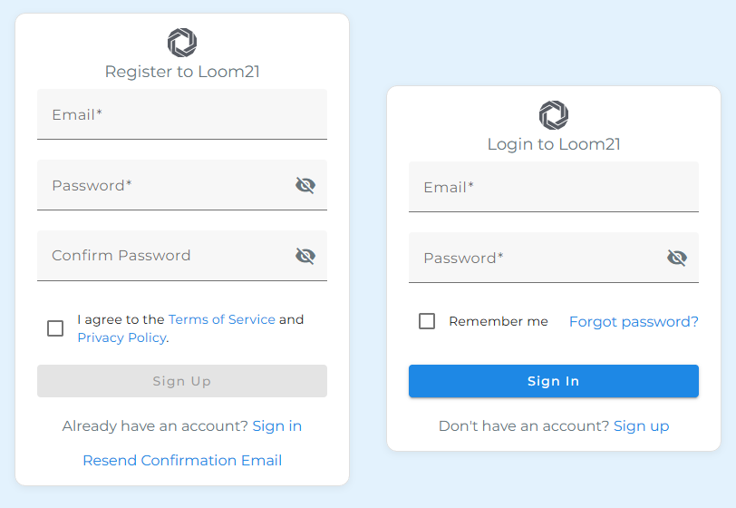

(<a href="#readme-top">back to top</a>)

<!-- DASHBOARD -->
## Dashboard

The Dashboard is the first page you see after signing in. It gives you an at-a-glance overview of your business performance for the selected time period.

**Key features:**

- **Period selector** — Choose from the last 30 days or any of the previous 6 calendar months to compare your performance over time.
- **KPI cards** — At the top you will find summary cards showing:
  - Total fiat revenue (card and bank payments)
  - Total Bitcoin revenue (in satoshis)
  - Number of paid invoices, broken down by payment method (Bitcoin vs. fiat)
  - Delivery orders completed and those still pending confirmation
  - Paid payment links, broken down by payment method
  - Trend indicators (up/down arrows) so you can quickly see whether your numbers are improving.
- **How revenue is counted** — revenue is the money actually received, on the day it was paid, not on the day of the sale. A sale from May paid in October counts as October revenue; it is still counted as a May sale in the invoice counts. Credit notes and recorded refunds are taken off, so the figure is net. An invoice that was never paid adds nothing.
- **Sales chart** — A bar chart showing daily sales volume for the selected period.
- **Payment Links chart** — A bar chart showing daily payment link activity.
- **Deliveries chart** — A bar chart showing daily delivery order activity.
- **Activity feed** — A chronological list of recent events across sales, deliveries, and payment links.
- **Light / Dark mode toggle** — Switch between light and dark themes using the icon button in the top-right corner of the Dashboard toolbar. Your preference is applied immediately across the whole application.

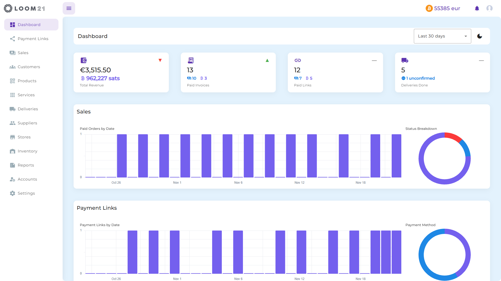

(<a href="#readme-top">back to top</a>)

<!-- PAYMENT LINKS -->
## Notifications

The **bell** at the top of every page shows how many notifications you haven't read yet. Click it to see the latest ones; click one to open what it is about (the sale, the payment link, Settings → Subscription …) and mark it read. **See all notifications** opens the full list, with **Unread only** and **Mark all as read**.

A notification that needs you to do something also shows as a **banner** at the top of every page until it's done (the refund is recorded, the company ID is saved) or you close it. The bell updates by itself, without reloading the page.

**What you're told, and who sees it:**
- **A payment arrived** on an invoice or a payment link ("Invoice 0000000123 was paid: €120.00 by card"): the users who see sales or payment links. Only in the app, no email. A payment you record yourself with **Set as Paid** isn't announced.
- **An invoice was paid more than it owed**, or a canceled invoice was paid: the users who record refunds, with a banner until the refund is recorded on the sale.
- **Orders this month at 80% and 100% of your plan's limit**, the grace period, a request to upgrade, and payment links and new orders running again: Administrators. **Payment links and new orders paused** goes to everyone, in the bell; the sale screen also says so when you start a new sale (see [Plan limits](#plan-limits)).
- **A plan given to you by loom21**, 14 days before it ends, and when it has ended: Administrators.
- **Your invoices are missing your company ID (EIK)**: Administrators, with a banner until it is saved in [General settings](#general-settings).
- **Changes to the Terms of Service**: Administrators.

The important ones (limits, overpayments, a plan ending) also come by email. Each user has their own read state: what you read stays unread for the others.

(<a href="#readme-top">back to top</a>)

## Payment Links 

A payment link is a unique URL you can share with customers to accept payments for a product, service, or donation — no login required on the buyer's side. Once created, you can copy the link, send it by email or message, or embed it anywhere.

**How to create a payment link:**

1. Navigate to **Payment Links** from the sidebar and click **New**.
2. Fill in the details:
   - **Name** — what the buyer will see (e.g. "Workshop Ticket").
   - **Currency** — the currency for this link.
   - **Amount** — the fixed price, or toggle **Variable Amount** to let the buyer enter their own amount within a min/max range you define.
   - **VAT** — enable and set a VAT percentage if applicable.
   - **VAT ledger category** — when the link has no VAT: what it sells (the same choices as on a sale), which decides its column in the [VAT Sales Ledger](#vat-ledger). Required when **Enable VAT** is on in [General settings](#general-settings).
   - **Description** — optional details shown to the buyer.
   - **Picture** — shown on the payment page. Once the link is saved, click **Upload picture** (JPEG, PNG or WebP, up to 10 MB), or paste the address of a picture that's online. **Replace picture** and **Remove** change it later.
   - **Short Code** — a memorable short identifier for the link (optional).
   - **Expiration Date** — automatically deactivate the link after a specific date.
   - **Stock Count** — limit the total number of purchases through this link.
   - **Max Per Order** — limit how many units a single buyer can purchase at once.
3. Select the **payment methods** to offer (only enabled processors appear here).
4. Add **promo codes** if you want to offer discounts — each code has a name, a discount value, and a type (percentage or fixed amount).
5. Click **Save**.

**After saving**, the link URL is shown at the top of the page. Use the **Copy** button to copy it to your clipboard, or **Preview** to open it as a buyer would see it.

**Pausing a link** — click the status toggle to pause a published link (buyers will no longer be able to pay) or re-publish it. You will be asked to confirm the change.

**What the buyer sees:** your company name ("Sold by …"), the order summary, the quantity (for a fixed price, up to Max Per Order and the stock left), a **Have a promo code?** link, the tax and the total, and their email. **Continue** then shows one button per way of paying (see [The customer's payment page](#pay-page)). Once paid, the page confirms it and offers **Make another payment**. A paused, expired or sold-out link says so and asks the buyer to contact you.

#### Supported Payment Processors

| Processor | Payment Type |
|-----------|-------------|
| Stripe | Credit / Debit Card |
| BTCPay Server | Bitcoin Lightning & On-chain |
| Lightning address (any wallet) | Bitcoin Lightning |
| Speed Wallet | Bitcoin Lightning & On-chain |
| LNBits | Bitcoin Lightning |

> :bell: More payment processors are coming soon.

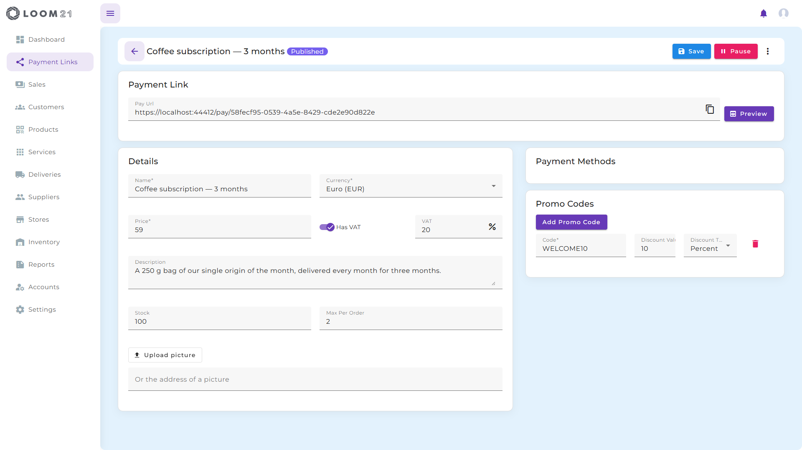

(<a href="#readme-top">back to top</a>)

## Storefronts and the Buy Button 

A **storefront** lets your own website sell your products through loom21. You publish the products you want to sell, and the website shows them and takes orders and payments. Prices, stock and payments stay in loom21: every order is a normal sale, numbered when it is paid, and its stock comes off the storefront's store.

The easiest way to use one is the **[Buy button](#buy-button)**: one line of HTML you paste into any website (WordPress, Webflow, Squarespace, plain HTML), with no developer needed. A developer can also use the storefront's key to build a whole shop on the loom21 Storefront API.

How many storefronts you can have depends on your plan: 1 on Free and Starter, 3 on Growth, 10 on Pro. Only Administrators manage storefronts.

### Setting Up a Storefront 

1. Make sure at least one payment provider is set up (see [Settings](#settings)), so buyers can pay.
2. Go to **Settings → Storefronts** and click **New storefront**. At your plan's limit the button is **Upgrade for more storefronts** instead.
3. Fill in the tabs (below) and click **Save**. The storefront gets its **publishable key** when it is first saved.
4. [Publish the products](#storefront-publish) you want to sell.
5. On the **Developer** tab, add your website under **Allowed websites**, then click **Generate a Buy button**.

The Storefronts page shows each storefront as a card: on or off, its store, payment and shipping methods, allowed websites and key. Click **Open** to change it.

**General**
- **Name** — shown to buyers by your website.
- **Support email** — where buyers write with questions. Empty: your company email.
- **Buyer email language** — the language of the receipt email buyers get after paying.
- **Enabled** — turned off, the key stops working and websites can't load products or take orders (the Buy button shows "Currently unavailable").
- Storefronts show your account's logo from [General settings](#general-settings).

**Catalog & stock**
- **Store** — its stock is what buyers can order, and orders take stock from it.
- **Price list** — sets the prices and the currency, quantity tiers included. See [Price Lists](#price-lists).
- **Stock display** — what buyers see: **In stock / Low stock / Out of stock** (never how many), **Exact quantity**, or **Hidden**. **Low-stock threshold** sets when "Low stock" shows.
- **Max quantity per line** — the most a buyer can order of one product (1 to 1000).
- **Reservation time** — how long a checkout holds the stock while the buyer pays (5 to 60 minutes). Stock held for an unpaid checkout can't be sold to anyone else; it is released when the time runs out or the buyer cancels.
- **Max units held at once** — across all unpaid checkouts, so nobody can hold your whole stock.

**Payments & shipping**
- **Payment methods** — buyers are offered the ticked ones, in this order (use the arrows to change it). Only the providers enabled in your payment settings are listed.
- **Shipping methods** — each with a **Name**, a flat **Price** before VAT and **Needs an address**. The chosen one is added to the invoice as a line. When you have shipping methods, buyers of goods must choose one; leave the list empty if you don't ship.

**Look & SEO** and **Pages** are for a full online store built on the storefront (the search-engine title and description, accent colour, social links, footer text, and pages such as terms, privacy and returns). The Buy button doesn't use them. The starter page texts are a starting point, not legal advice: have them checked before you rely on them.

**Developer**
- **Publishable key** — safe to put in your website's code: it can only read published products, price a cart and check out. **Roll key** makes a new one (the old one keeps working for a short while, so you can update your website); **Revoke** stops it at once.
- **Allowed websites** — the `https://` addresses of the sites where you'll use the storefront, e.g. `https://shop.example.com`. The address must match exactly, including `www.` if your site uses it. Saved with **Save**.
- **Buy button** — **Generate a Buy button** opens the [Buy button](#buy-button) dialog.
- **Server secret** and **Try it** — for developers building a shop on the Storefront API.

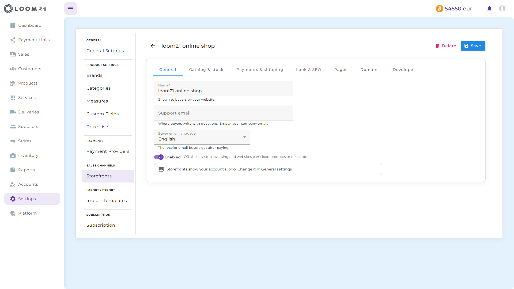

(<a href="#readme-top">back to top</a>)

### Publishing Products 

Only published products and services can be seen and ordered on your storefronts. Publish one on its **Storefront** tab (see [Products and Services](#products-services)), or tick several in the Products or Services list and click **Publish to storefront**. Custom fields show on a storefront only when **Show on storefront** is on (see [Custom Fields](#custom-fields)).

(<a href="#readme-top">back to top</a>)

### The Buy Button 

The Buy button sells one product on any website. Your buyer clicks it, enters their email, name and quantity (and a delivery method and address when you ship), and pays without leaving your page: with **Lightning** by QR code, with **on-chain Bitcoin** by QR code and address, or by **card** on loom21's payment page in a new tab. Once paid, the button shows the order number, the buyer gets a receipt email, and the order is in loom21.

**Making one:**
1. Open the dialog: **Buy button for your website** on a published product's Storefront tab, or **Generate a Buy button** on a storefront's Developer tab (then pick the product).
2. Choose the **Storefront**, the **Button text**, the **Language** (the page's own, English or Български), the **Theme** (Auto, Light or Dark), the **Colour**, **Show the price** and **Let buyers choose a quantity**.
3. Check the **preview**: it is the real button with your real price and stock. It doesn't take orders from inside loom21.
4. Copy a snippet and paste it into your website's HTML:
   - **Simple** — always the newest 1.x version, so fixes reach your website by themselves. Recommended.
   - **Pinned** — exactly one version, which the browser checks (Subresource Integrity). It never changes; to get a newer version, copy the snippet again.

The dialog warns you about anything that would stop the button working: the product isn't published (with a **Publish** button), the storefront has no allowed websites or no working key, or it is turned off.

**If the button doesn't appear on your website,** the website is almost always missing from **Allowed websites** on the storefront's Developer tab. The browser's console says exactly which address to add. "Powered by Loom21" shows under the checkout on every plan.

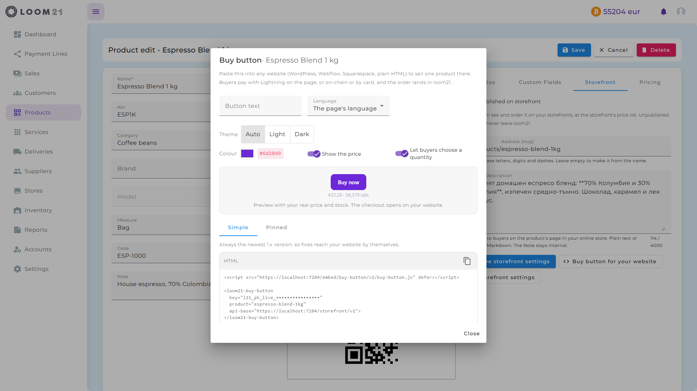

(<a href="#readme-top">back to top</a>)

### Storefront Orders 

- **Before it is paid,** a storefront order belongs to the buyer's checkout: it isn't in your sales list or reports, and you can't change it.
- **When it is paid,** it becomes a normal issued sale: it gets the next invoice number, its stock comes off the storefront's store, and the buyer is matched to a customer by email (or added as a new one). It counts toward your plan's orders like any other sale.
- On the sale screen it has a **Storefront** badge next to its number.
- **Paid after its reservation ran out:** the payment is still accepted, and the sale shows "Paid after the stock reservation expired — check stock for this order", because the stock may have been sold in the meantime.
- If the buyer doesn't pay in time, the checkout ends and its stock is released.

(<a href="#readme-top">back to top</a>)

## Sales

The Sales page lists all your sale orders. You can search by order number, customer name or note (press Enter or the magnifying glass). Create a new order with the **New Order** button, or open an existing order by clicking the purple arrow icon.

Click **Filters** to narrow the list. A filter applies as soon as you change it, and **Clear** resets them all:
- **Customer**, **Date Range** (by the sale's Order Date, the invoice date; both days are included) and **Min/Max Amount**.
- **Payment Status** and **Order Status**.
- **Document**: invoices or credit notes.
- **Annulled**: hide annulled invoices, or show only them.
- **Origin**: documents issued in Loom21, or those imported from your previous program (see [Moving From Another Program](#import-invoices)).
- **Store**, when you have more than one.

Credit notes, annulled invoices and imported documents each have a badge next to their number.

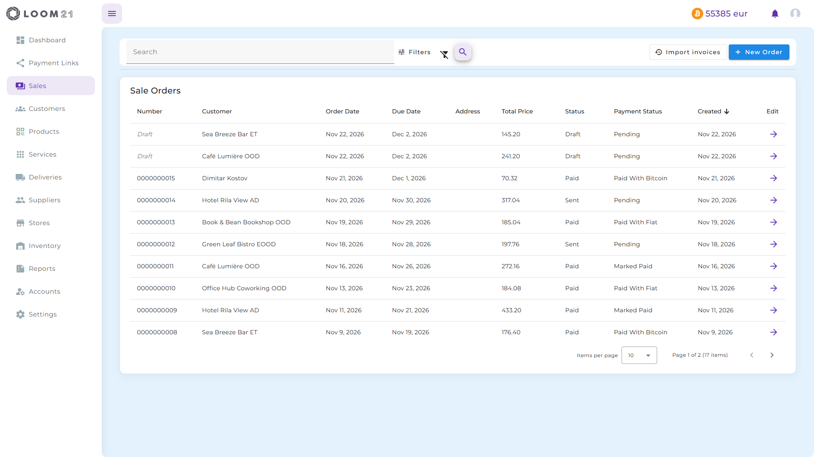

(<a href="#readme-top">back to top</a>)

### Add/Edit Sales 

**Order header fields** (left panel):
- **Serial Number** — given automatically when the sale is first sent or paid, and never changed after that. Drafts have no number yet. See [Invoice Numbers and PDFs](#invoice-numbers).
- **PO Number** — the customer's purchase order reference, if applicable.
- **Order Date / Due Date** — when the order was placed and when payment is expected.
- **Status** — track the order through Draft, Sent, Paid, etc.
- **Store** — select which store the goods are dispatched from (affects inventory levels; not applicable for services).
- **VAT** — enable or disable VAT per order; the percentage is inherited from your General Settings.
- **Legal basis for no VAT** — shown when VAT is off: why no VAT is charged, for example the law that exempts you. It is filled in from your [General Settings](#general-settings) and printed on the invoice. Change it here for a single sale if needed.
- **VAT ledger category** — shown when VAT is off: what kind of sale without VAT this is: an intra-EU supply of goods to a business, distance sales or services to consumers in the EU (OSS), services to a business in the EU, an exempt supply (or one outside the scope of VAT), or an export of goods outside the EU. It decides the sale's column in the [VAT Sales Ledger](#vat-ledger). Once a category is chosen, the **Legal basis for no VAT** is required, and it is filled in with the standard legal text for that category (for example "чл. 28 от ЗДДС" for an export), except for exempt supplies, where it depends on what you sell. Credit notes and copies take the invoice's category.
- **Discount %** — apply an overall percentage discount to the order total.
- **Note** — any internal note or instructions.

**Adding items:**
- Type directly into the product search field to add items one at a time.
- Click **Select Items** to search and tick multiple products or services at once.
- Click **Order History** (available once a customer is selected) to view that customer's previous purchases and re-add items from past orders in one click.

**Automatic price resolution** — when you select a product and a customer, the system automatically looks up the best applicable price from your [Price Lists](#price-lists) and [Customer Price Overrides](#price-lists). The unit price field updates instantly; you can still edit it manually if needed.

**Customer selection** — search and select a customer to automatically populate the shipping and billing address. You can modify the address fields directly on the order if needed.

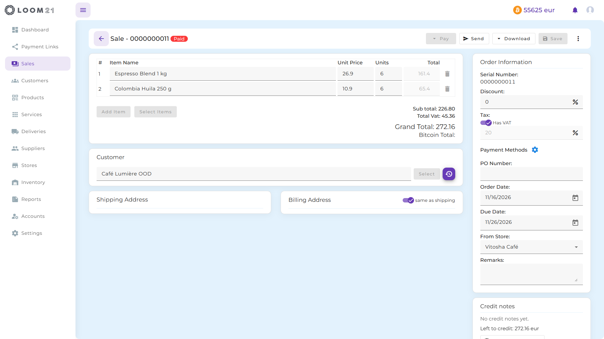

(<a href="#readme-top">back to top</a>)

### Payments 

The toolbar on a saved order gives you quick access to all payment and document actions:

**Pay** — a dropdown button showing every enabled payment processor. Choose one to open the payment dialog:
- **Stripe** — the customer enters card details directly in a secure dialog.
- **Bitcoin processors** (BTCPay Server, Lightning address, Speed Wallet, LNBits) — a QR code and Lightning/on-chain payment address is displayed. Bitcoin payments are confirmed in real time — the order status updates automatically the moment the transaction is settled, without needing to refresh the page. With a Lightning address, this needs one that supports payment verification: see [Lightning address](#lightning-wallet).

**Send** — saves the order and opens a dialog with the payment URL and print URL that you can copy and share with the customer.

**Download** — a dropdown to generate and download PDF documents:
- **Quote** — available before payment.
- **Invoice** — available once the order is marked as paid.
- **Receipt** — available once the order is marked as paid.
- **Pickup List** — available at any time.

**Set as Paid** — manually mark the order as paid (for cash or other offline payments).

**Export JSON** — download the full order data as a JSON file.

**Copy Order** — creates a new draft order pre-filled with the same customer, line items, payment methods, addresses, VAT settings, discount, currency, and notes as the current order. The copy is a draft and opens immediately so you can review and adjust it; it gets its number when it is sent or paid. Use this to quickly repeat a previous order or use an existing order as a starting template.

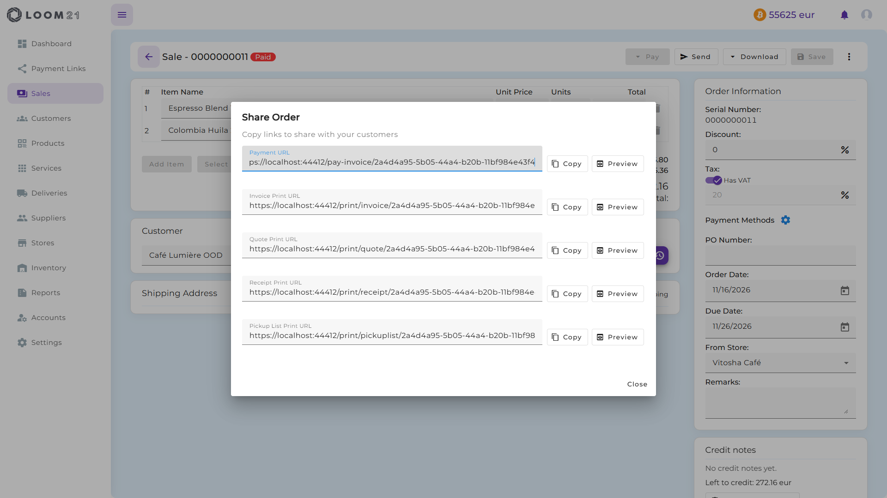

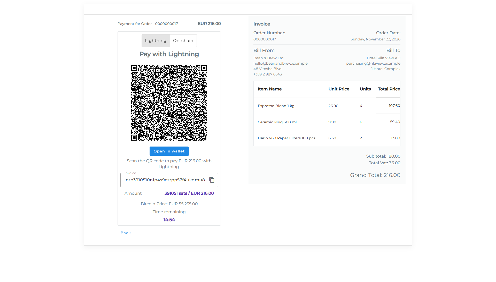

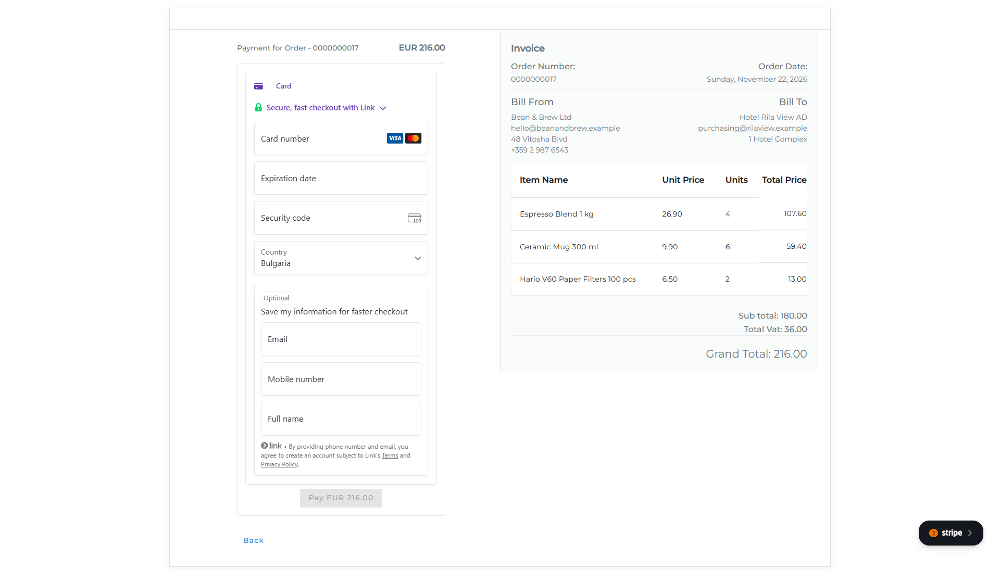

> :bell: All features within the application are protected by authentication, except for the links generated through the Send button.

#### The customer's payment page

The payment URL from **Send** opens a page where your customer sees the invoice and what is due, and pays without an account:
- **One button per way of paying:** **Card** (Stripe), **Bitcoin** (BTCPay Server) and **Lightning**. If you have several Lightning providers enabled (Lightning address, Speed Wallet, LNBits), the customer sees a single **Pay with Lightning** button, which uses the first of them. With only one way of paying, the payment starts at once.
- **Your logo** is at the top (Starter plan and up, from [General settings](#general-settings)). Without one, the Free plan shows the loom21 logo and paid plans show no logo. "Powered by Loom21" at the bottom is on the Free plan only.
- **When it is paid**, the page says so straight away, without a reload, with the invoice number and a **Download Invoice PDF** button.
- If credit notes reduced the invoice, the page says why the amount due is lower. A credit note or a canceled invoice can't be paid.
- If the page can't load (a wrong link, no connection), it says so and offers **Try again**.

(<a href="#readme-top">back to top</a>)

### Invoice Numbers and PDFs 

**Numbers.** A sale gets its number the first time it is sent or paid. Drafts have no number, so a draft you delete leaves no gap. Invoices and credit notes share one continuous 10-digit sequence (0000000001, 0000000002, …). Once given, a number never changes, and you can't type your own. See [Invoicing Rules and Your Country](#country-rules).

**Already issued invoices in another program?** [Import them](#import-invoices): numbering then continues after your last one. If you'd rather not import them, before you issue your first invoice in loom21, set **First invoice number** in [General settings](#general-settings) to the number after your last invoice, so the sequence carries on with no duplicates. For example, if your last invoice was 0000001234, enter 1235. Once the first invoice has a number, the setting is locked.

**Issued sales can't be edited or deleted.** Only drafts can. To correct an issued invoice, issue a [credit note](#credit-notes); if it was issued by mistake and nothing has happened to it yet, [annul it](#annul-invoice).

**PDF language.** Every sale and delivery PDF (invoice, quote, receipt, pickup list, credit note, delivery, delivery list) is in Bulgarian when your language is Bulgarian, and in English otherwise.

**What the invoice and credit note print**, besides the usual details:
- **ORIGINAL**;
- the **tax point** (the date of supply): the order date, or for a credit note the date of the return or change;
- the **Company ID** and **VAT number** of both you and the customer. Enter yours under [General settings](#general-settings) and the customer's on the [customer](#customers-suppliers);
- the **tax base**: the amount VAT is charged on. With a discount it shows the amount, the discount and the tax base;
- when no VAT is charged, the **legal basis** for it.

In Bulgarian, these print with the wording Bulgarian VAT law uses.

**Other currencies.** An invoice or credit note in a currency other than EUR also prints the exchange rate, for example "Exchange Rate: 1 USD = 0.9234 EUR (ECB/BNB rate as of 02.10.2026)". It is the European Central Bank's reference rate for the tax point, or for the last working day before it if that was a weekend or holiday. The ECB publishes the day's rate in the afternoon, so an invoice issued before 17:15 Bulgarian time uses the previous working day's rate, and keeps it. A credit note uses its invoice's rate. A currency the ECB doesn't publish a rate for, such as BTC, prints no rate.

Below the rate, as required for tax purposes, the PDF shows the **EUR equivalent**: the tax base, the VAT and the total in EUR.

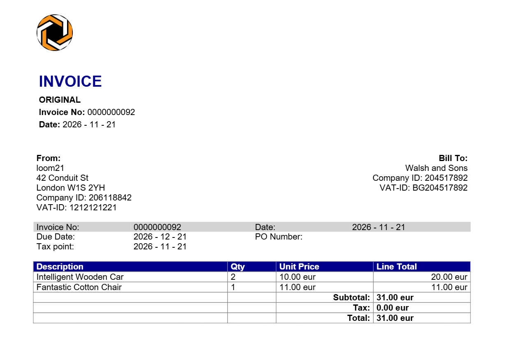

(<a href="#readme-top">back to top</a>)

### Credit Notes 

A credit note corrects an invoice that has already been issued: goods came back, or the customer gets a discount afterwards.

**To create one:** open the invoice, open the **⋮** menu and choose **Create credit note**. Choose **What to credit**:
- **Lines** — enter how much of each line to credit (**Credit everything left** fills them all in). For each line choose whether it goes back to stock, and into which store. Services never go back to stock.
- **An amount** — a discount after the invoice. Enter what the customer gets back, VAT included; the VAT is split out at the invoice's rate. Nothing goes back into stock.

Then fill in:
- **Reason** (required) — printed on the credit note, e.g. "Goods returned".
- **Date of return or change** — when the goods came back or the price changed. If that was more than 5 days ago you get a warning, but you can still issue the credit note (see [Invoicing Rules and Your Country](#country-rules)).
- **Refund** — only if the invoice was paid. Record how you gave the money back (store credit, cash, bank transfer, card or Lightning), the date and a reference. This only records it: Loom21 doesn't send the money.

Press **Issue credit note**. It gets the next number, is issued straight away and can't be changed.

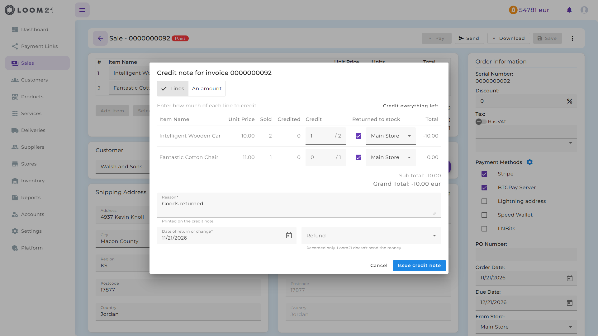

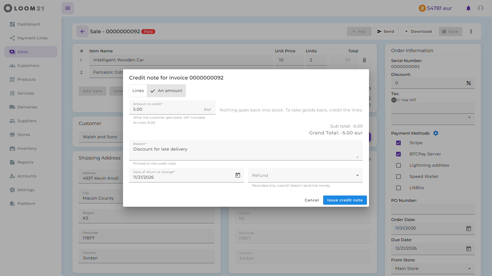

**What else to know:**
- An invoice can have several credit notes, up to what was invoiced. Its **Credit notes** card lists them, with what is left to credit.
- What the customer still owes drops by the credit notes ("Left to pay after credit notes"), and payments charge only that.
- When everything is credited, the invoice becomes **Canceled** (and **Refunded** if it was paid).
- A credit note on an unpaid invoice records no refund: there was no money to give back. It lowers what the customer owes.
- Credit notes have a badge on the Sales list, and the **Document** filter shows invoices or credit notes. In the reports they are negative rows.
- Download the credit note PDF from its screen.

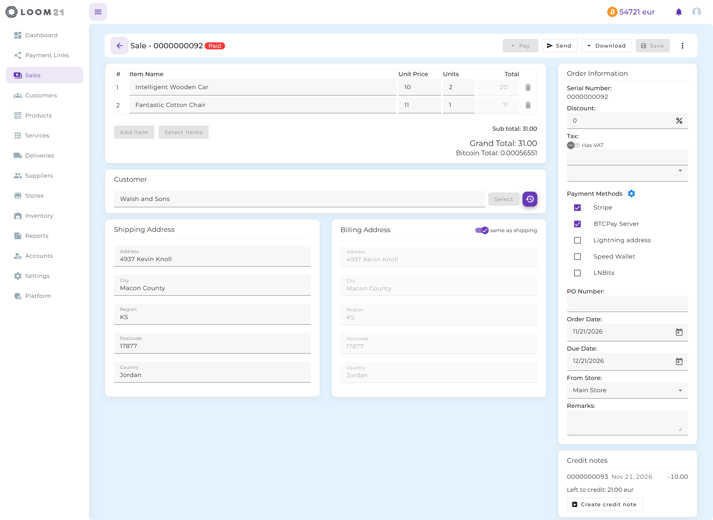

(<a href="#readme-top">back to top</a>)

### Annulling an Invoice 

An invoice issued by mistake (the wrong customer, a duplicate, the wrong VAT details) can be **annulled** rather than credited. Annulment follows Bulgarian VAT law; see [Invoicing Rules and Your Country](#country-rules).

**When you can annul:** only while the invoice is unpaid, has no credit notes, and was issued this calendar month. After that it may already be in a VAT return, so it is corrected with a credit note instead. When annulling isn't possible, the screen says why.

**To annul:** open the invoice, open the **⋮** menu and choose **Annul invoice**. Enter the reason (printed on the invoice and the protocol), and confirm that the customer has been told and won't record the invoice in their purchases ledger.

**What happens:**
- The invoice keeps its number and content, is marked **Annulled** (also on the PDF, with the reason) and becomes Canceled. Its goods go back into stock.
- It can't be changed, credited, sent or paid, and it is left out of the sales report.
- **Annulment protocol** downloads the protocol to sign with the customer.
- To issue the correct invoice, use **Copy Order**. The copy remembers which invoice it replaces, and the protocol names it once it is issued.

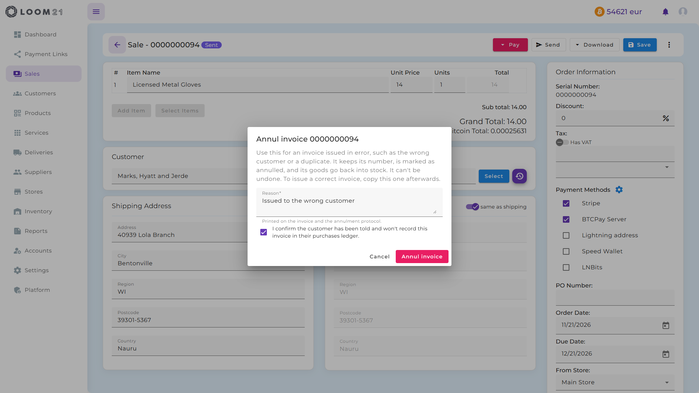

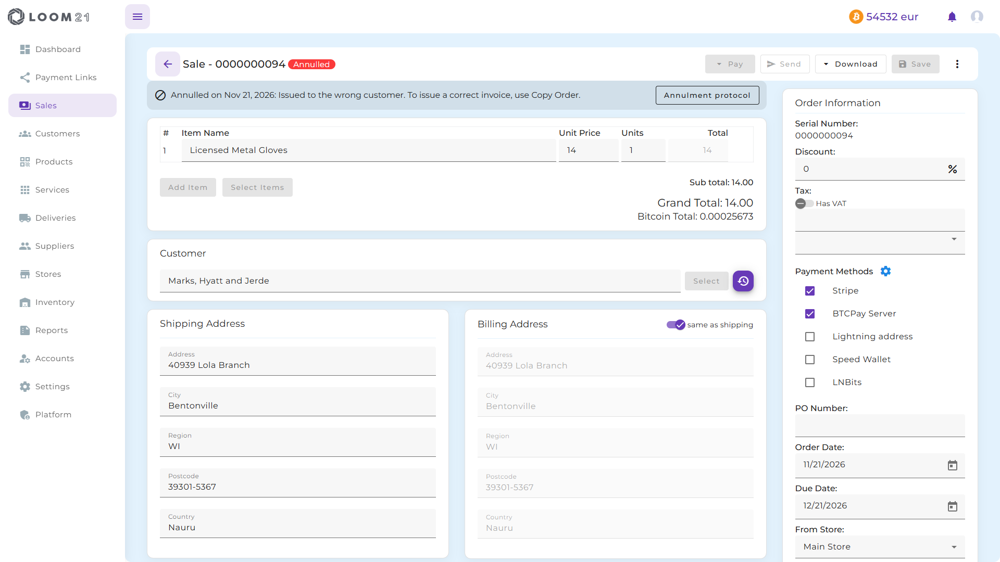

(<a href="#readme-top">back to top</a>)

### Overpayments and Refunds 

Sometimes a customer pays more than the invoice owes: a payment arrives after the invoice was canceled or credited, or the same invoice is paid twice. Loom21 emails you when that happens, and the invoice shows a warning with the amount to give back.

Loom21 doesn't send refunds. Give the money back yourself, then press **Record refund** on the warning and enter the amount and date. The warning shows what is left, and goes away when everything is refunded. Recorded refunds are taken off the [Dashboard](#dashboard) revenue.

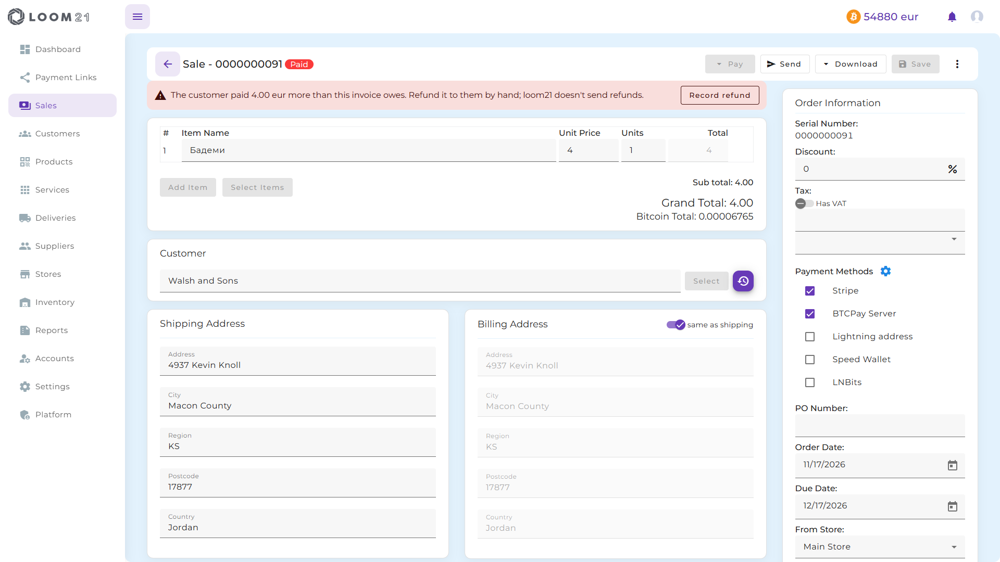

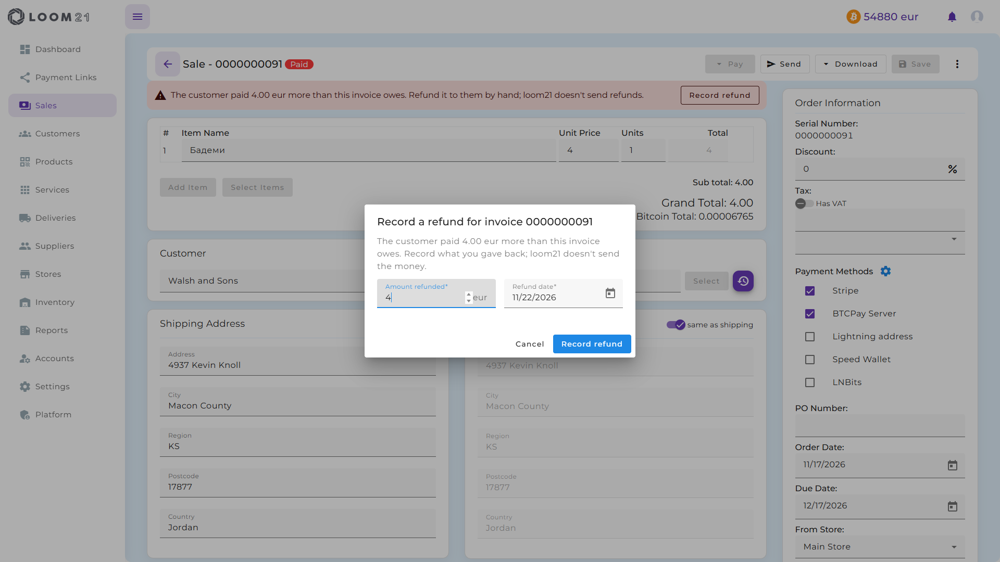

(<a href="#readme-top">back to top</a>)

### Moving From Another Program (Import Invoices) 

If you issued invoices with another program before Loom21, bring them in. You can then credit or annul them, collect what is unpaid, and Loom21's numbering simply continues after your last invoice. You can import only **before Loom21 issues its first invoice**; after that, the import closes.

**Before you start:** import your products and services (see [Import and Export](#import-templates)), so the invoice lines can be matched to them.

**How to use:**
1. Navigate to **Sales** and press **Import invoices**.
2. Press **Invoices Template** and fill in its two sheets:
   - **Documents**: one row per invoice or credit note, with its number, date, customer, currency, the totals as printed, and whether it was paid;
   - **Lines**: the lines of each document, with its number, the description as printed, quantity and unit price (without VAT, after any discount).

   Prefer CSV? **CSV Template** has the same columns on one sheet: one row per invoice line, with the document's columns repeated on each of its lines. Separate columns with commas or semicolons, write decimals with a dot, and save as UTF-8.
3. Press **Choose file**. Loom21 checks the whole file and lists every problem with its sheet, row and column. Fix them in the file and choose it again. Nothing is saved until the file is correct.
4. **Match the items.** Every line has to belong to one of your products or services. Loom21 finds most of them on its own: by product Id, barcode or code, or by exact name. The descriptions it can't place are listed once each, with how many lines use them and the closest products. Pick the product or service each one is. Choose **Create new product** or **Create new service** only if it really is new, so your catalog gets no duplicates. Loom21 remembers your choices for the next file.
5. **Review and import.** Check the summary, and answer one question: **which month's VAT return will you file from Loom21 first?** Then press **Import**.

**Good to know:**
- **The totals as printed win.** The lines, the VAT and any EUR amounts printed on the document must agree with them, to the cent.
- **Customers** are matched by Company ID, then VAT number, then name. Customers not found are added.
- **Paid invoices** get a payment on the date you give, so amounts due and the [Dashboard](#dashboard) are right.
- **Credit notes** name the invoice they correct, in the same file or an earlier import, and credit its lines.
- **Currency:** an empty Currency means your account's currency (Settings → General), so fill it in when your account is set to something else.
- **A document in another currency** needs the rate printed on it, as EUR for 1 unit (EurPerUnit) or, if the check asks for it, as units for 1 EUR (UnitsPerEur).
- **Stock isn't changed.** The goods left when the old program issued the invoice.
- **Imported invoices can't be edited.** They can be paid, credited and annulled. Their PDF says "COPY" and that the document was imported, because the original was issued by your previous program.
- **The VAT ledger** includes imported documents only from the first month you file from Loom21. Earlier months were filed by your previous program, so including them would declare them twice.
- **Years of invoices?** Split them into several files of up to 10,000 rows, and import the oldest first.
- **Made a mistake?** Under **Imported so far**, **Remove import** takes an import out completely, with its payments, until Loom21 issues its first invoice. Customers and products it added stay.

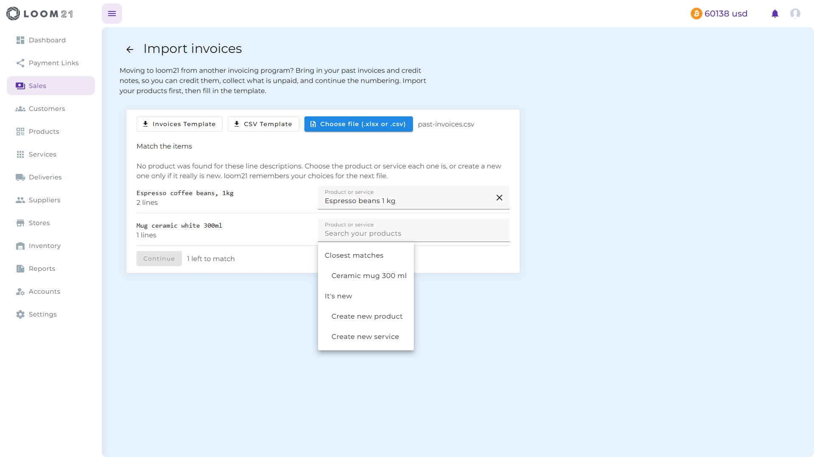

(<a href="#readme-top">back to top</a>)

### Invoicing Rules and Your Country 

Loom21's invoicing was built to Bulgarian VAT law, and today it applies the same rules to every account, whatever country you are in. Most of them are what EU VAT rules ask of any invoice; a few are Bulgarian only. If you invoice outside Bulgaria, check the Bulgarian-only ones with your accountant.

| Rule | What Loom21 does | Where it comes from |
|---|---|---|
| Invoice numbers | One continuous sequence for invoices and credit notes, given when a sale is issued and never changed | EU VAT rules require sequential numbers. The 10-digit format is Bulgarian |
| Corrections | An issued invoice is corrected with a credit note, never edited or deleted | Common EU practice |
| Invoice details | Prints the tax point, the VAT numbers, the tax base, and the reason when no VAT is charged | On the EU list of required invoice details |
| "ORIGINAL" | Printed on invoices and credit notes | Bulgarian practice |
| Company ID | Printed when you fill it in | In Bulgaria the EIK. Elsewhere, enter your company registration number, or leave it empty |
| Credit note deadline | A warning when a credit note comes more than 5 days after the return or change. It never blocks | Bulgarian law |
| Annulment | Allowed only for an unpaid invoice with no credit notes, issued this calendar month (Bulgarian time) | Bulgarian law. Elsewhere, correct invoices with credit notes unless your accountant says annulling is allowed |
| [VAT Sales Ledger](#vat-ledger) | The Bulgarian sales ledger layout, document types and columns | Bulgarian law. Elsewhere, ask your accountant which columns they need |

We plan to let each account choose its country, so that these rules follow it.

(<a href="#readme-top">back to top</a>)

<!-- REPORTS -->## Reports

The Reports section gives you detailed insight into your sales and delivery activity. Navigate to **Reports** from the sidebar to choose a report type.

<!--  -->

### Sales Report

The Sales Report shows a full, searchable, and filterable list of every product or service that has been sold — one line per line item across all orders.

**How to use:**

1. Navigate to **Reports → Sales Report**.
2. Use the **search bar** at the top to find items by product name or serial number.
3. Click **Filters** to expand the filter panel and narrow results by:
   - **Date range** — select a start and end date.
   - **Category** — filter by product category.
   - **Measure** — filter by unit of measurement.
   - **Brand / Model** — filter by brand, and then by specific model within that brand.
   - **Customer** — type a customer name to search and filter by a specific buyer.
4. Press the **Search** button (magnifying glass) to apply your filters.
5. Click **Clear** to reset all filters and start fresh.
6. Use the **Export** menu to download the report with the current filters:
   - **Export Excel** — an .xlsx file with numbers and dates as real numbers and dates, ready to sort and sum.
   - **Export CSV** — a plain text file you can open in Excel or Google Sheets.
   - **Export JSON** — downloads a structured data file for technical use.
7. Results are sortable by clicking any column header. Use the **pagination** controls at the bottom to navigate through large result sets.
8. Click the arrow icon on any row to navigate directly to the original sale order.

Columns shown: Product name, barcode, serial number, quantity, note, unit price, total price, customer name, measure, category, and date.

Credit notes are negative rows with a badge, so totals are net of them. An amount credit is one row named after its reason. Annulled invoices are left out.

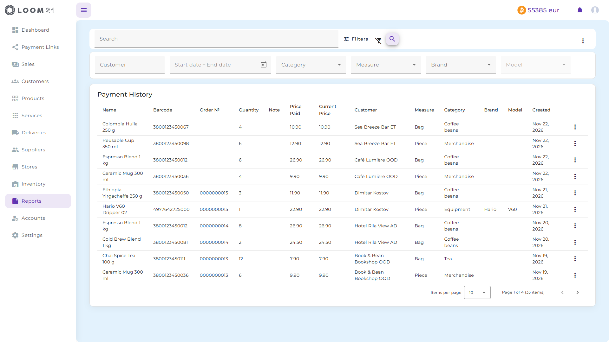

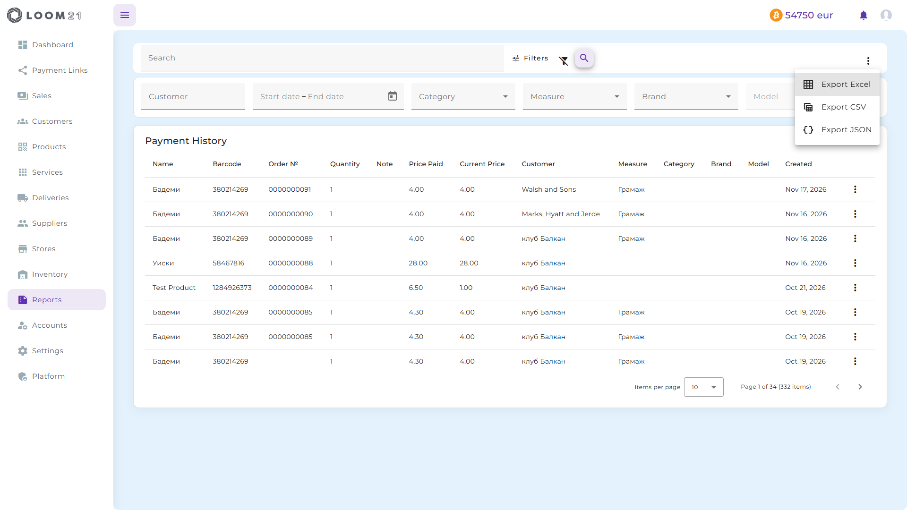

(<a href="#readme-top">back to top</a>)

### Deliveries Report

The Deliveries Report provides the same detailed, filterable view for delivery orders — showing every product that has been received as a delivery, along with supplier and date information.

Use it in the same way as the Sales Report: apply filters, search, sort, and export as needed.

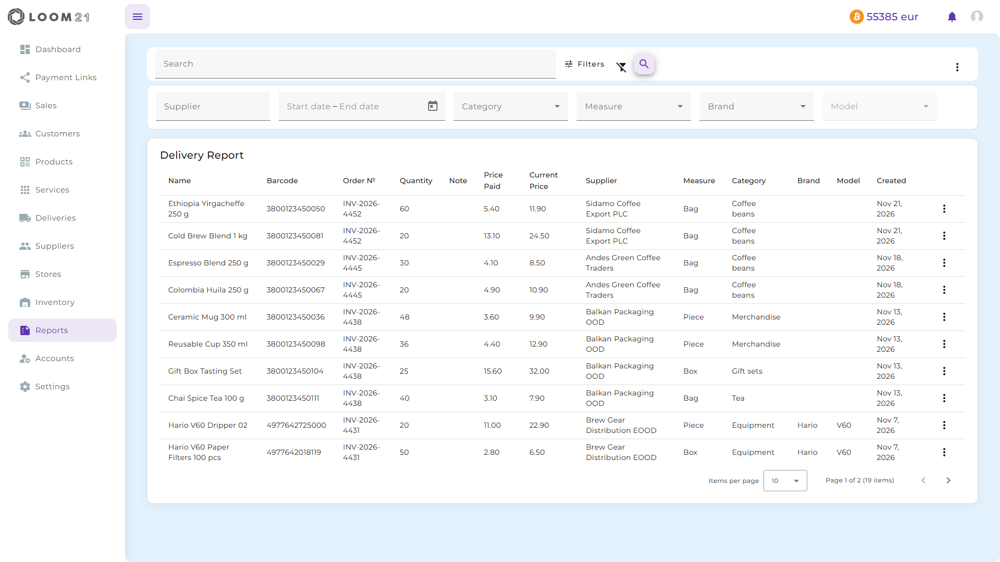

(<a href="#readme-top">back to top</a>)

### VAT Sales Ledger

The VAT sales ledger is the month's list of sales your accountant imports into their accounting software to file your VAT return. It follows Bulgarian VAT rules (see [Invoicing Rules and Your Country](#country-rules)) and is only available when **Enable VAT** is on in [General settings](#general-settings), which means your company is registered for VAT.

**How to use:**
1. Navigate to **Reports → VAT sales ledger**. It opens on last month.
2. Choose the **Month** and **Year**.
3. Check the list under **Check these before importing**, if there is one, and fix what it points to.
4. Open **Export** and choose **Export Excel** or **Export CSV**, then send the file to your accountant.

**What goes in it:**
- **Invoices** — in the month of their tax point (the order date).
- **Credit notes** — in the month they were issued, with **negative** amounts, and the number and date of the invoice they correct.
- **Annulled invoices** — with their number, date and customer, and every amount **0.00**.
- **Sales through payment links** — one line for the whole month (numbered year, month and 02, e.g. 20261002), as sales without an invoice, split by VAT rate and less any refunds.
- **[Imported invoices](#import-invoices)** — only from the first month you file from Loom21. In earlier months they are left out, and the screen says so: your previous program filed them.

**Which column a sale goes in:**
- A sale with VAT goes in the **20%** or the **9%** column, by its VAT rate.
- A sale without VAT goes in the column of its **VAT ledger category**, chosen on the sale. Payment links without VAT go in the column of the link's category.
- All amounts are in **EUR**. A sale in another currency is converted at the rate printed on its invoice or credit note (see [Invoice Numbers and PDFs](#invoice-numbers)), so its ledger amounts are exactly the PDF's EUR equivalent. The screen shows its currency, the rate and the rate's date.
- A customer with no Company ID and no VAT number counts as a private individual: both are filled with fifteen nines, as Bulgarian practice requires.

**The exported file** has the columns your accountant's software imports, with Bulgarian headers, in this order:
1. row number;
2. document type (01 invoice, 02 sales without an invoice, 03 credit note);
3. document number;
4. issue date;
5. tax point date;
6. customer name;
7. Company ID (ЕИК);
8. VAT number;
9. for a credit note, the invoice's number;
10. for a credit note, the invoice's date;
11. the total with VAT (ledger column 9);
12. then the amounts for ledger columns 11, 12, 13 and 14 (20% and 9% with their VAT), 16 (exports), 17 (intra-EU goods), 19 (distance sales), 21 (services to EU businesses) and 25 (exempt).

Dates are written as DD.MM.YYYY and amounts with two decimals. The currency, the rate and the warnings aren't in the file: they are on the screen, and the warnings are also on the Excel file's second sheet.

**What the ledger flags.** It never guesses. These are listed on the screen, marked on their rows, and put on a second sheet in the Excel file:
- a sale in a currency with no ECB rate, such as BTC (its amounts stay in that currency);
- a rate not yet published for the day (the last one is used: export again later);
- a sale without VAT with no VAT ledger category (choose one on the sale);
- a VAT rate other than 20% or 9%;
- payment links without VAT and without a VAT ledger category, or in a currency with no ECB rate.

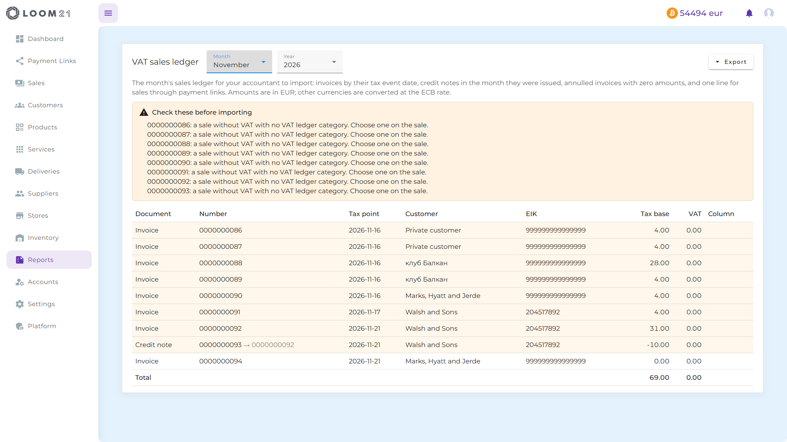

(<a href="#readme-top">back to top</a>)

<!-- SETTINGS -->
## Settings

Configure your organization's preferences and payment processors here. Payment processors must be set up in this section before they become available as options at checkout or in payment links.

### General settings 

This is where you configure your organization's core identity and preferences. These settings affect the whole application.

**Company details:**
- **Company Name, Email, Phone** — appear on printed invoices and documents.
- **Company logo** (Starter plan and up) — click **Upload logo** (JPEG, PNG or WebP, up to 10 MB; a wide logo on a plain or transparent background works best). It is printed at the top of your invoices, credit notes, quotes, receipts and delivery documents, and shown at the top of your payment pages and storefronts. On the Free plan you see an **Upgrade** link instead. If you move back to Free, the logo is kept but not shown; upgrading brings it back.
- **Billing Address** — your organization's address, also printed on documents.

**Localization:**
- **Language** — changes the application language. The page reloads automatically when you save a language change.
- **Currency** — your primary operating currency. Affects prices, totals, and reports throughout the app.
- **Default Store** — the store pre-selected when creating new sales and deliveries.

**VAT settings:**
- **Enable VAT** — turns VAT on globally. You can still toggle it per order.
- **VAT Number** — your organization's tax registration number, printed on invoices.
- **Company ID (EIK)** — your company registration number (in Bulgaria, the EIK), printed on invoices and credit notes.
- **First invoice number** — if you issued invoices before loom21, the number after your last one; empty starts at 1. The hint shows the number the next invoice will get. It can only be changed until the first invoice or credit note is issued, then it is locked, so the numbering never has gaps or duplicates.
- **VAT Percentage** — the default rate applied to new orders.
- **Legal basis when no VAT is charged** — why your invoices carry no VAT, for example because you aren't registered for VAT. It is filled in on new sales without VAT and printed on their invoices. EU VAT rules require a reason on every invoice without VAT.

**Inventory control:**
- **Forbid Negative Quantity** — when enabled, the system will not allow a sale that would take a product's stock below zero.

**Bitcoin settings:**
- **Hide Bitcoin Prices** — removes all Bitcoin price displays and payment options across the app.
- **Override Bitcoin Rate** — lets you enter a fixed exchange rate instead of using the live market rate. Useful for invoicing in a fixed BTC price.
- **Use Bitcoin Only** — hides fiat totals and shows only Bitcoin amounts.

**Theme:**
- **Dark Mode** — toggle between light and dark theme. This can also be toggled quickly from the [Dashboard](#dashboard).

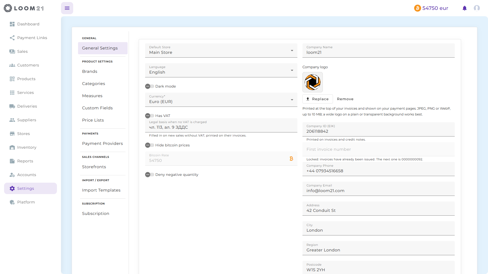

(<a href="#readme-top">back to top</a>)

### Subscription

Shows your current loom21 plan and how it's billed:
- paid monthly or yearly by card: "renews on …";
- paid yearly in bitcoin: "paid until …";
- **Free**: "Free forever, no card needed". Every new account starts on Free;
- a plan **given to you by loom21**: "Free until …, given by loom21". Choose a plan before then to keep it; otherwise the account goes back to Free.

Below it is what the plan includes: users, orders a month, stores, user roles, API access, support, your own logo, and whether payment pages show "Powered by loom21".

**Usage** shows a bar each for orders this month, stores and users, against the plan's limits ("42 of 50", or "7, unlimited"). The order count starts again on the 1st of each month. The orders bar turns amber at 80% and red at the limit.

Click **Change Subscription**, or **Choose a Plan** on Free, to open the plan picker. Each card shows the plan's price in euro per month (yearly and bitcoin plans also show the year's total) and what it includes. See [Pricing](https://loom21.com/en/pricing).

#### Plan limits

- **Users and stores:** you can't invite more users or add more stores than the plan allows. Upgrade first.
- **Orders a month:** issued invoices and payment-link payments count; drafts, credit notes and imported invoices don't. You get an email and a [notification](#notifications) at 80% and at 100%. When an account goes over its limit, the Terms of Service (section 6) apply: a grace period, then a request to upgrade, and after that, in any month the limit is reached, **payment links and new sales are paused** until the next month starts or you upgrade. An upgrade lifts a pause at once.
- **An invoice already issued can always be paid,** even while paused, and existing sales can still be edited.
- **While paused,** a new sale shows "New orders are paused until …" at the top, with an **Upgrade** button for Administrators.

(<a href="#readme-top">back to top</a>)

### Stripe
- To accept fiat payments via Stripe, configure your Stripe Publishable and Secret keys.

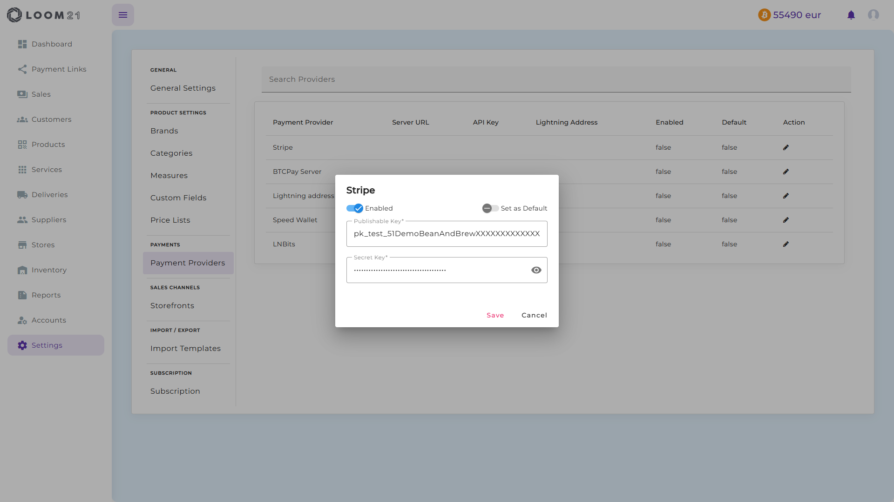

(<a href="#readme-top">back to top</a>)

### BTCPay Server
- Self-hosted Bitcoin payment processor supporting both Lightning and on-chain payments.
- Configure your BTCPay Server URL and API Key to enable it.

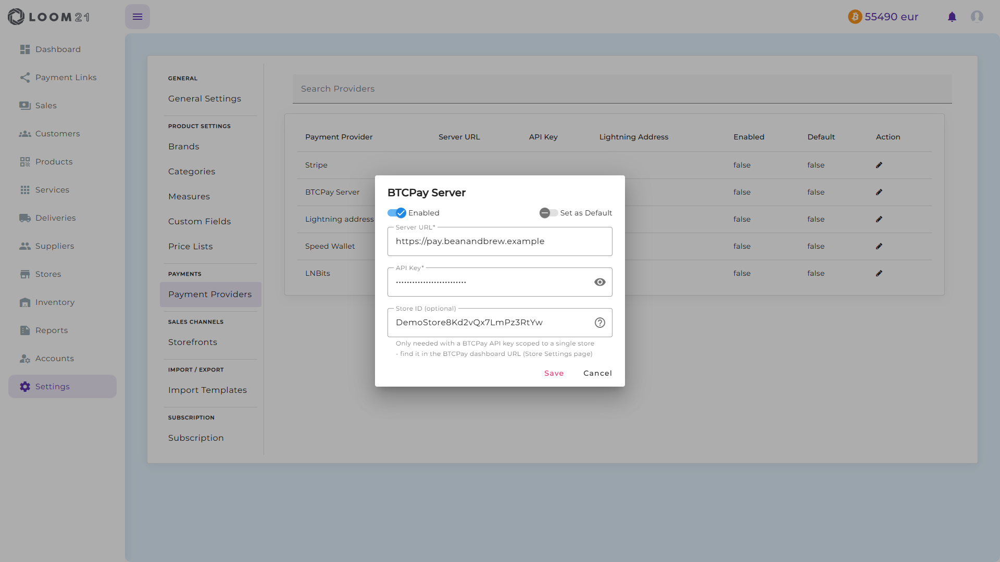

(<a href="#readme-top">back to top</a>)

### Lightning address
Receive Lightning payments straight into your own wallet, through its **Lightning address** (it looks like an email address, e.g. `you@breez.tips`). It works with **any wallet whose Lightning address supports LNURL-pay**. loom21 only asks your address for an invoice, so it never holds your money or your keys.

- Enter your Lightning address in **LN URL**.
- **Automatic confirmation needs payment verification (LUD-21).** For loom21 to see that an invoice was paid, your wallet's Lightning address service must support it, and not all do. Click **Test Connection** before you go live. It asks your address for a test invoice (nothing is paid) and tells you one of:
  - **"Real-time payment confirmation is supported"** — payments are confirmed automatically, like with the other providers.
  - **"This wallet doesn't support real-time payment confirmation"** — customers can still pay you, but loom21 can't tell. Check your wallet and mark the sale with **Set as Paid**. Payment links and the Buy button can't be marked by hand, so use a wallet that supports it for them.
  - **"Could not reach this address"** — check the address.
- Known to support it (November 2026): Glow (`breez.tips` addresses), Alby and Coinos. Wallet of Satoshi and Zebedee don't. Support can change, so trust **Test Connection** over this list.
- Lightning only. For on-chain bitcoin, use [BTCPay Server](#btcpay-server).

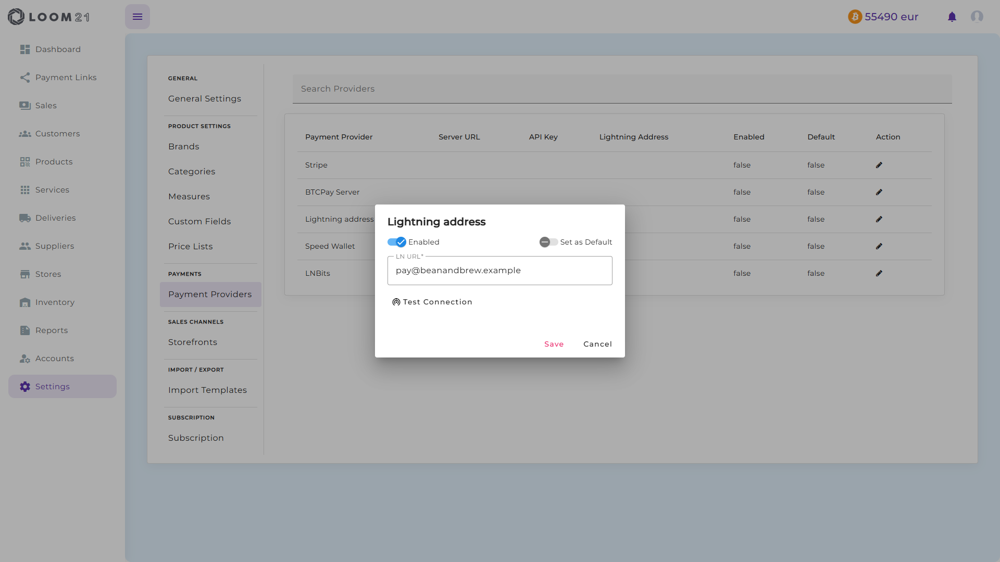

(<a href="#readme-top">back to top</a>)

### Speed Wallet
- Bitcoin wallet supporting both Lightning and on-chain payments.
- Enter your Speed Wallet API Key to enable it.

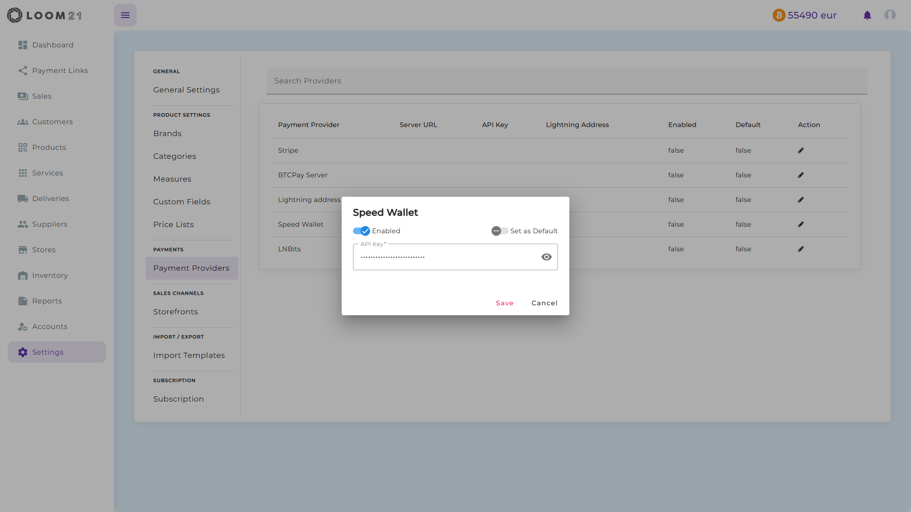

(<a href="#readme-top">back to top</a>)

### LNBits
- Open-source Lightning Network accounts system. Supports multiple wallets and extensions.
- Configure your LNBits URL and API Key to enable it.

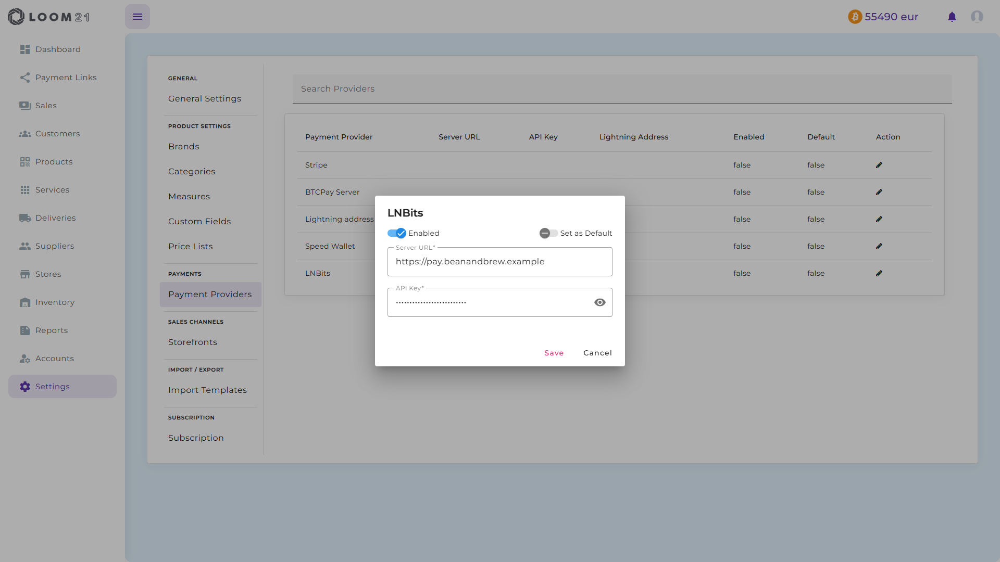

(<a href="#readme-top">back to top</a>)

### Product Settings

The **Product Settings** section (found under Settings in the sidebar) groups several configuration pages that control how your products are organized, described, and priced. Use the sub-navigation to switch between:

- **Brands & Models** — manufacturers and product model lines
- **Categories** — groups for organizing products
- **Measures** — units of measurement
- **Custom Fields** — additional fields you define for product data
- **Price Lists** — tiered and customer-specific pricing rules

(<a href="#readme-top">back to top</a>)

### Product Categories 

Categories let you group related products together, making them easier to find and filter across the app — on the Products list, in Inventory, and in Reports.

**Adding a category:**

1. Navigate to **Settings → Product Settings → Categories**.
2. Click **Add** (or the **+** button) to open the category form.
3. Enter a **Name** for the category (e.g. "Electronics", "Clothing", "Raw Materials").
4. Click **Save**. The new category appears in the list and is immediately available to assign to products.

**Editing a category:**

1. Find the category in the list and click the **edit** icon on its row.
2. Update the name as needed.
3. Click **Save**. The change is reflected everywhere the category is used.

**Slug:** the category's address in an online store built on your [storefront](#storefronts). Lowercase letters, digits and dashes; leave it empty and it is made from the name.

**Category picture:** open a saved category and click **Upload picture** (JPEG, PNG or WebP, up to 10 MB). It is saved at once, even if you then close the form, and shows in the categories list; click it there to see it full screen. **Replace picture** and **Remove** change it later.

**Deleting a category:**

1. Click the **delete** icon on the category row.
2. Confirm the deletion when prompted.

> Products already assigned to that category are not deleted — they simply lose the category association and will show no category until you reassign them.

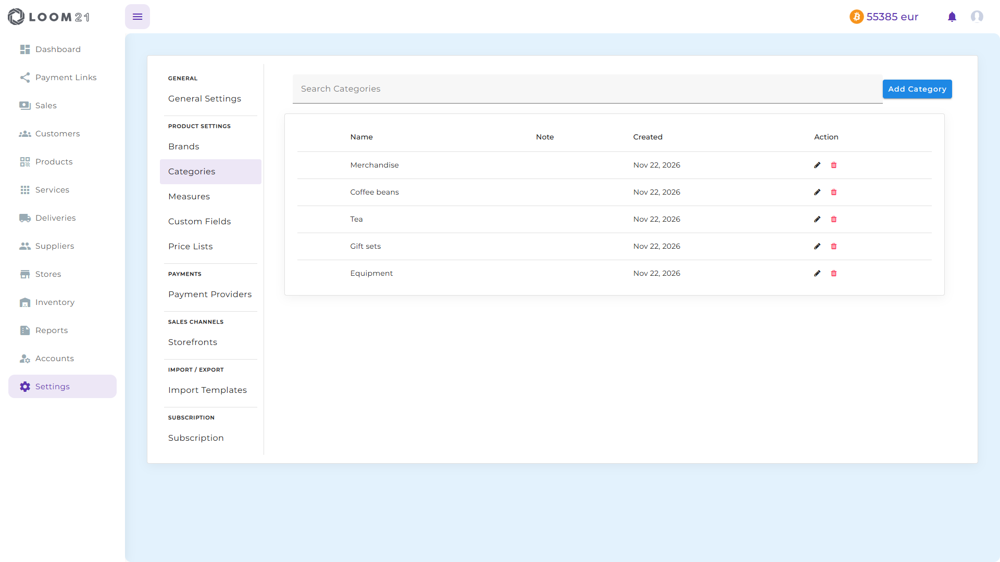

(<a href="#readme-top">back to top</a>)

### Measures

Measures define the units of measurement used when describing product quantities — for example, kilograms, liters, pieces, or meters. Once defined, a measure can be assigned to any product or service and is used throughout the app in inventory, sales, and reports.

**Adding a measure:**

1. Navigate to **Settings → Product Settings → Measures**.
2. Click **Add** (or the **+** button) to open the measure form.
3. Enter a **Name** for the unit (e.g. "Kilogram", "Piece", "Liter").
4. Click **Save**. The measure is now available to assign to products and services.

**Editing a measure:**

1. Find the measure in the list and click the **edit** icon on its row.
2. Update the name as needed.
3. Click **Save**. The updated name is reflected wherever the measure is used.

**Deleting a measure:**

1. Click the **delete** icon on the measure row.
2. Confirm the deletion when prompted.

> Products already using that measure are not deleted — they simply lose the measure association and will show no unit until you reassign them.

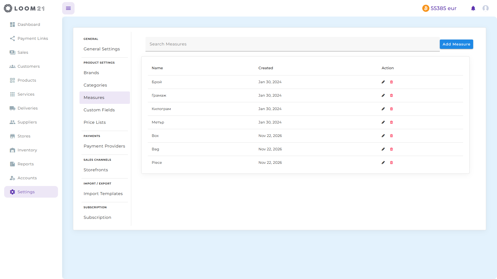

(<a href="#readme-top">back to top</a>)

### Brands & Models

If your products are associated with manufacturers or brand names, you can manage those brands here. Each brand can have multiple models beneath it, which you can then assign to individual products for more detailed categorization and reporting.

**How to use:**

1. Navigate to **Settings → Product Settings → Brands**.
2. Click **Add** to create a new brand. Enter the brand name, an optional description, and, if you have one, the address of its logo. Once the brand is saved, open it again to **Upload picture** for its logo instead.
3. Click a brand in the list to see its details on the right side and manage its models.
4. Within the brand detail panel, click **Add Model** to create models (e.g. specific product lines or versions) belonging to that brand.
5. Use the edit and delete buttons to update or remove brands and models as needed.

Once brands and models are set up, you can assign them to products on the product edit page. This lets you filter the Sales Report by brand or model to see exactly which product lines are performing best.

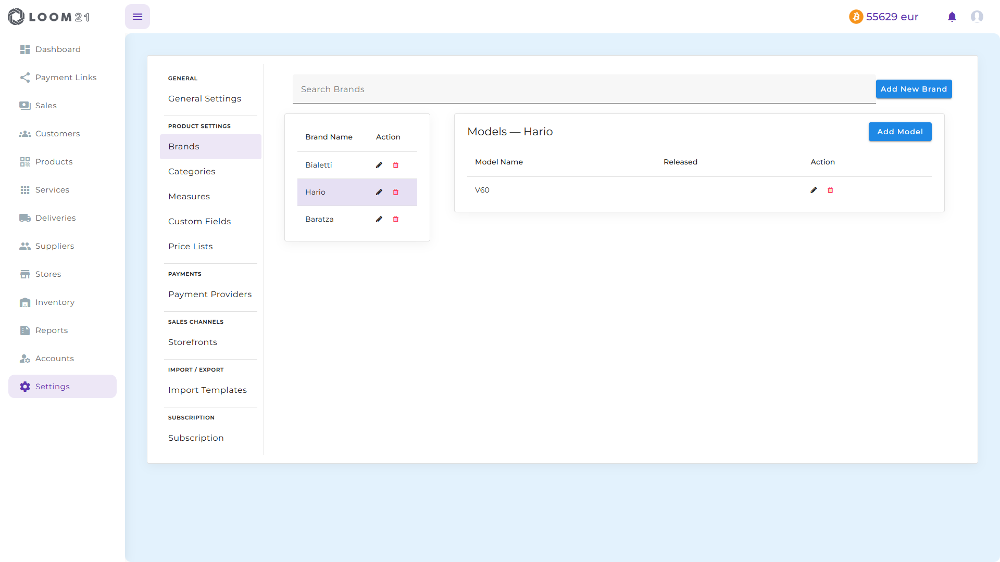

(<a href="#readme-top">back to top</a>)

### Custom Fields

Custom Fields let you add your own data fields to every product in your catalog — beyond the standard fields like name, price, and category. For example, you might add a "Warranty Expiry Date," a "Supplier Reference Number," or a "Certified" checkbox.

**How to use:**

1. Navigate to **Settings → Product Settings → Custom Fields**.
2. Click **Add Field** to define a new custom field. You will be asked to enter:
   - **Label** — the name shown on the product form (e.g. "Warranty Expiry").
   - **Field Name** — a short internal identifier (no spaces, e.g. `warrantyExpiry`).
   - **Data Type** — choose from Text, Number, Decimal, Yes/No, or Date.
   - **Required** — whether the field must be filled in before saving a product.
   - **Default Value** — an optional pre-filled value.
   - **Show on storefront** — buyers see the field on the product's page in your online store (e.g. Material, Size). Fields with it off never leave loom21. The list marks the shown ones in its **Storefront** column.
3. Use the **drag handle** (the grip icon on the left) to reorder fields — this controls the order they appear on the product form.
4. Use the **toggle switch** to activate or deactivate a field without deleting it. Inactive fields are hidden on product forms but their data is preserved.
5. Click the **edit** or **delete** icons to modify or remove a field definition.

Once custom fields are defined, they appear as an additional tab called **Custom Fields** on every product's edit page, where you can fill in the values for each product.

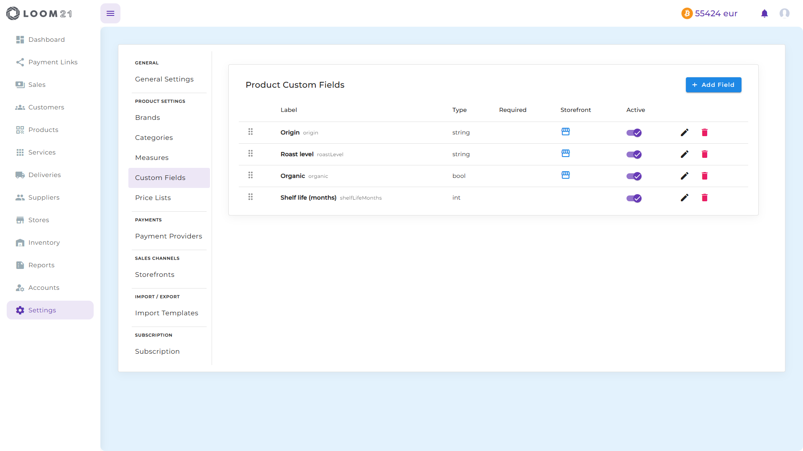

(<a href="#readme-top">back to top</a>)

### Price Lists

Price Lists give you full control over your pricing strategy. Instead of using a single fixed price per product, you can create multiple price lists — for example, a "Wholesale" list with lower prices, a "Retail" list, or a seasonal promotion — and assign specific prices per product within each list.

Within each price list you can also set **quantity-based tiers** (the price automatically drops when the customer orders more), apply **percentage discounts**, or even define a **formula** that calculates the price dynamically.

In addition, you can set **customer-specific price overrides** directly on a product — so one particular customer always gets a special price regardless of the active price list.

#### Creating a Price List

1. Navigate to **Settings → Product Settings → Price Lists**.
2. Click **New Price List** to expand the creation form.
3. Enter a **name** (e.g. "Wholesale 2025"), select the **currency**, and optionally set a **Valid From / Valid To** date range to make the list active only during a specific period.
4. Check **Default** if this should be the primary price list used when no other rule matches.
5. Click **Save**. The new list appears in the left panel.

#### Adding Products and Tiers to a Price List

1. Click on a price list in the left panel to open it.
2. In the **Tiers** section, use the product search box to find the product you want to add.
3. Fill in:
   - **Min Qty** — the minimum quantity the customer must order to get this price (leave blank for "any quantity").
   - **Price** — the sale price for this product in this list.
   - **Discount %** — an optional percentage discount applied on top of the price.
   - **Formula** — an advanced option that lets you enter a mathematical expression to calculate the price automatically (e.g. `BasePrice * 0.85` to always apply a 15% reduction). Available variables: `BasePrice`, `Quantity`, and any custom fields you have defined.
4. Click **Add Tier**. You can add multiple tiers for the same product with different minimum quantities to create volume-based pricing steps.
5. Use the **edit** and **delete** icons on each tier row to modify or remove them.

#### Activating or Deactivating a Price List

- Use the **toggle switch** next to each price list name to activate or deactivate it without deleting it.

#### Deleting a Price List

- Click the **delete** icon next to the price list. You will be asked to confirm. Deleting a price list also removes all its tiers.

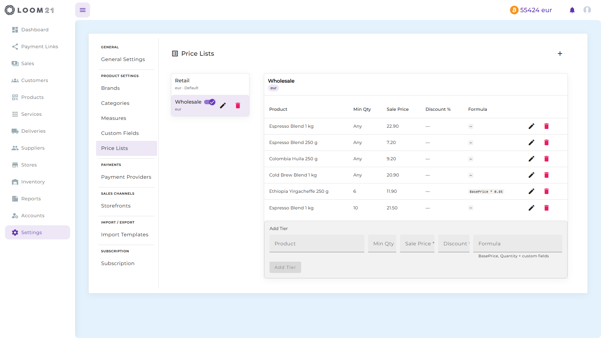

(<a href="#readme-top">back to top</a>)

### Import and Export (Excel and CSV)

Products, services, customers and suppliers can be exported to a spreadsheet and imported from one, to add many records at once or to change many at once. Excel (.xlsx) and CSV (.csv) both work; Excel is recommended.

**Where:**
- **Export** — on the Products, Services, Customers or Suppliers screen, open **Export** and choose **Export Excel**, **Export CSV** or **Export JSON**.
- **Import** — the **Import** button on the same screen.
- **Empty templates** — **Settings → Product Settings → Import Templates**, or **Import template (Excel)** in a screen's Export menu. The templates include your [custom fields](#custom-fields).
- **Past invoices** from another program have their own template and import: see [Moving From Another Program](#import-invoices).

#### Adding new records

1. Download the template.
2. Fill in one row per record. Only **Name** is required; leave out any column you don't need. Column order and capital letters don't matter.
3. Import the file on the matching screen.

#### Changing records you already have

1. **Export** the records to Excel.
2. Change what you need in the file: prices, names, categories, custom fields and so on.
3. **Import** the file on the same screen. The records are updated; no copies are made.

This works because every export has an **Id** column, which tells the import which record a row belongs to. In Excel the column is hidden so it isn't changed by accident:
- **Excel** — click the triangle in the top-left corner to select the whole sheet, then right-click any column letter and choose **Unhide**.
- **Google Sheets** — click the small arrows at the left edge of the **B** column header, or right-click a column header and choose **Unhide columns**. Open the file in Google Sheets first; Drive's preview can't do this.

<!-- SCREENSHOT TODO: an exported products file in Excel or Google Sheets with the Id column shown.
 -->

**Good to know:**
- **Leave the Id values alone.** A row without an Id is added as a new record. An Id from another account, or from a service in the products file, is refused.
- **Only the columns in the file are changed.** You can import a file with just **Id** and **PriceSale** to update prices; everything else stays as it was. An empty cell in a column that *is* in the file clears that value.
- Save the file as **.xlsx** (in Google Sheets: **File → Download → Microsoft Excel**) or **.csv**. For customers and suppliers use .xlsx: CSV can hold only one sheet, so the Addresses sheet would be lost.

#### If the import finds problems

Nothing is saved until the whole file is correct. The screen lists the first problems, each with its row number as you see it in the spreadsheet, for example:
- "Row 4: PriceSale must be a number."
- "Row 7: Name is required."
- "Row 9: Supplier "Nobody" isn't one of your suppliers. Add it under Suppliers first."
- "Addresses row 3: more than one row is named "Shop". Fill in CompanyId."

Fix them in the file and import it again. Files can be up to 10 MB and 10,000 rows.

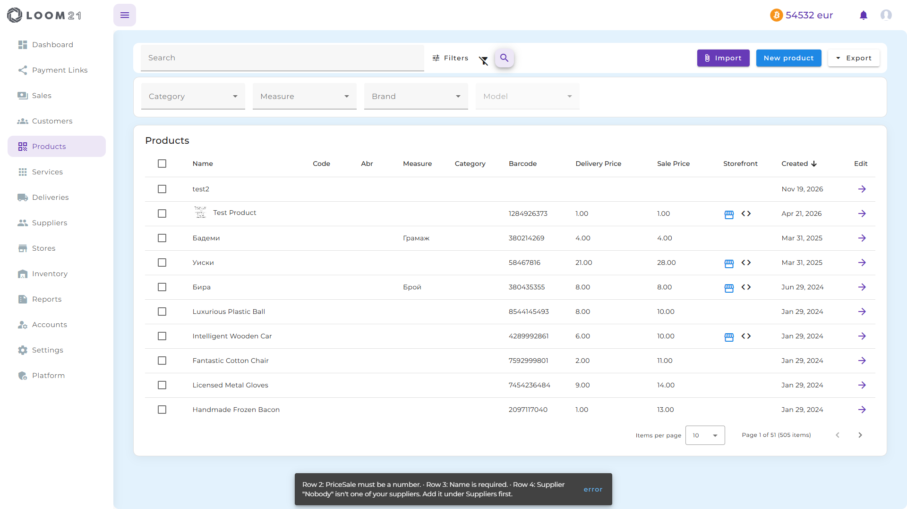

#### Products & Services columns

| Column | Required | Description |
|---|---|---|
| `Id` | No | Filled in by the export. Leave it empty for a new product (hidden in Excel) |
| `Name` | **Yes** for new rows | The product or service name (up to 256 characters) |
| `PriceSale` | No | Selling price (0 or more) |
| `PriceDelivery` | No | Cost / delivery price (0 or more) |
| `BtcPriceSale`, `BtcPriceDelivery` | No | Prices in bitcoin |
| `Code` | No | Your internal product code or SKU (up to 50 characters) |
| `Abr` | No | Short abbreviation for the product name |
| `Barcode` | No | Barcode number. Leading zeros are kept |
| `QrCode` | No | QR code text |
| `Category` | No | Category name. A new one is created if it doesn't exist |
| `Measure` | No | Unit of measurement. A new one is created if it doesn't exist |
| `Brand` | No | Brand name. A new one is created if it doesn't exist |
| `Model` | No | Model of that brand. Needs a `Brand`; a new one is created if it doesn't exist |
| `Supplier` | No | Supplier name. The supplier must already exist under [Suppliers](#customers-suppliers) |
| `Note` | No | Internal note |
| `Image` | No | URL to a product image |
| `Discontinued` | No | `TRUE` or `FALSE` |
| *your custom fields* | Depends | One column per [custom field](#custom-fields), named after its label. A required field must be filled in when its column is in the file. A field with a format must match it |

> Services use the same columns as products. Names are matched without regard to capital letters.

#### Customers & Suppliers columns

| Column | Required | Description |
|---|---|---|
| `Id` | No | Filled in by the export. Leave it empty for a new record (hidden in Excel) |
| `Name` | **Yes** for new rows | Company or person name |
| `ContactName` | No | Name of the primary contact person |
| `Email`, `Phone`, `Website` | No | Contact details |
| `EIK` | No | Company ID (registration number), printed on invoices. A column named `Bulstat` works too |
| `TaxNumber` | No | VAT or tax registration number |
| `PriceList` | No | Customers only: the name of one of your [Price Lists](#price-lists) |
| `Note` | No | Internal notes |
| `BitcoinAddress` | No | Bitcoin address for the contact |

**Addresses.** In Excel, addresses are on a second sheet, **Addresses**, with one row per address:

| Column | Description |
|---|---|
| `Company` | The customer's or supplier's name, as on the first sheet |
| `Name`, `Phone` | A name for the address (e.g. "Office") and its phone number |
| `AddressLine1`, `AddressLine2`, `City`, `Region`, `Postcode`, `Country` | The address |
| `Default` | `TRUE` for the default address |
| `Id`, `CompanyId` | Filled in by the export (hidden). Leave them empty for a new address |

- An address row belongs to the company on the first sheet with that name, which can be one added by the same file, or else to your existing customer or supplier with that name.
- A company's first address becomes its default unless you set one.
- Addresses missing from the file are kept, not deleted.

In CSV, a customer or supplier has one address in the columns `AddressLine1`, `AddressLine2`, `City`, `Region`, `Postcode` and `Country`: the default address.

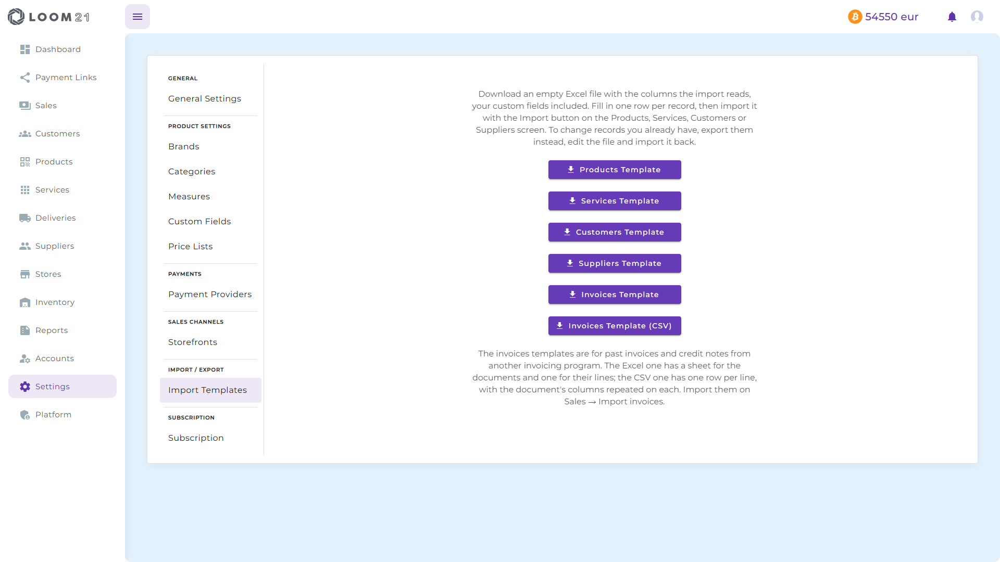

(<a href="#readme-top">back to top</a>)

## Accounts 

The Accounts page shows all users who have access to your organization. Each row displays the user's email, first name, last name, company name, website, and phone number.

**Inviting a new user** (administrators only):
1. Click the **Invite User** button.
2. Fill in the new user's **email address**, **password**, first name, last name, and phone. An email that already has a loom21 account can't be invited: use a different one.
3. Choose one or more **Roles** with the checkboxes (Growth plan and up). On other plans everyone you invite is an Administrator.
4. Save — the user can now sign in with the credentials you created.

**Editing a user:**
- Click the edit icon on any row to update their details or change their roles. Only an administrator changes roles, and nobody changes their own: another administrator can.

**Roles and what they allow** (Growth plan and up):

| Role | What the user can do |
|---|---|
| Administrator | Everything, including users and roles, company and payment settings, stores and the subscription. |
| Cashier | Creates sales, sends invoices and marks them paid, adds customers. Can't change prices, give discounts, issue credit notes or annul. |
| Sales Manager | Everything a cashier does, plus prices and discounts, credit notes, annulment, refunds, invoice import, payment links, customer prices, revenue on the dashboard and the sales report. Not the deliveries report, which shows purchase prices. |
| Warehouse | Adds and removes stock by hand and receives deliveries: sets them as delivered, without changing them. Doesn't create deliveries or suppliers, mark deliveries paid, see purchase prices (except a delivery's own prices) or see sales. |
| Purchasing | Creates and edits deliveries and suppliers, with purchase prices, and marks deliveries paid. Doesn't adjust stock by hand or see sales. |
| Catalog | Products and services, purchase prices, price lists, brands, categories, measures and custom fields. |
| Accountant | Sees sales, credit notes, payments, purchase prices, revenue, reports and the VAT sales ledger. Changes nothing. |

- A user with several roles can do everything any of them allows.
- Each user sees only the menu items and buttons their roles allow, and loom21 checks every action on the server as well.
- Without the right to change prices, a sale's prices are the customer's price, the price list's or the product's, with no discount.
- Purchase prices are left out for roles that don't see them.
- After a change to a plan below Growth, the roles already given keep applying, but they can't be changed until the plan has roles again.

**Removing a user:**
- Open the user's edit page and click **Delete** to remove their access. Only an administrator can remove users, and not themselves.
- A removed user can't sign in any more and no longer counts toward your plan's user limit. The sales and deliveries they made stay as they are.
- You can invite them back with the same email: they get the invite's roles and password.

How many users you can invite depends on your plan.

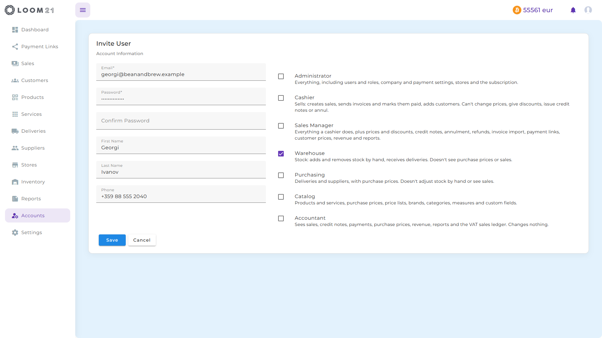

(<a href="#readme-top">back to top</a>)

## Products and Services 
The Products list lets you search by name or code, filter by Category, Measure, Brand, and Model (selecting a Brand enables the Model filter), and import or export your catalog as Excel, CSV or JSON (see [Import and Export](#import-templates)). The table shows each product's main photo, name, code, abbreviation, measure, category, barcode, delivery price, sale price, and creation date.

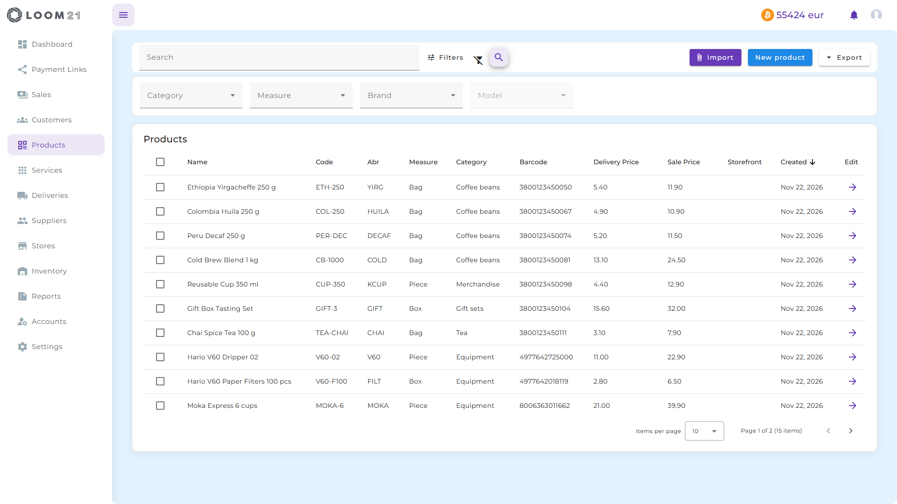

Click **New Product** to create one, or click the arrow icon on any row to open it. Available fields:

- **Name** (required), **Abbreviation**, **Code**, **Note**
- **Category**, **Measure**
- **Brand & Model** — assign to a brand and model (configured in [Brands & Models](#brands)); selecting a brand enables the model dropdown.
- **Delivery Price** — the cost price used when receiving stock via delivery orders.
- **Sale Price** — the default selling price (can be overridden by [Price Lists](#price-lists)).
- **Bitcoin prices** — if Bitcoin is enabled, separate Bitcoin price fields appear with arrow buttons to convert between fiat and Bitcoin at the current exchange rate.
- **Barcode & QR Code** — enter or scan a barcode; a QR code is generated automatically.

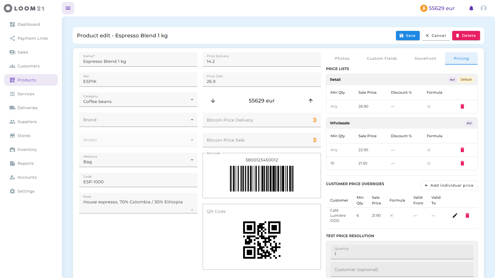

#### Photos Tab

Each product can have up to **20 photos**. Open the product and click the **Photos** tab:
- Click **Add photos**, or drop pictures onto the tab, to add several at once (JPEG, PNG or WebP, up to 10 MB each).
- The selected photo shows large above the others; click a small photo to see it large. Click the large photo (or **View full size**) to open it full screen, where the arrows or the ←/→ keys move between photos and Esc closes it.
- **Drag** a photo to change the order, or click **Make main** under the large photo. The first one is the **main photo**: it shows in the Products list and next to the product on a sale.
- To delete a photo, click its delete button, then click again to confirm.

Photos are resized for the screen and turned the right way up, and the camera's details (including the location where a phone photo was taken) are removed. Without the right to edit products, you see the photos but can't change them.

#### Storefront Tab

Puts the product on your [storefronts](#storefronts) (once you have one):
- **Publish to storefront** / **Unpublish** — buyers can see and order a published product on your storefronts, at the storefront's price list. Unpublished products never leave loom21.
- **Address (slug)** — the product's address in your online store and the name the Buy button uses. Lowercase letters, digits and dashes; leave it empty and it is made from the name.
- **Public description** — shown to buyers on the product's page in your online store. Plain text or simple Markdown. The **Note** stays internal.
- **Save storefront settings** saves this tab; the product's own **Save** doesn't.
- **Buy button for your website** — opens the [Buy button](#buy-button) dialog for this product.

To publish many at once, tick them in the Products list and click **Publish to storefront** or **Unpublish** in the bar that appears. Published products have a storefront icon in the list's **Storefront** column.

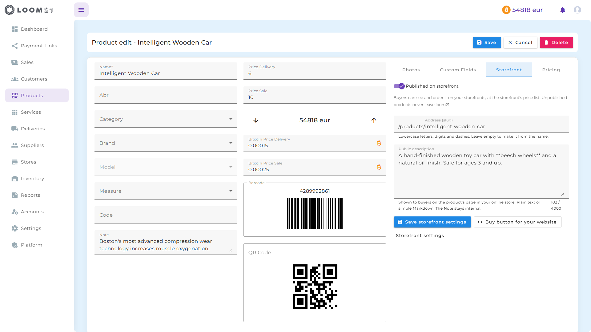

#### Custom Fields Tab

If you have defined custom fields in [Settings → Custom Fields](#custom-fields), each product's edit page will include a **Custom Fields** tab. Here you can fill in the values for those extra fields — such as a warranty date, a supplier reference, or any other information specific to your business.

1. Open a product by clicking the purple arrow on the Products list.
2. Click the **Custom Fields** tab.
3. Fill in the values for each field displayed.
4. Click **Save** to store the custom data for this product.

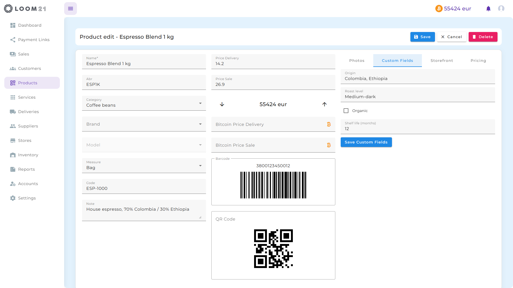

#### Pricing Tab

Each product also has a **Pricing** tab that lets you view and manage how this specific product is priced across all your price lists, as well as any customer-specific overrides.

**Price List Tiers** — For each price list you have created, you can see the pricing tiers already set for this product. You can delete a tier here; to add new tiers or edit existing ones, navigate to **Settings → Product Settings → Price Lists**.

**Customer Price Overrides** — You can set a special price for a specific customer for this product. Click **Add individual price** to:
- Search for and select a customer.
- Enter the override price (and optionally a minimum quantity, a formula, or a validity date range).
- Click **Save**.

**Test Price Resolution** — Enter a quantity and optionally select a customer, then click **Resolve Price** to see exactly which price the system will calculate for that combination. The result shows the final price and whether it came from a customer override, a price list tier, or the base product price.

#### Services Management

Services are managed from a dedicated **Services** page in the sidebar. The list supports the same search, filter (Category, Measure), import, and export (Excel, CSV or JSON) capabilities as the Products list.

**Service fields:**
- **Name** (required), **Abbreviation**, **Code**, **Note**
- **Category**, **Measure**
- **Delivery Price**, **Sale Price** (and Bitcoin equivalents if Bitcoin is enabled)
- **QR Code** — auto-generated from the code field for easy scanning.
- **Photos** — once the service is saved, up to 20 photos, the same as a product's [Photos tab](#products-services): add, drag to reorder or **Make main**, and view full size. The main photo shows in the Services list and on sales.
- **Storefront** — publish the service on your storefronts, the same as a product's [Storefront tab](#products-services). The Services list has the same **Publish to storefront** / **Unpublish** bar and **Storefront** column.

Services differ from products in two key ways:
- They are **not tracked in inventory** — selling a service never reduces stock.
- They have no **Brand**, **Model**, **Barcode**, **Custom Fields tab**, or **Pricing tab**.

(<a href="#readme-top">back to top</a>)

## Inventory 

The Inventory page shows current stock levels for all your products across all stores. Stock is updated automatically as you record sales (which reduce stock) and delivery orders (which add stock).

**Filtering inventory:**
Click **Filters** to expand the filter panel and narrow the list by:
- **Search** — find a product by name.
- **Store** — show stock levels for a specific location.
- **Category, Measure, Brand, Model** — further narrow to specific product groups.

The table shows each product's current quantity, unit of measure, category, brand, and model.

**Manual stock adjustments:**
Click the edit icon on any product row to open the adjustment dialog:
- **Add** — enter a quantity and select a store to increase stock (e.g. after a physical stock count).
- **Remove** — enter a quantity and select a store to decrease stock.

This is useful when correcting discrepancies found during a stock count, or recording stock that was damaged or returned.

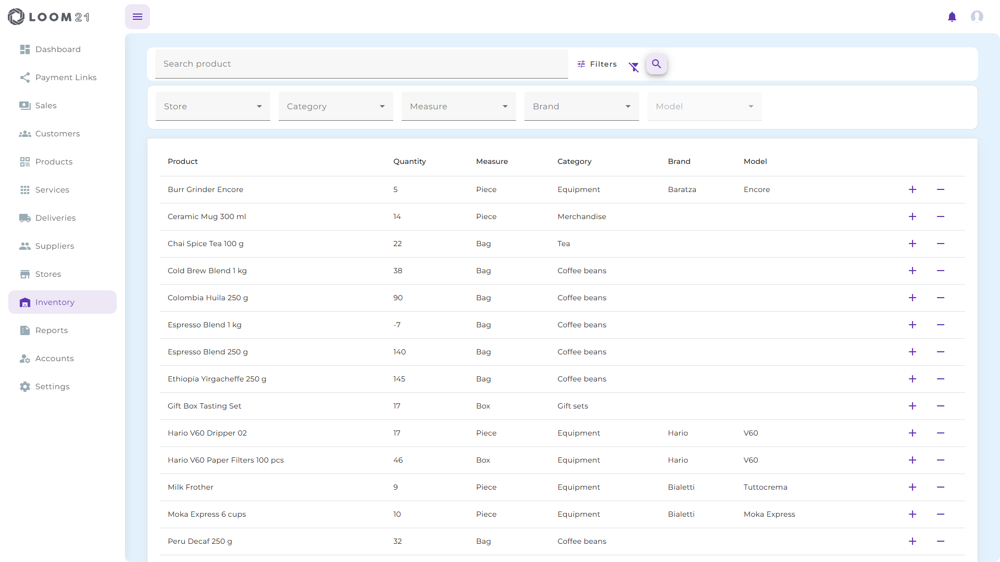

(<a href="#readme-top">back to top</a>)

## Stores 

Stores represent your physical locations or warehouses. Inventory is tracked per store, and each sale or delivery order is linked to a specific store.

**Store list** — stores are displayed as cards, each showing the store's picture, name, abbreviation, address, and phone number. A store without a picture shows a store icon.

**Adding or editing a store:**

1. Click **Add Store** (or the edit button on an existing store card).
2. Fill in:
   - **Name** (required) — the full name of the store or location.
   - **Note** — any internal notes.
   - **Address** — street address and phone number for this location.
3. Click **Save**.

**Picture:** once the store is saved, open it and click **Upload picture** (JPEG, PNG or WebP, up to 10 MB). It is saved at once and shows on the store's card. Click the picture to see it full screen; **Replace picture** and **Remove** change it later.

To delete a store, open it and click the **Delete** button.

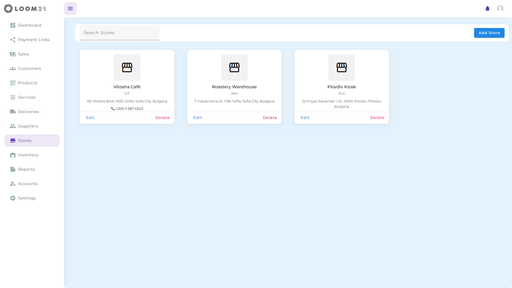

(<a href="#readme-top">back to top</a>)

## Delivery Orders 

Delivery orders record incoming stock from suppliers. Each delivery you confirm automatically increases the inventory of the received products in the selected store.

- **Create** a new delivery order with the **New** button.
- **Search** existing orders and open them with the purple arrow icon.

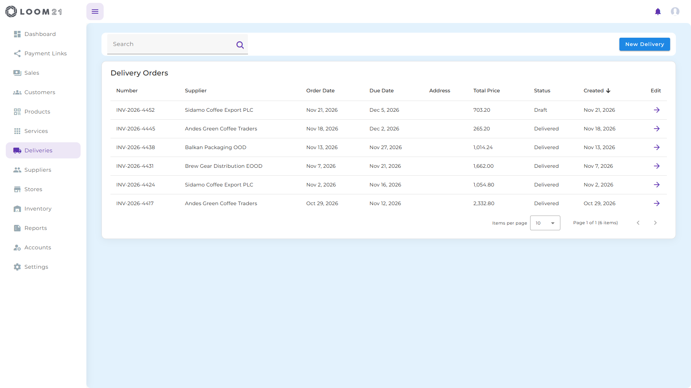

#### Delivery Order Details

**Order header fields** (left panel):
- **Order Number** — auto-generated reference, editable.
- **Order Date / Due Date** — when the order was created and when it is expected.
- **Supplier** — search and select the supplier for this delivery.
- **Store** — the destination store where received stock will be added.
- **Include Tax** — toggle whether tax is included in item prices.
- **Status** — track the delivery from Draft through to Delivered.
- **Note** — any internal remarks.

**Adding items:**
- Search for products by name and add them one at a time, or use **Select Items** to multi-select.
- Enter the quantity and unit price for each item received.
- The subtotal, VAT, and grand total are calculated automatically.

**Documents** — use the **Download** button to generate and download a PDF:
- Delivery invoice, receipt, or pickup list.

**Address** — the supplier's delivery address is populated automatically when you select a supplier. You can edit it per order if needed.

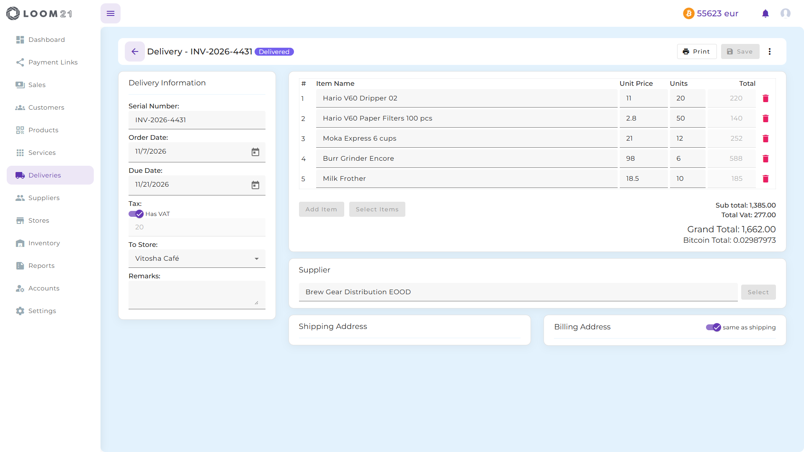

(<a href="#readme-top">back to top</a>)

## Customers and Suppliers 
This page allows you to easily manage your customer database. Key features include:
- Search Customers: Quickly find customers by name using the search bar.
- Import and export customers: add or update many customers at once from an Excel or CSV file (see [Import and Export](#import-templates)).
- Create or Edit Customers: Add new customers by pressing the blue button or modify existing customer details by clicking the purple arrow.

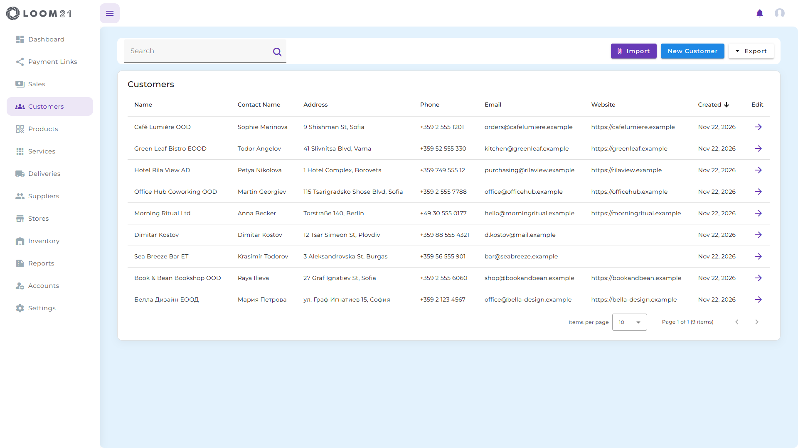
On this page, you can manage and update detailed information for each customer. The available fields include:

#### Customer Details
- **Name** — the customer's full company or person name.
- **Contact Name** — the specific person to address at that company.
- **Company ID (EIK)** — the customer's company registration number (in Bulgaria, the EIK), printed on invoices and credit notes.
- **Tax Number** — the customer's VAT or tax registration number, printed on invoices.
- **Note** — any internal notes about this customer.
- **Phone, Email, Website** — contact details.
- **Price List** — optionally assign one of your [Price Lists](#price-lists) to this customer. When set, all new sale orders for this customer automatically use that price list instead of the default one.
- **Multiple Addresses** — add and manage multiple delivery or billing addresses for the customer.

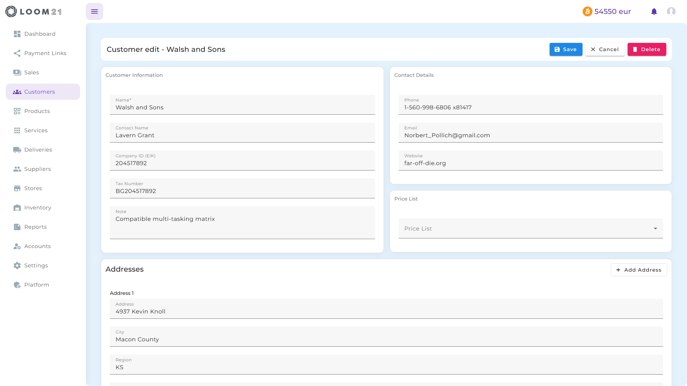

#### Suppliers Management

Suppliers are managed in a dedicated **Suppliers** section accessible from the sidebar. The list view lets you search, import, export (Excel, CSV or JSON), and paginate through your supplier records. See [Import and Export](#import-templates).

**Supplier details** (when creating or editing):
- **Name** (required), **Contact Name**, **Company ID (EIK)**, **Tax Number**, **Note**
- **Phone**, **Email**, **Website**
- **Multiple Addresses** — add as many delivery addresses as needed.

The key distinction from customers is in their usage:
- **Suppliers** are selected when creating **Delivery Orders** (incoming stock).
- **Customers** are selected when creating **Sale Orders** (outgoing sales).

Unlike customer records, suppliers do not have a Price List assignment.

(<a href="#readme-top">back to top</a>)

## User Profile

Click your name or the profile icon in the top navigation bar to access your **User Profile**. Here you can update your personal information independently of the organization-wide settings.

**Profile Information:**
- First Name, Last Name
- Email address
- Phone number
- Company Name
- Website

Click **Save** to apply any changes.

**Change Password** — a separate form at the bottom of the page:
1. Enter your **Current Password**.
2. Enter a **New Password** (minimum 8 characters).
3. Confirm the new password.
4. Click **Change**.

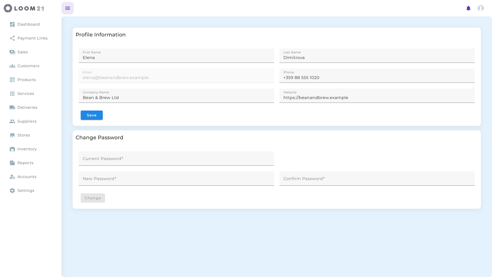

(<a href="#readme-top">back to top</a>)

<!-- CONTACT -->
## Contact

loom21 - [@loom21app](https://x.com/loom21app)

Project Link: [https://github.com/loom21/loom21doc](https://github.com/loom21/loom21doc)

(<a href="#readme-top">back to top</a>)

